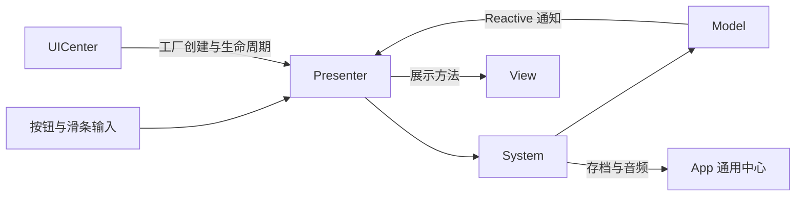

# Meowody GDExtension C++ 框架完整手册

Meowody 是 Godot 4.7 的 C++20 GDExtension 框架。它把常用运行服务、原生 UI 控件、反射生成和编辑器工具放在同一项目中：业务代码使用 C++；场景、资源及节点引用由 Godot 序列化；编辑器界面使用 GDScript，C++ 提供后端。

本文是项目文档的统一维护入口，覆盖原有模块教程与示例，并对照当前代码修正旧入口、头文件路径和编辑器实现。源码头文件是 API 的最终依据。`godot-cpp` 等第三方依赖的 Markdown 保留在依赖目录。

## 目录

- [快速上手](#quickstart)
- [项目创建器](#project-creator)
- [项目结构、资源路径与命名](#layout)
- [App 与生命周期](#app)
- [构建选项和热重载](#build-options)
- [反射与 codegen](#reflection)
- [基础工具：Connection、Delegate、TypeToken](#core)
- [MainThreadCenter：主线程投递](#main-thread)
- [TaskCenter：后台任务与取消](#task)
- [InputCenter：上下文与重绑定](#input)
- [EventCenter：类型事件](#event)
- [Reactive、Computed 与 Effect](#reactive)
- [CoroutineCenter：帧协程](#coroutine)
- [TweenCenter：补间与 Sequence](#tween)
- [DownloadCenter：下载、续传与缓存](#download)
- [ResourceCenter：本地、远程与资源包](#resource)
- [SaveCenter：存档、资源导出与加密](#save)
- [PoolCenter：节点与场景池](#pool)
- [TimeCenter：日历、校时与每日订阅](#time)
- [AudioCenter：多通道音频](#audio)
- [NetCenter：HTTP 与可达性监测](#net)
- [SceneCenter：场景切换](#scene)
- [MVP 与业务 System：职责、注入和完整示例](#mvp)
  - [System 初始化、失败回滚与关闭](#system-lifecycle)
  - [Model 存档：非模板接口与排行榜示例](#model-save)
  - [Model 存档版本与逐步迁移](#model-migration)
- [UICenter：场景 UI、动画与 Presenter](#ui)
- [C++ Scene Binding：一键生成与绑定](#binding)
- [SpriteAtlas：编辑器合图与原生查询](#atlas)
- [MultiPatch：任意切片网格](#multipatch)
- [Common Nodes：14 个原生控件](#nodes)
- [DebugCenter、日志与崩溃诊断](#debug)
- [各节点独立示例与属性速查](#node-examples)
- [Godot MCP：编辑器协作](#mcp)
- [性能分析、优化结果与复测](#performance)
- [测试与验证](#verification)
- [常见问题](#troubleshooting)
- [项目 Skill 与文档维护](#project-skill)

<a id="quickstart"></a>
## 快速上手

准备 Godot 4.7、支持 C++20 的工具链、Python 与 SCons。Windows 使用 MSVC 工具链；Godot 必须能从 PATH 找到 SCons，才能在编辑器中自动构建。`godot-cpp` 应完整检出并与工程的 API 配置一致。

```powershell
# 在包含 SConstruct 的框架根目录执行。
scons
# Godot 打开 meow/project.godot；首次注册新原生类后重新打开项目。
# 将下方 Godot.exe 替换为实际可执行文件路径。
```

PowerShell 直接执行带空格/引号的路径时使用调用运算符：

```powershell
& "D:/path/to/Godot.exe" --editor --path meow
```

最小的业务节点：保存为 `src/examples/ExampleNode.h`，类注册、属性访问器和绑定由构建生成，之后可在 Add Node 中创建 ExampleNode。

```cpp
#pragma once
#include "reflection/reflection.h"
#include <godot_cpp/classes/node.hpp>
#include <godot_cpp/variant/dictionary.hpp>
#include "runtime/app.h"

class ExampleNode : public godot::Node {
    GDREFLECT_CLASS(ExampleNode, godot::Node)
private:
    GDPROPERTY
    int score = 2;
public:
    GDMETHOD
    void save_score() {
        godot::Dictionary data;
        data["score"] = score;
        const auto status = meowody::App::save->save("progress", "default", data);
        if (!status.ok()) {
            // status.error / status.message；此处按业务处理。
        }
    }
};
```

`GDPROPERTY int score = 2;` 自动生成缺失的 get_score / set_score 声明、实现和 Godot 绑定，无需在类头文件中重复声明。自动 setter 只赋值；需要校验、资源通知或信号重连时，可以提供业务 setter 并让生成器复用它。具体规则见[反射章节](#reflection)。

下面的代码块有两类：独立示例带完整初始化；API 片段复用前文的变量。PlayerSave、SettingsSystem、TestPanelView 等是教程中的业务类型，需要按场景生成或定义；URL、音频路径和资源包路径需替换成你的真实资源。14 个原生控件的逐项示例在[节点示例章节](#node-examples)。

<a id="project-creator"></a>
## 项目创建器

Windows 桌面创建器从本框架的 Git 远程仓库指定版本生成独立工程，新工程使用 `project/` 作为 Godot 目录，包含完整框架服务、原生节点、编辑器插件、反射工具、MCP 源码及空白场景，不携带当前游戏或业务测试类。

源码启动：`python tools/project_creator/app.py`。打包 EXE：`./tools/project_creator/build.ps1`；输出在 `build/project-creator/dist/MeowodyProjectCreator.exe`。创建时支持下载官方 Godot 稳定版或选择本地引擎，并完成固定 godot-cpp 依赖准备、Debug 编译和加载验证。详情见 [创建器说明](tools/project_creator/README.md)。首次使用前需推送 `framework-dependencies.json` 和支持版本配置的 SConstruct；旧 ref 缺少固定依赖记录会停止创建。

`framework-dependencies.json` 固定官方 godot-cpp 提交；创建器为新工程初始化独立 Git 仓库，生成 `.gitmodules` 并注册固定提交的 godot-cpp 子模块，不自动提交或推送。克隆新工程后执行 `git submodule update --init --recursive` 恢复依赖。新项目的 `meowody-project.json` 保存 Godot/API 版本及 `project_dir`。普通构建与编辑器热重载共用这些配置，显式命令行 API 参数优先。未配置该文件时，本仓库仍按原有 `meow/` 和 4.7 默认配置构建。

<a id="layout"></a>
## 项目结构、资源路径与命名

```text
./
├── README.md                     本手册，统一维护入口
├── SConstruct                    扩展构建入口
├── godot-cpp/                    第三方绑定依赖
├── reflect_codegen/              头文件扫描、生成与注册
├── src/
│   ├── reflection/               属性、方法、信号与类标记
│   ├── runtime/app.h             App 中心入口
│   ├── runtime/{模块}/           通用服务
│   ├── runtime/ui/nodes/         原生控件，每类独立 h/cpp
│   ├── editor/                   原生编辑器后端
│   ├── log/                      日志、原生栈、CrashHandler
│   └── ui/generated/            绑定插件生成的业务类
├── meow/                         Godot 项目根目录，res:// 指向这里
│   ├── project.godot
│   ├── bin/                      原生扩展描述与库
│   └── addons/                   GDScript 编辑器、示例和 shader 资产
├── tests/                        框架测试驱动及 fixtures
├── tools/godot_mcp/              本地 MCP 服务（Node.js），独立于游戏运行时
├── build/generated/             codegen 输出，不手改
└── .agents/skills/meowody-framework/ 项目开发 Skill
```

`res://addons/...` 对应磁盘 `meow/addons/...`，`user://` 对应 Godot 的用户数据目录。C++ include 以 `src/` 为搜索根，例如 `runtime/ui/nodes/number_label.h`。

用户类和生成文件分开：绑定插件首次创建 `.h/.cpp`，之后维护 `.includes.gen.h` 和 `.bindings.gen.inc`；reflect 维护 `build/generated/`。不要通过修改生成文件实现业务逻辑。shader 保持独立 `.gdshader`，运行时需要的 shader 仍是发布资产。

<a id="app"></a>
## App 与生命周期

GDExtension 初始化已调用 App::initialize，App 自动挂到 SceneTree 根部并以 PROCESS_MODE_ALWAYS 驱动。业务不需要创建第二个 App，也不重复 update 全局中心。Godot SceneTree 暂停不会停止 App 的服务推进。

| 服务 | 当前入口 | 主要用途 |
| --- | --- | --- |
| MainThreadCenter | `App::main_thread->` | 线程安全投递、主线程预算执行 |
| TaskCenter | `App::task->` | 后台工作、取消、主线程结果交付 |
| InputCenter | `App::input->` | 输入上下文、焦点与重绑定 |
| SystemCenter | `App::system->` | 业务注册、初始化与关闭 |
| EventCenter | `App::event->` | 类型事件发布订阅 |
| CoroutineCenter | `App::coroutine->` | 帧驱动步骤与等待 |
| TweenCenter | `App::tween->` | 动画管理、控制与清理 |
| DownloadCenter | `App::download->` | 文件下载、续传、缓存 |
| ResourceCenter | `App::resource->` | Godot 资源及远程资源包 |
| SaveCenter | `App::save->` | 分区存档与帧末提交 |
| PoolCenter | `App::pool->` | 节点和场景对象池 |
| TimeCenter | `App::time->` | 时间、校时、每日回调 |
| AudioCenter | `App::audio->` | 常驻多通道音频 |
| NetCenter | `App::net->` | HTTP 与连接状态 |
| SceneCenter | `App::scene->` | 异步场景切换 |
| DebugCenter | `App::debug->` | 控制台、日志与调试 |
| UICenter | `App::ui->` | 原生场景 UI 生命周期 |

这些成员是 Proxy，只提供 `operator->`：

```cpp
#include "runtime/app.h"
auto &resources = meowody::App::resource;
auto result = resources->load<godot::PackedScene>("res://scenes/player.tscn");
```

旧 `Runtime::resources()` / `Runtime::saves()` 接口已不属于当前代码。更新顺序为 MainThread → Time → Download → Resource → Net → Audio → Scene → UI → Debug；延迟 late_process 提交 Tween、推进 Coroutine 并合并 Save 写盘。Godot Tween 自己推进时钟。

Connection、订阅、协程与请求句柄的生命周期各不相同：必须持有 RAII Connection；不要把裸 Node 指针带到节点销毁之后；取消是否抑制回调请看对应模块。中心 API 默认在主线程使用。MainThreadCenter::post、TaskCenter::submit 及它们的句柄查询／取消支持跨线程；其它服务不因此获得线程安全。App 退出先关闭 UI 和 System，取消并等待 Task 工作线程退出、丢弃 MainThread 待执行回调，再释放 System 与其余中心。独立构造的中心需要自己安排驱动和关闭。

<a id="build-options"></a>
## 构建选项和热重载

```powershell
scons
# 发布构建：
scons target=template_release
# 速度优先（默认）或体积优先：
scons target=template_release optimize=speed
scons target=template_release optimize=size
# 按需覆盖：
scons log_records=no
scons durable_saves=yes
```

默认 debug 使用 use_hot_reload=yes，release 默认为 no。常规 debug 构建直接使用 scons，由工程自动选择并行度；不要给日常构建固定 -j 4 / -j 8。构建日志可重定向到 build 中的文件，结束后读取最后有效内容。

| 选项 | 作用 | 默认 |
| --- | --- | --- |
| api_version | godot-cpp API 版本 | 4.7 |
| use_hot_reload | godot-cpp 热重载支持 | debug yes；release no |
| optimize | godot-cpp 编译优化策略，支持 speed / speed_trace / size 等值 | release speed；debug speed_trace；dev none |
| log_records | 结构化日志采集及原生栈订阅 | debug 开启；release 关闭 |
| durable_saves | 持久化文件替换后端 | release 开启；debug 关闭 |

运行中替换库应通过绑定插件的构建与发布流程，它使用临时输出、检查完成状态后发布库并调用原生重载。首次安装、增加原生类型或升级基础接口后，先构建再重新打开项目。仅将 gdextension 的 reloadable 设为 true 不足以代替编译选项。


<a id="reflection"></a>
## 反射与 codegen

实现位置：`src/reflection/`。


GDReflect 在构建时扫描 C++ 头文件，自动生成类注册、属性访问器和 Godot 方法／信号绑定。运行时没有额外的反射扫描，也不需要手写 `_bind_methods()`。


<a id="reflection-0-1"></a>
### 最小写法

```cpp
#include <godot_cpp/classes/node.hpp>
#include "reflection/reflection.h"

class Player : public godot::Node {
    GDREFLECT_CLASS(Player, godot::Node)
private:
    GDPROPERTY_NAME("health")
    GDPROPERTY_RANGE(0, 100, 1)
    int m_health = 100;
public:
    GDEMIT_SIGNAL
    void health_changed(int value);

    GDMETHOD
    void notify_health() { health_changed(m_health); }
};
```

将头文件放在 `src/` 下并构建即可。`GDREFLECT_CLASS` 是唯一的类标记，类注册与 `_bind_methods()` 均自动生成；已移除冗余的 `GDCLASS_ATTR`，旧代码直接删掉这个标记。Godot 基类必须是第一个基类。所有注册类的短名称必须唯一，包括不同命名空间中的类。

生成文件位于 `build/generated/`，不要手动编辑。生成的成员声明会自动加入类。添加新属性后先构建，IDE 才能看到新生成的访问器。


<a id="reflection-0-2"></a>
### 属性与业务校验

`GDPROPERTY` 自动生成缺失的 `get_字段名()` 与 `set_字段名(value)`，字段可以是 private。`GDPROPERTY_NAME("health")` 同样会导出字段，同时把 Inspector、Godot get/set 和资源序列化中的名字设为 `health`；C++ 字段 `m_health` 和默认访问器 `get_m_health` 不变。

旧字段不会自动去掉 `m_` 或尾部下划线，以免已有存档与场景失效。修改导出别名也会改变序列化键，应自行迁移旧数据。

有校验／通知需求时指定自己的访问器：

```cpp
private:
    GDPROPERTY_NAME("health")
    GDPROPERTY_ACCESSORS(read_health, write_health)
    int m_health = 100;
public:
    int read_health() const { return m_health; }
    void write_health(int value) {
        m_health = value < 0 ? 0 : value;
        health_changed(m_health);
    }
```

访问器必须是 public 非静态成员；getter 无参数并返回字段类型，setter 返回 void 且接受同类型参数（支持 const 引用）。显式指定的方法必须存在，不会把拼写错误当成新方法生成。访问器无需额外添加 `GDMETHOD`。

可以组合 `GDPROPERTY_RANGE`、`ENUM`、`FLAGS`、`FILE`、`DIR`、`MULTILINE`、`PLACEHOLDER`、`PASSWORD`、`USAGE`、`CATEGORY`、`GROUP`、`SUBGROUP` 等现有宏。组合宏都放在同一个字段前；分类／分组从该字段开始生效。枚举提示仅提供 Inspector 选项，不等同于自动注册 C++ enum。


<a id="reflection-0-3"></a>
### 信号、方法与 RPC

- `GDEMIT_SIGNAL void changed(int value);` 同时注册信号并生成 `emit_signal` 方法体。C++ 直接调用 `changed(42)`，支持多个参数、Godot 类型和 const 引用。不要再在 cpp 中实现同名方法。
- `GDSIGNAL` 保持原来的仅注册行为，不生成方法体；适合只调用 `emit_signal("changed", ...)` 或自行实现包装函数的代码。
- `GDMETHOD` 导出 public 实例方法；重载请提供名称不同的包装函数。当前不支持自动导出 C++ 默认参数或静态方法。
- `GDRPC(...)` 现在自身就包含方法导出的语义，不必重复添加 `GDMETHOD`。已有双标记写法仍有效。原有 RPC 就绪配置机制不变；自行实现 `_notification` 时仍需在 READY 调用 `_gdreflect_apply_rpc_config()`。


<a id="reflection-0-4"></a>
### 兼容与验证

保留 `GS` 简写，但内部统一使用普通属性与访问器注解，不再需要 `GDGS_FIELD`／`GDGS_ACCESSOR`。`GDPROPERTY_WITH_HINT` 已并入 `GDPROPERTY_HINT(Hint)`，需要提示文本时写 `GDPROPERTY_HINT(Hint, "text")`；原生场景绑定生成的 `.inc` 继续工作。重复属性名、缺失显式访问器、访问器类型错误及反射方法重载会在生成阶段报告文件和行号。

```text
python -X utf8 -m unittest discover -s tests -p test_reflect_codegen.py
scons
python -X utf8 tests/run_atlas_editor_test.py --godot "Godot 可执行文件路径"
```

引擎测试覆盖免重复类标记、私有字段、属性别名、自定义 setter、自动字符串访问器、带参数信号和分类／范围提示。生成器诊断测试可独立于 Godot 运行。

生成器的实际入口为 `reflect_codegen/reflect_generator.py`，由 SCons 调用。扫描同时支持源码树与构建树中的 godot-cpp 生成头文件；任何 Clang 解析错误都会中止生成并给出位置，防止未知类型被恢复成 int 后写入绑定。生成前还检查属性重名、类短名称冲突、访问器签名和方法／信号重载。Dictionary 等 Godot 值类型保持正确 Variant 类型，生成的 C++ 访问器保留类型命名空间。

扫描通过内存中的一个 C++ 翻译单元包含全部排序后的头文件，复用 Godot／标准库声明，不写入用户源码。仍解析 inline 函数体并检查每个头文件中的错误；类和错误的位置仍指向原始文件。生成文件内容未变时不重写。耗时与输出一致性见[性能复测](#performance)。


<a id="core"></a>
## 基础工具：Connection、Delegate、TypeToken

实现位置：`src/runtime/core/`。


`runtime/core` 是运行时工具层，给上层的 `event`、`reactive` 等模块提供通用能力。

当前目录包含：

- `connection.hpp`：订阅句柄，负责安全断开连接。
- `delegate.hpp`：move-only 的类型擦除可调用对象。
- `type_token.hpp`：不依赖 RTTI 的类型键。

---


<a id="core-0-1"></a>
### 1. 什么时候直接使用这一层

大多数业务代码通常直接用：

- `runtime/event/event_center.hpp`
- `runtime/reactive/reactive.hpp`

只有在你需要自己实现“订阅系统”“回调容器”“按类型分桶的数据结构”时，才需要直接用 `runtime/core`。

---


<a id="core-0-2"></a>
### 2. Connection


<a id="core-0-3"></a>
#### 2.1 作用

`Connection` 表示“一条已经建立的订阅关系”。

它有几个关键特性：

1. **move-only**，不能复制，只能移动。
2. 析构时会自动 `disconnect()`。
3. 如果事件源或响应式对象已经销毁，`disconnect()` 也不会去访问悬空指针。

这意味着最常见的用法是：**把 `Connection` 保存成成员变量，谁拥有订阅，谁持有它。**


<a id="core-0-4"></a>
#### 2.2 基本用法

```cpp
#include "runtime/event/event_center.hpp"

struct ScoreChanged
{
    int value = 0;
};

class HUD
{
public:
    void bind(meowody::EventCenter& events)
    {
        score_changed_connection_ =
            events.connect<ScoreChanged>(
                [this](const ScoreChanged& event)
                {
                    score_ = event.value;
                }
            );
    }

    void unbind()
    {
        score_changed_connection_.disconnect();
    }

private:
    int score_ = 0;

    meowody::Connection score_changed_connection_;
};
```


<a id="core-0-5"></a>
#### 2.3 状态判断

```cpp
if (connection.connected())
{
    connection.disconnect();
}

if (connection)
{
    // 等价于 connected()
}
```


<a id="core-0-6"></a>
#### 2.4 移动语义

```cpp
meowody::Connection a =
    events.connect<ScoreChanged>([](const ScoreChanged&) {});

meowody::Connection b =
    std::move(a);

// a 已经失效，b 接管订阅
```


<a id="core-0-7"></a>
#### 2.5 使用建议

- 需要长期监听时，把 `Connection` 存为成员。
- 只想临时监听一个作用域时，让它作为局部变量即可。
- 若你不保存返回值，表达式结束后连接会立刻析构并自动取消订阅。

---


<a id="core-0-8"></a>
### 3. Delegate


<a id="core-0-9"></a>
#### 3.1 作用

`Delegate<Signature>` 是一个 **move-only 的回调容器**。

它支持：

- 普通函数
- lambda
- 捕获 lambda
- 成员函数绑定结果

它内部自带小对象优化，小对象会直接放在内部存储区，大对象才会走堆分配。


<a id="core-0-10"></a>
#### 3.2 最简单的例子

```cpp
#include "runtime/core/delegate.hpp"

meowody::Delegate<void(int)> print_value(
    [](int value)
    {
        std::cout << value << std::endl;
    }
);

print_value(42);
```


<a id="core-0-11"></a>
#### 3.3 返回值签名

```cpp
meowody::Delegate<int(int, int)> sum(
    [](int a, int b)
    {
        return a + b;
    }
);

int result = sum(3, 4);
```


<a id="core-0-12"></a>
#### 3.4 后续重新赋值

```cpp
meowody::Delegate<void()> callback;

callback.assign(
    []()
    {
        std::cout << "first" << std::endl;
    }
);

callback();

callback.assign(
    []()
    {
        std::cout << "second" << std::endl;
    }
);
```


<a id="core-0-13"></a>
#### 3.5 判空与 reset

```cpp
meowody::Delegate<void()> callback;

if (!callback.valid())
{
    callback.assign([]() {});
}

callback.reset();
```


<a id="core-0-14"></a>
#### 3.6 绑定成员函数

```cpp
class Player
{
public:
    void on_damage(int amount)
    {
        hp_ -= amount;
    }

private:
    int hp_ = 100;
};

Player player;

auto callback =
    meowody::Delegate<void(int)>::bind(
        &player,
        &Player::on_damage
    );

callback(10);
```


<a id="core-0-15"></a>
#### 3.7 `make_delegate`

如果你更喜欢函数式写法，可以用 `make_delegate`：

```cpp
auto callback =
    meowody::make_delegate<void(int)>(
        [](int value)
        {
            std::cout << value << std::endl;
        }
    );
```


<a id="core-0-16"></a>
#### 3.8 注意事项

- `Delegate` 不能复制，只能移动。
- 调用空 `Delegate` 是错误用法，应先 `valid()` 或显式赋值。
- 成员函数绑定不会托管对象生命周期，对象要比 `Delegate` 活得更久。

---


<a id="core-0-17"></a>
### 4. TypeToken


<a id="core-0-18"></a>
#### 4.1 作用

`TypeToken` 用静态地址作为类型唯一标识，替代：

- `typeid(T)`
- `std::type_index`

因此它可以在 **`/GR-` 或 `-fno-rtti`** 环境下使用。


<a id="core-0-19"></a>
#### 4.2 基本用法

```cpp
#include "runtime/core/type_token.hpp"

struct DamageEvent {};
struct HealEvent {};

auto damage_token =
    meowody::type_token_of<DamageEvent>();

auto heal_token =
    meowody::type_token_of<HealEvent>();

bool same =
    damage_token == heal_token; // false
```


<a id="core-0-20"></a>
#### 4.3 作为哈希表 key

```cpp
#include <unordered_map>

std::unordered_map<
    meowody::TypeToken,
    int,
    meowody::TypeTokenHash
> counters;

counters[meowody::type_token_of<DamageEvent>()] = 1;
counters[meowody::type_token_of<HealEvent>()] = 2;
```


<a id="core-0-21"></a>
#### 4.4 适用场景

适合所有“**编译期知道类型，运行时按类型分类存储**”的场景，例如：

- 事件中心
- 组件注册表
- 自定义工厂表
- 无 RTTI 的服务定位器

---


<a id="core-0-22"></a>
### 5. 一起看一个小例子

下面这个例子演示 `Delegate` 和 `Connection` 如何作为上层系统的基础设施配合使用：

```cpp
#include "runtime/event/event_center.hpp"

struct PlayerDied
{
    int player_id = 0;
};

class RespawnSystem
{
public:
    explicit RespawnSystem(meowody::EventCenter& events)
    {
        connection_ =
            events.connect<PlayerDied>(
                [this](const PlayerDied& event)
                {
                    respawn(event.player_id);
                }
            );
    }

private:
    void respawn(int player_id)
    {
        std::cout
            << "respawn player: "
            << player_id
            << std::endl;
    }

private:
    meowody::Connection connection_;
};
```

如果你只是使用现成事件系统或响应式系统，通常不必手动操作 `TypeToken`，但理解这层可以帮助你在后续扩展 runtime 模块时保持风格一致。


<a id="main-thread"></a>
## MainThreadCenter：主线程投递

实现：`src/runtime/main_thread/main_thread_center.h/.cpp`，入口 `App::main_thread`。构造中心的线程就是它的执行线程；App 在 Godot 主线程创建它，并在每次 _process 的最前面执行 update。

```cpp
#include "runtime/app.h"

// 普通 C++ 回调，可从工作线程投递；回调在 App 的主线程执行。
auto pending = meowody::App::main_thread->post([] {
    // 这里可以更新 Model 或调用 Godot 节点 API。
});
pending.cancel(); // 仅能取消尚未开始执行的回调。
```

### 安全更新可能已销毁的节点

节点存活时先在主线程获取 get_instance_id()。工作线程只持有 ID 和普通 C++ 数据，在回调执行时重新查找目标：

```cpp
#include "runtime/app.h"
#include <godot_cpp/classes/label.hpp>
#include <godot_cpp/core/object.hpp>

meowody::DispatchHandle post_label_text(uint64_t label_id, std::string text) {
    return meowody::App::main_thread->post([label_id, text = std::move(text)] {
        auto *label = godot::Object::cast_to<godot::Label>(godot::ObjectDB::get_instance(label_id));
        if (label) label->set_text(godot::String(text.c_str()));
    });
}
```

### API 与执行边界

| API | 行为 |
| --- | --- |
| post(Delegate<void()>) | 返回 DispatchHandle；线程安全，FIFO 入队 |
| update(max_callbacks=128, max_milliseconds=2.0) | 仅创建线程执行，返回实际执行数量；0 毫秒表示只限制数量 |
| is_main_thread / pending_count / is_closed | 判断所属线程、待处理数量及关闭状态 |
| shutdown | 取消队列中尚未执行的回调；App 自动调用，独立中心在所属线程关闭 |
| DispatchHandle::status / cancel / error | 查询状态、取消待执行回调、读取错误；句柄销毁不会自动取消 |

默认容量 4096；空回调、队列满或关闭后投递返回 Rejected。状态包括 Pending、Running、Completed、Cancelled、Failed、Rejected。已进入 Running 的回调不能中断。开启 C++ 异常时，回调异常记录为 Failed；关闭异常的发布构建应通过业务返回值处理错误。

每次 update 只处理调用开始时队列中的条目；回调里新投递的工作延后处理。取消条目也占本次扫描数量，避免大量取消记录导致无限扫描。时间预算只在回调之间检查，单个耗时回调不能被预算抢占。重入 update 或在其它线程调用 update 返回 0。

只有 post 和句柄状态／取消适合跨线程；不要在回调中等待一个还需要主线程处理的任务。外部自己创建的线程必须在 App 销毁前停止和 join。存活检查、取消和必要的业务版本检查由回调完成，投递队列不会自动延长 Node 生命周期。

<a id="task"></a>
## TaskCenter：后台任务与取消

实现：`src/runtime/task/task_center.h/.cpp`，入口 `App::task`。工作线程在首次 submit 时创建，默认使用最多 4 个线程（至少 1 个），默认待执行队列容量 256。独立中心可以在构造时指定线程数和容量；MainThreadCenter 必须比 TaskCenter 活得更久。

### 普通数据计算与主线程交付

```cpp
#include "runtime/app.h"

meowody::TaskHandle calculate_sum(std::vector<int64_t> numbers) {
    return meowody::App::task->submit(
        [numbers = std::move(numbers)](const meowody::TaskContext &context) -> meowody::TaskResult {
            double sum = 0;
            for (auto value : numbers) {
                if (context.is_cancelled())
                    return {meowody::TaskError::Cancelled, {}, "Cancelled"};
                sum += double(value);
            }
            return {meowody::TaskError::None, sum, {}};
        },
        [](const meowody::TaskResult &result) {
            if (!result.ok()) return; // 记录 result.message 或显示失败状态。
            const auto *sum = std::get_if<double>(&result.value);
            if (!sum) return;
            // 在主线程使用 *sum 更新 Model／UI；不可保存此临时引用。
        });
}
```

System 或 Presenter 持有任务句柄，在关闭时显式 cancel：

```cpp
meowody::TaskHandle task = calculate_sum({10, 20, 30});
// Presenter 已配置生命周期时，可登记面板级取消：
// presenter.defer([task] { task.cancel(); });
task.cancel();
```

TaskValue 是标准 variant，支持 monostate、bool、int64_t、double、std::string、std::vector<uint8_t> 和 std::shared_ptr<void>，不依赖 RTTI。较复杂结果可以使用共享的普通 C++ 结构：

```cpp
struct ComputedRows { std::vector<int64_t> scores; };

meowody::TaskResult make_rows(const meowody::TaskContext &context) {
    if (context.is_cancelled()) return {meowody::TaskError::Cancelled, {}, "Cancelled"};
    auto rows = std::make_shared<ComputedRows>();
    rows->scores = {900, 800, 700};
    std::shared_ptr<void> payload = rows;
    return {meowody::TaskError::None, std::move(payload), {}};
}
void receive_rows(const meowody::TaskResult &result) {
    if (!result.ok()) return;
    const auto *payload = std::get_if<std::shared_ptr<void>>(&result.value);
    if (!payload || !*payload) return;
    // 必须与对应工作函数返回的实际类型一致。
    auto rows = std::static_pointer_cast<ComputedRows>(*payload);
    // 主线程使用 rows->scores。
}
```

### 状态、失败和关闭

| API／状态 | 含义 |
| --- | --- |
| submit(work, completed={}) | work 在后台执行；completed（如提供）在主线程执行，包括工作返回失败的情况 |
| TaskContext::is_cancelled | 工作函数定期检查的协作取消标志 |
| TaskHandle::cancel | 取消排队任务或请求正在执行的任务停止；尚未交付的完成回调被抑制 |
| status / is_cancel_requested / result | 线程安全查询；Queued／Running 的 result 返回 NotReady |
| Queued → Running → AwaitingMainThread | 有完成回调的工作执行流程 |
| Completed / Failed | 无完成回调时后台完成；有回调时主线程开始交付后进入终态 |
| Cancelled | 排队或等待交付时取消；运行中取消则等工作函数返回后进入此状态 |
| Rejected | 空工作函数、队列满、关闭或主线程交付被拒绝；查看 result.error/message |
| shutdown | 只能在所属主线程调用；取消全部未完成任务并 join，重复调用安全；其它线程调用返回 false |

取消不会强制终止线程。长循环要检查 TaskContext，文件／网络阻塞操作要有自己的超时；shutdown 会等待正在执行的函数返回。句柄销毁不会取消任务。主线程队列关闭而导致完成回调被丢弃时，任务进入 Cancelled，不会永久停在 AwaitingMainThread。

后台函数、捕获对象和结果使用普通 C++ 数据，不访问 Node、SceneTree、UI、Reactive 或其它 App 中心。完成回调捕获 ObjectID、weak_ptr 或可取消的任务状态；不要把裸 Node 指针作为跨帧存活保证，也不要让工作线程销毁 Godot Ref 或其它需要主线程释放的对象。

开启异常时，工作／完成回调抛出的异常转成 Failed 和 message。发布配置关闭异常时，工作函数显式返回 TaskError::Failed。std::get_if 失败返回空指针，适合无异常／无 RTTI 构建。完成回调看到的 TaskResult 只在调用期间有效，需要继续保留数据时复制值或共享指针。

App 退出：System 先取消自己拥有的任务，TaskCenter 再取消剩余工作并等待退出，随后 MainThreadCenter 丢弃回调，最后释放 System。不要在工作函数中销毁 TaskCenter、阻塞等待主线程结果或调用 shutdown；它的生命周期属于创建线程。

<a id="input"></a>
## InputCenter：上下文与重绑定

实现：`src/runtime/input/input_center.h/.cpp`、`input_bindings.cpp`。入口 `App::input`。所有操作和 InputContext 释放在 Godot 主线程；动作沿用项目 InputMap，不自动创建业务按键。

### 游戏与菜单上下文

先在 Project Settings → Input Map 中建立 move_left、move_right、move_up、move_down、interact 和 menu_back，并设置默认键盘／手柄绑定：

```cpp
#include "runtime/app.h"

class GameInput {
    meowody::InputContext gameplay;
    meowody::InputContext menu;
public:
    bool initialize() {
        godot::PackedStringArray game_actions;
        for (const char *name : {"move_left", "move_right", "move_up", "move_down", "interact"}) game_actions.append(name);
        godot::PackedStringArray menu_actions;
        menu_actions.append("menu_back");
        if (!meowody::App::input->define_context("gameplay", game_actions, 0, false) ||
            !meowody::App::input->define_context("menu", menu_actions, 100, true)) return false;
        gameplay = meowody::App::input->push_context("gameplay");
        return gameplay.valid();
    }
    void open_menu() { menu = meowody::App::input->push_context("menu"); }
    void close_menu() { menu.release(); }
    godot::Vector2 movement() const {
        return meowody::App::input->get_vector("gameplay", "move_left", "move_right", "move_up", "move_down");
    }
    bool interact() const { return meowody::App::input->is_action_just_pressed("gameplay", "interact"); }
    bool menu_back() const { return meowody::App::input->is_action_just_pressed("menu", "menu_back"); }
    void shutdown() { menu.release(); gameplay.release(); }
};
```

InputContext 是移动专属 RAII 句柄，必须由业务对象持有；临时 push 后立即销毁就会退出上下文。可用 set_enabled 暂时禁用某个激活实例；release 或析构退出。中心关闭后句柄失效，之后释放也安全。同名上下文可同时激活多个实例，查询采用最新启用实例。

### 路由和焦点规则

- priority 越高越靠上；同优先级最近 push 的实例靠上。
- exclusive=true 的上层上下文屏蔽所有下层查询；false 则只占用自己声明的动作，其它动作允许穿透。
- 查询必须指定上下文，动作必须在该上下文声明；未激活、禁用、被遮挡或不存在时返回 false／0。
- 支持 is_action_pressed、is_action_just_pressed、is_action_just_released、get_action_strength、get_axis、get_vector。get_vector 使用原始强度与径向死区，并限制对角速度；deadzone 默认取四个动作的平均配置。
- 上下文栈、启用状态、焦点或绑定变化的当前 process 帧屏蔽 just_pressed／just_released，避免打开菜单的同一按键立刻触发返回；pressed／strength 仍反映当前可读动作。之后沿用 Godot 的输入边沿，不重放遮挡期间的按键。
- App 接收应用焦点进出通知，自动调用 set_focused；失焦时所有中心查询归零。独立中心自行接入焦点。set_enabled(false) 可整体禁用路由。
- 路由规则作用于 InputCenter 查询。Godot Input、原生 Control 和直接使用 Input 的脚本继续由 Godot 处理；游戏业务读取输入时使用此入口。重绑定修改全局 InputMap，因此也会影响直接读取这些动作的代码。

### 键盘、鼠标和手柄重绑定

```cpp
#include "runtime/app.h"
#include <godot_cpp/classes/input_event_key.hpp>

meowody::SaveStatus bind_interact_to_e() {
    godot::Ref<godot::InputEventKey> key;
    key.instantiate(); key->set_physical_keycode(godot::KEY_E);
    godot::TypedArray<godot::InputEvent> events;
    events.append(key);
    return meowody::App::input->rebind("interact", events);
}
```

rebind 替换该动作全部事件，可传空数组解除绑定。支持 InputEventKey、InputEventMouseButton、InputEventJoypadButton、InputEventJoypadMotion；保存键码／物理键／标签、修饰键、设备和轴方向。deadzone=-1 保留已有配置，其它值必须在 [0,1)。验证全部事件后才修改 InputMap，并释放旧动作状态。

reset_bindings(action) 恢复本中心首次改动该动作之前的运行时绑定与死区，不会重新加载整个项目 InputMap。未改动动作返回 false；默认快照仅存在当前中心生命周期内。

### 保存与恢复玩家绑定

```cpp
#include "runtime/app.h"

meowody::SaveStatus save_input_bindings() {
    godot::PackedStringArray actions;
    actions.append("interact"); actions.append("move_left");
    auto exported = meowody::App::input->export_bindings(actions);
    if (!exported.ok()) return {exported.error, exported.message};
    return meowody::App::save->save("input", "default", exported.data);
}
meowody::SaveStatus restore_input_bindings() {
    auto loaded = meowody::App::save->load("input", "default");
    if (!loaded.ok()) return {loaded.error, loaded.message};
    return meowody::App::input->import_bindings(loaded.data);
}
```

绑定快照是纯 Dictionary／Array 值数据，格式 version=1，兼容 SaveCenter 的加密和提交机制。import_bindings 先验证所有动作、事件和数值，再统一应用；一个记录错误不会部分修改按键。未知动作拒绝，未列出的动作保持原样。旧版本或未知格式返回 UnsupportedVersion；缺失玩家存档时继续使用项目默认绑定。输入格式版本独立于 Model 的业务存档迁移版本。

### 验证

```powershell
clang++ -std=c++20 -Isrc tests/async_centers_test.cpp src/runtime/main_thread/main_thread_center.cpp src/runtime/task/task_center.cpp -o build/async_centers_test.exe
./build/async_centers_test.exe
python -X utf8 tests/run_centers_test.py --godot "你的 Godot console exe 路径"
```

核心测试检查并发、容量、主线程交付、取消、错误、关闭和死锁边界；Godot 隔离测试检查失效节点、输入上下文、焦点、真实按键、四种绑定事件、存档往返和失败时不修改 InputMap。无异常／无 RTTI 的 C++ 核心测试也已覆盖。

<a id="event"></a>
## EventCenter：类型事件

实现位置：`src/runtime/event/`。


`runtime/event` 提供一个轻量、模板化、**不依赖 RTTI** 的事件中心。

它适合：

- 模块间广播通知
- UI 与逻辑解耦
- 输入、状态变化、流程节点等一对多派发

核心类型只有一个：

- `meowody::EventCenter`

内部细节里还有 `EventChannel<Event>`，但业务侧一般不需要直接使用它。

---


<a id="event-0-1"></a>
### 1. 引入方式

推荐直接包含：

```cpp
#include "runtime/event/event_center.hpp"
```

旧代码如果还在包含：

```cpp
#include "runtime/event/event_center.h"
```

当前目录也保留了兼容入口。

---


<a id="event-0-2"></a>
### 2. 设计特点


<a id="event-0-3"></a>
#### 2.1 每种事件类型都有自己的通道

例如：

```cpp
struct ScoreChanged { int old_score; int new_score; };
struct GameStarted {};
```

`ScoreChanged` 和 `GameStarted` 会进入两个不同的事件通道。


<a id="event-0-4"></a>
#### 2.2 不依赖 RTTI

事件中心内部不是用 `typeid(Event)`，而是用 `TypeToken` 作为 key，所以可以适配 no-RTTI 构建。


<a id="event-0-5"></a>
#### 2.3 订阅返回 `Connection`

每次 `connect()` 都会返回一个 `Connection`。只要这个对象还活着且没断开，监听就还在。

---


<a id="event-0-6"></a>
### 3. 最小可运行示例

```cpp
#include <iostream>

#include "runtime/event/event_center.hpp"

struct ScoreChanged
{
    int old_score = 0;
    int new_score = 0;
};

int main()
{
    meowody::EventCenter events;

    auto connection =
        events.connect<ScoreChanged>(
            [](const ScoreChanged& event)
            {
                std::cout
                    << event.old_score
                    << " -> "
                    << event.new_score
                    << std::endl;
            }
        );

    events.emit(
        ScoreChanged{10, 20}
    );
}
```

---


<a id="event-0-7"></a>
### 4. 支持的订阅形式

`EventCenter::connect` 当前支持两大类用法：

1. 传一个可调用对象
2. 传对象实例 + 成员函数指针

同时每类又分为：

- **有事件参数**
- **无事件参数**

下面四种都是合法的。


<a id="event-0-8"></a>
#### 4.1 lambda / 函数对象：有参数

```cpp
struct ScoreChanged
{
    int old_score = 0;
    int new_score = 0;
};

meowody::EventCenter events;

auto connection =
    events.connect<ScoreChanged>(
        [](const ScoreChanged& event)
        {
            std::cout
                << event.old_score
                << " -> "
                << event.new_score
                << std::endl;
        }
    );
```

这种形式适合你需要读取事件负载时使用。


<a id="event-0-9"></a>
#### 4.2 lambda / 函数对象：无参数

```cpp
struct GameStarted
{
};

auto connection =
    events.connect<GameStarted>(
        []()
        {
            std::cout << "game started" << std::endl;
        }
    );
```

适合只关心“事件发生了”，不关心事件内容的情况。


<a id="event-0-10"></a>
#### 4.3 成员函数：有参数

```cpp
class PlayerHUD
{
public:
    void on_score_changed(
        const ScoreChanged& event
    )
    {
        score_ = event.new_score;
    }

private:
    int score_ = 0;
};

PlayerHUD hud;

auto connection =
    events.connect<ScoreChanged>(
        &hud,
        &PlayerHUD::on_score_changed
    );
```


<a id="event-0-11"></a>
#### 4.4 成员函数：无参数

```cpp
class GameFlow
{
public:
    void on_game_started()
    {
        started_ = true;
    }

private:
    bool started_ = false;
};

GameFlow flow;

auto connection =
    events.connect<GameStarted>(
        &flow,
        &GameFlow::on_game_started
    );
```

---


<a id="event-0-12"></a>
### 5. 事件触发


<a id="event-0-13"></a>
#### 5.1 触发带数据的事件

```cpp
events.emit(
    ScoreChanged{
        .old_score = 100,
        .new_score = 200
    }
);
```

只要 `ScoreChanged` 通道上有活跃订阅者，回调就会依次被调用。


<a id="event-0-14"></a>
#### 5.2 触发无参事件

```cpp
events.emit<GameStarted>();
```

这种写法要求 `GameStarted` 能默认构造。对空 struct 最常见，也最适合。

例如：

```cpp
struct GameStarted {};
struct SceneLoaded {};
```

---


<a id="event-0-15"></a>
### 6. 连接对象的正确使用方式


<a id="event-0-16"></a>
#### 6.1 一定要保存返回值

如果你这样写：

```cpp
events.connect<ScoreChanged>(
    [](const ScoreChanged&) {}
);
```

那么返回的 `Connection` 会在这行语句结束时立刻析构，订阅也会立刻被取消。

正确做法是保存它：

```cpp
meowody::Connection score_connection =
    events.connect<ScoreChanged>(
        [](const ScoreChanged&) {}
    );
```


<a id="event-0-17"></a>
#### 6.2 作为成员变量保存

```cpp
class CombatView
{
public:
    void bind(meowody::EventCenter& events)
    {
        damage_connection_ =
            events.connect<DamageTaken>(
                [this](const DamageTaken& event)
                {
                    last_damage_ = event.amount;
                }
            );
    }

private:
    struct DamageTaken
    {
        int amount = 0;
    };

    int last_damage_ = 0;

    meowody::Connection damage_connection_;
};
```


<a id="event-0-18"></a>
#### 6.3 主动断开

```cpp
if (score_connection.connected())
{
    score_connection.disconnect();
}
```

---


<a id="event-0-19"></a>
### 7. 查询和清理 API


<a id="event-0-20"></a>
#### 7.1 `has_channel<Event>()`

用来判断某个事件类型对应的通道是否已经创建过。

```cpp
if (!events.has_channel<ScoreChanged>())
{
    // 当前还没有 ScoreChanged 通道
}
```

注意：**通道是在第一次 `connect<Event>()` 时创建的**。仅仅定义了事件类型，并不会创建通道。


<a id="event-0-21"></a>
#### 7.2 `clear<Event>()`

清空某一类事件的全部订阅。

```cpp
events.clear<ScoreChanged>();
```

适合用于：

- 场景切换时清理某类临时监听
- 某个子系统整体重置


<a id="event-0-22"></a>
#### 7.3 `clear_all()`

清空所有事件通道里的订阅。

```cpp
events.clear_all();
```

适合用于：

- 整个 `Runtime` 关闭
- 热重载前重置全部订阅
- 测试 teardown

---


<a id="event-0-23"></a>
### 8. 一个完整例子

下面示例把四种订阅方式、两种 emit、主动断开都串起来。

```cpp
#include <iostream>

#include "runtime/event/event_center.hpp"

struct ScoreChanged
{
    int old_score = 0;
    int new_score = 0;
};

struct GameStarted
{
};

class Player
{
public:
    void on_score_changed(
        const ScoreChanged& event
    )
    {
        score_ = event.new_score;
        std::cout
            << "[member args] score = "
            << score_
            << std::endl;
    }

    void on_game_started()
    {
        std::cout
            << "[member no args] game started"
            << std::endl;
    }

private:
    int score_ = 0;
};

int main()
{
    meowody::EventCenter events;
    Player player;

    auto lambda_args =
        events.connect<ScoreChanged>(
            [](const ScoreChanged& event)
            {
                std::cout
                    << "[lambda args] "
                    << event.old_score
                    << " -> "
                    << event.new_score
                    << std::endl;
            }
        );

    auto lambda_no_args =
        events.connect<GameStarted>(
            []()
            {
                std::cout
                    << "[lambda no args] game started"
                    << std::endl;
            }
        );

    auto member_args =
        events.connect<ScoreChanged>(
            &player,
            &Player::on_score_changed
        );

    auto member_no_args =
        events.connect<GameStarted>(
            &player,
            &Player::on_game_started
        );

    events.emit(
        ScoreChanged{10, 20}
    );

    events.emit<GameStarted>();

    lambda_args.disconnect();
    member_args.disconnect();

    events.emit(
        ScoreChanged{20, 30}
    );
}
```

---


<a id="event-0-24"></a>
### 9. 常见问题


<a id="event-0-25"></a>
#### 9.1 为什么我明明 `connect` 了却没收到事件？

最常见原因是没有保存 `Connection`，导致它立刻析构并自动取消订阅。


<a id="event-0-26"></a>
#### 9.2 `emit<Event>()` 为什么要求默认构造？

因为内部需要先构造一个 `Event{}` 再派发给有参/无参监听者。  
如果事件本身没有默认构造能力，就应该使用：

```cpp
events.emit(Event{...});
```


<a id="event-0-27"></a>
#### 9.3 成员函数订阅会托管对象生命周期吗？

不会。  
`EventCenter` 只保存回调，不拥有 `object`。你必须保证对象在订阅有效期内仍然存在，或者在对象销毁前断开连接。


<a id="event-0-28"></a>
#### 9.4 多个监听者的调用顺序固定吗？

当前实现按通道内部槽位顺序遍历，通常接近注册顺序，但这层 API 不应依赖严格稳定顺序。若业务逻辑对顺序敏感，建议显式组织流程，而不是把顺序约束埋进事件系统。


<a id="reactive"></a>
## Reactive、Computed 与 Effect

实现位置：`src/runtime/reactive/`。


`runtime/reactive` 提供一套轻量响应式基础设施，适合构建：

- UI 状态
- 配置联动
- 派生数据
- 自动重新执行的副作用逻辑

当前目录拆成了这些头文件：

- `dependency.hpp`：依赖收集与通知的底层机制
- `reactive_value.hpp`：可写响应式值 `Reactive<T>`
- `computed.hpp`：惰性计算值 `Computed<T>`
- `effect.hpp`：副作用执行器 `Effect`
- `reactive.hpp`：聚合入口，业务代码通常直接包含它

---


<a id="reactive-0-1"></a>
### 1. 推荐引入方式

通常直接包含：

```cpp
#include "runtime/reactive/reactive.hpp"
```

只有在你明确只想用其中某一块时，才单独包含拆分后的头文件。

---


<a id="reactive-0-2"></a>
### 2. 核心概念

这一套 API 里有三个最重要的角色：

| 类型 | 作用 | 是否可写 |
| --- | --- | --- |
| `Reactive<T>` | 原始状态 | 是 |
| `Computed<T>` | 从别的状态推导出来的值 | 否 |
| `Effect` | 读取响应式数据并在变化时重新执行 | 不适用 |

可以把它理解成：

```text
Reactive -> Computed -> Effect
```

当然它们也可以自由组合，不一定必须全用。

---


<a id="reactive-0-3"></a>
### 3. Reactive<T>


<a id="reactive-0-4"></a>
#### 3.1 作用

`Reactive<T>` 表示“一个可被追踪的值”。

当它的值发生变化时：

1. 依赖它的 `Computed<T>` 会被标记 dirty
2. 依赖它的 `Effect` 会重新执行
3. 通过 `subscribe()` 注册的监听者会收到新值


<a id="reactive-0-5"></a>
#### 3.2 构造方式

```cpp
meowody::Reactive<int> count;
meowody::Reactive<int> score(100);
meowody::Reactive<std::string> name("player");
```


<a id="reactive-0-6"></a>
#### 3.3 读取值

有两种常用方式：

```cpp
int a = count.get();
int b = count.value.get();
```

这两种读取都会参与依赖追踪。

对于类类型，`value` 代理还支持 `operator->`：

```cpp
meowody::Reactive<std::string> player_name("alice");

std::size_t length =
    player_name.value->size();
```


<a id="reactive-0-7"></a>
#### 3.4 写入值

```cpp
count.set(2);
count = 3;

name.set("bob");
name = std::string("charlie");
```

如果 `T` 支持 `==`，那么设置成相同值时不会重复触发通知。


<a id="reactive-0-8"></a>
#### 3.5 最小例子

```cpp
#include <iostream>

#include "runtime/reactive/reactive.hpp"

int main()
{
    meowody::Reactive<int> count(1);

    std::cout << count.get() << std::endl;

    count.set(2);
    count = 3;

    std::cout
        << count.value.get()
        << std::endl;
}
```

---


<a id="reactive-0-9"></a>
### 4. 订阅 Reactive


<a id="reactive-0-10"></a>
#### 4.1 `subscribe()`

如果你不想走 `Computed` / `Effect` 自动依赖链，而是想显式订阅某个值，可以直接用：

```cpp
meowody::Connection connection =
    count.subscribe(
        [](const int& value)
        {
            std::cout
                << "count changed: "
                << value
                << std::endl;
        }
    );
```


<a id="reactive-0-11"></a>
#### 4.2 订阅回调签名

当前要求签名是：

```cpp
void(const T&)
```

例如：

```cpp
count.subscribe(
    [](const int& value)
    {
        std::cout << value << std::endl;
    }
);
```


<a id="reactive-0-12"></a>
#### 4.3 一定要保存 `Connection`

和事件系统一样，如果你不保存返回值：

```cpp
count.subscribe(
    [](const int&) {}
);
```

这条订阅会在语句结束时自动断开。

正确做法：

```cpp
auto connection =
    count.subscribe(
        [](const int&) {}
    );
```


<a id="reactive-0-13"></a>
#### 4.4 手动取消订阅

```cpp
connection.disconnect();
```

---


<a id="reactive-0-14"></a>
### 5. Computed<T>


<a id="reactive-0-15"></a>
#### 5.1 作用

`Computed<T>` 表示“由其他响应式值推导出来的结果”。

它的特点是：

1. **懒计算**
2. **有缓存**
3. 依赖变化时不会立刻重算，而是先标记 dirty
4. 下一次读取时才真正 recompute


<a id="reactive-0-16"></a>
#### 5.2 使用 `computed(...)`

推荐用辅助函数创建：

```cpp
meowody::Reactive<int> count(2);

auto doubled =
    meowody::computed(
        [&]()
        {
            return count.value.get() * 2;
        }
    );

int value =
    doubled.value.get();
```

这里 `doubled` 的类型会自动推导成 `Computed<int>`。


<a id="reactive-0-17"></a>
#### 5.3 直接写 `Computed<T>`

如果你需要显式写类型，也可以：

```cpp
meowody::Computed<int> doubled(
    [&]()
    {
        return count.value.get() * 2;
    }
);
```


<a id="reactive-0-18"></a>
#### 5.4 多个依赖

```cpp
meowody::Reactive<int> attack(10);
meowody::Reactive<int> bonus(5);

auto total_attack =
    meowody::computed(
        [&]()
        {
            return
                attack.value.get() +
                bonus.value.get();
        }
    );
```


<a id="reactive-0-19"></a>
#### 5.5 依赖链

`Computed` 可以依赖 `Reactive`，也可以依赖别的 `Computed`：

```cpp
auto doubled =
    meowody::computed(
        [&]()
        {
            return count.value.get() * 2;
        }
    );

auto label =
    meowody::computed(
        [&]()
        {
            return std::string("value = ") +
                   std::to_string(
                       doubled.value.get()
                   );
        }
    );
```


<a id="reactive-0-20"></a>
#### 5.6 什么时候重算

```cpp
meowody::Reactive<int> count(2);

auto doubled =
    meowody::computed(
        [&]()
        {
            std::cout << "recompute" << std::endl;
            return count.value.get() * 2;
        }
    );

doubled.value.get(); // 输出 recompute
doubled.value.get(); // 不输出，使用缓存

count.set(3);        // 只标记 dirty
doubled.value.get(); // 再次输出 recompute
```

---


<a id="reactive-0-21"></a>
### 6. Effect


<a id="reactive-0-22"></a>
#### 6.1 作用

`Effect` 用于执行副作用逻辑。  
它会在创建时立刻运行一次，以后只要依赖变化，就会再次运行。


<a id="reactive-0-23"></a>
#### 6.2 使用 `observe(...)`

```cpp
auto effect =
    meowody::observe(
        [&]()
        {
            std::cout
                << "count = "
                << count.value.get()
                << std::endl;
        }
    );
```


<a id="reactive-0-24"></a>
#### 6.3 创建时就执行

`observe(...)` / `Effect(...)` 在构造时就会先执行一次，所以通常不需要手动调用 `run()`。


<a id="reactive-0-25"></a>
#### 6.4 必须持有返回值

和 `Connection` 类似，如果你这样写：

```cpp
meowody::observe(
    [&]()
    {
        std::cout << count.value.get() << std::endl;
    }
);
```

那么临时 `Effect` 会在表达式结束时析构，后续变化就不会再触发。

正确做法：

```cpp
auto effect =
    meowody::observe(
        [&]()
        {
            std::cout << count.value.get() << std::endl;
        }
    );
```


<a id="reactive-0-26"></a>
#### 6.5 依赖可以是 Reactive 或 Computed

```cpp
auto doubled =
    meowody::computed(
        [&]()
        {
            return count.value.get() * 2;
        }
    );

auto effect =
    meowody::observe(
        [&]()
        {
            std::cout
                << "doubled = "
                << doubled.value.get()
                << std::endl;
        }
    );
```

---


<a id="reactive-0-27"></a>
### 7. 完整联动例子

下面示例把 `Reactive`、`Computed`、`Effect`、`subscribe` 全部串起来：

```cpp
#include <iostream>
#include <string>

#include "runtime/reactive/reactive.hpp"

int main()
{
    meowody::Reactive<int> count(1);
    meowody::Reactive<int> bonus(10);

    auto total =
        meowody::computed(
            [&]()
            {
                return
                    count.value.get() +
                    bonus.value.get();
            }
        );

    auto label =
        meowody::computed(
            [&]()
            {
                return std::string("total = ") +
                       std::to_string(
                           total.value.get()
                       );
            }
        );

    auto effect =
        meowody::observe(
            [&]()
            {
                std::cout
                    << "[effect] "
                    << label.value.get()
                    << std::endl;
            }
        );

    auto connection =
        count.subscribe(
            [](const int& value)
            {
                std::cout
                    << "[subscribe] count = "
                    << value
                    << std::endl;
            }
        );

    count.set(2);
    bonus.set(20);
    count = 3;

    std::cout
        << "[manual read] "
        << total.value.get()
        << std::endl;
}
```

一个可能的执行过程是：

1. `effect` 创建时先执行一次
2. 里面读取 `label`
3. `label` 读取 `total`
4. `total` 读取 `count` 和 `bonus`
5. 后续 `count` / `bonus` 变化时，依赖链被标记并重新传播
6. `effect` 自动再次执行

---


<a id="reactive-0-28"></a>
### 8. 拆分头文件分别怎么用


<a id="reactive-0-29"></a>
#### 8.1 只要 `Reactive<T>`

```cpp
#include "runtime/reactive/reactive_value.hpp"
```


<a id="reactive-0-30"></a>
#### 8.2 只要 `Computed<T>`

```cpp
#include "runtime/reactive/computed.hpp"
```


<a id="reactive-0-31"></a>
#### 8.3 只要 `Effect`

```cpp
#include "runtime/reactive/effect.hpp"
```


<a id="reactive-0-32"></a>
#### 8.4 想直接拿全套

```cpp
#include "runtime/reactive/reactive.hpp"
```

---


<a id="reactive-0-33"></a>
### 9. 生命周期与使用建议


<a id="reactive-0-34"></a>
#### 9.1 `Reactive<T>` 的订阅是显式生命周期

`subscribe()` 返回的是 `Connection`，谁保存它，谁就控制订阅有效期。


<a id="reactive-0-35"></a>
#### 9.2 `Effect` 的生命周期就是对象本身

`Effect` 活着时依赖关系才存在；它析构后会自动清理依赖。


<a id="reactive-0-36"></a>
#### 9.3 `Computed<T>` 通常也应该跟随拥有者一起保存

如果你需要长期复用缓存结果，就把 `Computed<T>` 存成成员，而不是每次临时创建。

例如：

```cpp
class ViewModel
{
public:
    ViewModel()
        :
        doubled_(
            [&]()
            {
                return count_.value.get() * 2;
            }
        )
    {
    }

private:
    meowody::Reactive<int> count_{1};
    meowody::Computed<int> doubled_;
};
```

---


<a id="reactive-0-37"></a>
### 10. 常见问题


<a id="reactive-0-38"></a>
#### 10.1 为什么设置相同值没有触发？

如果 `T` 支持 `==`，`Reactive<T>::set` 会跳过“值未变化”的重复通知。这通常是期望行为。


<a id="reactive-0-39"></a>
#### 10.2 `Effect` 为什么只执行了一次？

最常见原因是你没有保存 `Effect` 对象，导致它立刻析构。


<a id="reactive-0-40"></a>
#### 10.3 `Computed` 为什么依赖变化后没有立刻重算？

这是设计行为。  
`Computed` 在依赖变化后只是标记 dirty，真正重算发生在下一次读取时。


<a id="reactive-0-41"></a>
#### 10.4 `subscribe()` 和 `observe()` 有什么区别？

| API | 触发方式 | 是否自动依赖收集 | 适合场景 |
| --- | --- | --- | --- |
| `subscribe()` | 只监听单个 `Reactive<T>` | 否 | 精确监听某个值 |
| `observe()` | 回调里读到谁就订阅谁 | 是 | 联动逻辑、UI 刷新、派生副作用 |


<a id="reactive-0-42"></a>
#### 10.5 什么时候用 `Computed`，什么时候直接在 `Effect` 里算？

- **会被多次读取、需要缓存**：用 `Computed`
- **只是临时副作用逻辑里算一次**：直接在 `Effect` 里算也可以


<a id="coroutine"></a>
## CoroutineCenter：帧协程

实现位置：`src/runtime/coroutine/`。


这个目录下的协程系统是一个**纯 C++**、**无 `RefCounted` 依赖**、基于 `Delegate` 的轻量运行时。

它的目标很明确：

1. 用接近脚本语言的方式描述一串异步步骤。
2. 用 `Delegate` 的 **SBO（Small Buffer Optimization）** 降低小对象回调的堆分配成本。
3. 不引入 C++20 `co_await` / `co_yield` 语法和编译器协程框架，保持实现简单、可控、可移植。
4. 支持你想要的链式写法：`foo << barYield`，把 `<<` 当成“把这个步骤/yield 追加到协程里”。

---


<a id="coroutine-0-1"></a>
### 1. 核心设计

这个系统由 3 层组成：

| 组件 | 作用 |
| --- | --- |
| `Coroutine` | 保存并执行“步骤队列” |
| `IYield` | 描述“等待条件”基类 |
| `CoroutineCenter` | 在每帧里驱动所有运行中的协程 |

整体执行模型是：

1. 你往 `Coroutine` 里连续塞入步骤。
2. 每个步骤本质上都是一个 `Delegate<bool(double)>`。
3. `true` 表示这个步骤完成，可以进入下一个步骤。
4. `false` 表示这个步骤还没完成，本帧暂停，下一帧继续。
5. 当所有步骤都完成时，整个协程结束。

---


<a id="coroutine-0-2"></a>
### 2. 文件结构

| 文件 | 说明 |
| --- | --- |
| `coroutine.h/.cpp` | 协程主体、`<<` 链式接口、嵌套协程支持 |
| `coroutine_center.h` | 协程调度器 |
| `i_yield.h/.cpp` | Yield 抽象基类 |
| `yield/wait_for_frames.h/.cpp` | 等待若干帧 |
| `yield/wait_for_seconds.h/.cpp` | 等待若干秒 |
| `yield/wait_until.h/.cpp` | 等待条件成立 |

---


<a id="coroutine-0-3"></a>
### 3. `Coroutine` 的本质

`Coroutine` 内部维护的是一个步骤队列：

```cpp
using Step = Delegate<bool(double)>;
```

这里的 `double` 是当前帧传入的 `delta time`，返回值语义如下：

- `true`：当前步骤结束，立刻进入下一个步骤
- `false`：当前步骤未结束，暂停到下一帧继续

所以你可以把它理解成：

> **Coroutine = 一组按顺序执行的 Step**

---


<a id="coroutine-0-4"></a>
### 4. 为什么用 `Delegate`

这个协程系统不是直接用 `std::function` 存步骤，而是复用了 `runtime/core/delegate.hpp`。

这样做的好处：

1. **SBO**：小 lambda / 小回调对象通常直接放进内联缓冲区，减少堆分配。
2. **move-only**：对捕获大对象或唯一所有权对象更友好。
3. **更接近底层容器/事件系统的统一回调模型**。

对协程来说，这点很重要，因为一个协程通常会塞很多小步骤、小 predicate、小 update lambda。

---


<a id="coroutine-0-5"></a>
### 5. 最基本的用法


<a id="coroutine-0-6"></a>
#### 5.1 创建协程

```cpp
using namespace meowody;

auto coroutine = Coroutine::make();
```

`Coroutine::make()` 返回 `std::shared_ptr<Coroutine>`，这样既方便嵌套，也方便交给 `CoroutineCenter` 管理。


<a id="coroutine-0-7"></a>
#### 5.2 追加普通步骤

```cpp
coroutine << [] {
    // 立即执行的一步
};
```

普通 lambda 会被包装成一个“执行一次就完成”的 Step。

等价理解：

```cpp
coroutine->then([] {
    // do something
});
```


<a id="coroutine-0-8"></a>
#### 5.3 链式写法

```cpp
coroutine
    << [] { /* step 1 */ }
    << [] { /* step 2 */ }
    << [] { /* step 3 */ };
```

这就是这个系统最核心的体验：**把每一个动作当成一段顺序脚本来写**。

---


<a id="coroutine-0-9"></a>
### 6. Yield 的语义

Yield 不是“另一个线程”，也不是“挂起 CPU”。

这里的 Yield 只是一个“**当前步骤什么时候算完成**”的对象。

所有 Yield 都继承自：

```cpp
class IYield
```

它的关键接口是：

```cpp
bool update(double p_delta_time);
```

内部逻辑是：

1. 第一次进入这个 yield 时，先**跳过一帧**，直接返回 `false`
2. 从下一帧开始，才真正调用 `tick(delta)`
3. `tick()` 返回 `true` 时，yield 完成

这意味着：

> `foo << wait_for_frames(1)` 的语义是“至少等到下一帧再继续”。

这个“先跳过一帧”的行为和很多游戏里的协程体验比较接近，能避免“刚塞进去就同帧继续执行”的情况。

---


<a id="coroutine-0-10"></a>
### 7. `wait_for_frames`


<a id="coroutine-0-11"></a>
#### 7.1 用法

```cpp
coroutine << wait_for_frames(3);
```

表示当前协程在这里等待 3 帧，然后继续。


<a id="coroutine-0-12"></a>
#### 7.2 适用场景

- 等待下一帧
- 等待若干帧后再播动画/发事件
- 需要和渲染帧同步的轻量延迟


<a id="coroutine-0-13"></a>
#### 7.3 示例

```cpp
auto coroutine = Coroutine::make();

coroutine
    << [] { printf("A\n"); }
    << wait_for_frames(2)
    << [] { printf("B\n"); };
```

执行效果：

1. 第一次 `update()` 执行 `A`
2. 接下来等待若干帧
3. 条件满足后执行 `B`

---


<a id="coroutine-0-14"></a>
### 8. `wait_for_seconds`


<a id="coroutine-0-15"></a>
#### 8.1 用法

```cpp
coroutine << wait_for_seconds(0.5);
```

表示等待大约 0.5 秒后继续。


<a id="coroutine-0-16"></a>
#### 8.2 工作方式

`WaitForSeconds` 会在每帧的 `tick(delta)` 中累减剩余时间：

```cpp
remaining -= delta;
return remaining <= 0.0;
```

所以它依赖 `CoroutineCenter::update(delta)` 每帧传入的 `delta` 是否正确。


<a id="coroutine-0-17"></a>
#### 8.3 示例

```cpp
coroutine
    << [] { /* 播放音效 */ }
    << wait_for_seconds(1.0)
    << [] { /* 1 秒后再做下一步 */ };
```

---


<a id="coroutine-0-18"></a>
### 9. `wait_until`

`wait_until` 适合“等待某个状态成立”。


<a id="coroutine-0-19"></a>
#### 9.1 最简单的形式

```cpp
bool loaded = false;

coroutine << wait_until([&loaded] {
    return loaded;
});
```

只要 lambda 返回 `true`，协程就会继续。


<a id="coroutine-0-20"></a>
#### 9.2 带每帧 update 的形式

```cpp
float t = 0.0f;

coroutine << wait_until(
    [&] { return t >= 1.0f; },
    [&](double delta) { t += static_cast<float>(delta); }
);
```

第二个参数会在每帧执行，适合：

- 一边轮询一边累积状态
- 等待条件时顺便推进插值
- 等待期间做轻量刷新


<a id="coroutine-0-21"></a>
#### 9.3 update lambda 的两种签名

都支持：

```cpp
[](double delta) { ... }
[] { ... }
```

如果你不需要 `delta`，可以直接用无参版本。

---


<a id="coroutine-0-22"></a>
### 10. 自定义 Step

除了普通 lambda 和 yield，还可以手动塞一个原始 Step：

```cpp
Coroutine::Step custom = [ticks = 0](double) mutable {
    ++ticks;
    return ticks > 3;
};

coroutine << std::move(custom);
```

这个 Step 会连续运行多帧，直到返回 `true`。

适合：

- 需要自己管理内部状态
- 不想额外定义 `IYield` 子类
- 想快速写一个一次性的小状态机

---


<a id="coroutine-0-23"></a>
### 11. 自定义 Yield

如果你希望某种等待逻辑能够复用，推荐继承 `IYield`。


<a id="coroutine-0-24"></a>
#### 11.1 最小示例

```cpp
class WaitForCounter final : public meowody::IYield
{
public:
    explicit WaitForCounter(int target) :
        target_(target) {}

protected:
    bool tick(double) override
    {
        return current_ >= target_;
    }

    void on_reset() noexcept override
    {
        current_ = 0;
    }

private:
    int current_ = 0;
    int target_ = 0;
};
```

然后这样用：

```cpp
coroutine << WaitForCounter(10);
```


<a id="coroutine-0-25"></a>
#### 11.2 什么时候该写成 `IYield` 子类

推荐场景：

1. 这段等待逻辑会在很多地方复用
2. 你希望它有明确类型名
3. 它内部状态比较复杂
4. 你想把初始化/重置逻辑封装好

如果只是一次性逻辑，通常 `wait_until(...)` 或自定义 `Step` 就够了。

---


<a id="coroutine-0-26"></a>
### 12. 嵌套协程

你可以把一个协程塞进另一个协程里：

```cpp
auto child = Coroutine::make();
child
    << [] { /* child step 1 */ }
    << wait_for_seconds(0.2)
    << [] { /* child done */ };

auto parent = Coroutine::make();
parent
    << [] { /* parent before */ }
    << child
    << [] { /* parent after child */ };
```

语义是：

> 父协程会等待子协程完整跑完，再继续执行后续步骤。

这对于“任务拆分”和“组合行为”很有用。

---


<a id="coroutine-0-27"></a>
### 13. `CoroutineCenter` 的职责

`CoroutineCenter` 是调度器，负责每帧推进所有正在运行的协程。


<a id="coroutine-0-28"></a>
#### 13.1 启动协程

```cpp
CoroutineCenter manager;

auto id = manager.start(coroutine);
```

返回值 `CoroutineId` 可以用于后续停止：

```cpp
manager.stop(id);
```


<a id="coroutine-0-29"></a>
#### 13.2 每帧更新

```cpp
manager.update(delta_time);
```

每次调用会：

1. 保存当前帧 `delta`
2. 遍历所有活跃协程
3. 调用每个协程的 `move_next(delta)`
4. 已完成的协程自动移除


<a id="coroutine-0-30"></a>
#### 13.3 查询状态

```cpp
if (manager.empty()) {
    // 没有活跃协程
}
```

也可以读取上一帧记录的 delta：

```cpp
double dt = manager.delta_time();
```

---


<a id="coroutine-0-31"></a>
### 14. 一个完整示例

```cpp
#include "runtime/coroutine/coroutine.h"
#include "runtime/coroutine/coroutine_center.h"
#include "runtime/coroutine/yield/wait_for_frames.h"
#include "runtime/coroutine/yield/wait_for_seconds.h"
#include "runtime/coroutine/yield/wait_until.h"

using namespace meowody;

int main()
{
    CoroutineCenter manager;

    bool ready = false;

    auto child = Coroutine::make();
    child
        << [] { /* child start */ }
        << wait_for_frames(2)
        << [] { /* child end */ };

    auto root = Coroutine::make();
    root
        << [] { /* step 1 */ }
        << wait_for_seconds(0.5)
        << child
        << wait_until(
            [&ready] { return ready; },
            [](double) {
                // polling / update
            })
        << [] { /* final step */ };

    manager.start(root);

    while (!manager.empty())
    {
        manager.update(1.0 / 60.0);

        // 某个时机准备完成
        ready = true;
    }
}
```

---


<a id="coroutine-0-32"></a>
### 15. 推荐使用模式


<a id="coroutine-0-33"></a>
#### 15.1 适合用协程的场景

- UI 流程控制
- 动画/演出序列
- 技能释放流程
- 需要“做一步，等一下，再做下一步”的游戏逻辑
- 把分散的回调改写成顺序逻辑


<a id="coroutine-0-34"></a>
#### 15.2 不太适合的场景

- 超大规模、超长生命周期、强并发任务系统
- 需要抢占式调度的工作线程任务
- 真正的异步 IO runtime

这个系统更偏向**主线程帧驱动脚本化流程**，不是线程池，也不是 OS 协程。

---


<a id="coroutine-0-35"></a>
### 16. 性能特征

这个实现的性能重点主要在这几处：

1. **步骤回调基于 `Delegate` SBO**
2. **yield 对象按值捕获进 Step**
3. **manager 使用 slot + free list 复用索引**
4. **已完成协程自动回收**

这意味着它很适合大量“小步骤、小等待条件、小 lambda”的游戏逻辑。

当然，是否真正高性能还取决于：

- 你的 lambda 捕获是不是很大
- 你是不是频繁创建/销毁超大量协程
- 每帧等待条件本身是不是很重

经验上建议：

1. 尽量让捕获对象小一点
2. 重逻辑放到外面，yield/step 里只保留调度判断
3. 能复用的等待逻辑尽量做成轻量对象

---


<a id="coroutine-0-36"></a>
### 17. 设计细节与注意点


<a id="coroutine-0-37"></a>
#### 17.1 `then()` 里的返回值会被忽略

普通步骤的语义是“执行一次就完成”，所以：

```cpp
coroutine << [] { return false; };
```

这里返回什么都不会改变流程，它仍然会在本帧完成。

如果你需要“多帧反复执行直到完成”，应该使用：

- `Coroutine::Step`
- `wait_until(...)`
- 自定义 `IYield`


<a id="coroutine-0-38"></a>
#### 17.2 Yield 默认会先跳过一帧

这不是 bug，是刻意设计。

如果你写：

```cpp
coroutine << wait_until([] { return true; });
```

它也不会在加入当帧立刻完成，而是至少等到下一帧再继续。


<a id="coroutine-0-39"></a>
#### 17.3 嵌套协程使用 `shared_ptr`

这是为了：

1. 方便父子协程共享生命周期
2. 方便交给 manager 持有
3. 避免手动管理裸指针


<a id="coroutine-0-40"></a>
#### 17.4 `CoroutineCenter` 不是线程安全的

目前这个实现默认是单线程、主循环驱动。

如果你将来要跨线程投递协程，建议额外加队列或同步层，不要直接从多个线程同时操作 manager。

---


<a id="coroutine-0-41"></a>
### 18. 最推荐的书写风格

通常我建议把“立即动作”和“等待条件”交替写出来：

```cpp
auto crt = Coroutine::make();

crt
    << [] { play_spawn_fx(); }
    << wait_for_frames(1)
    << [] { show_nameplate(); }
    << wait_for_seconds(0.25)
    << [] { enable_input(); };
```

这样可读性最好，后期维护也最轻松。

如果等待逻辑比较业务化，再抽成命名 yield：

```cpp
crt << WaitForEnemyDead(enemy_id);
```

---


<a id="coroutine-0-42"></a>
### 19. 总结

这套协程系统本质上是一个：

> **基于 `Delegate` SBO 的、帧驱动的、顺序步骤队列**

你可以把它当成一个高性能、低依赖、适合游戏逻辑的“小型流程脚本机”。

最常用的三种写法分别是：

```cpp
coroutine << [] { ... };
coroutine << wait_for_seconds(1.0);
coroutine << wait_until([] { return condition; });
```

以及你最想要的这种：

```cpp
foo << barYield;
```

这里的 `<<` 不代表位运算，而是：

> **把一个动作 / yield / 子协程追加到当前协程的执行链里**


<a id="tween"></a>
## TweenCenter：补间与 Sequence

实现位置：`src/runtime/tween/`。


### 模块说明


基于 Godot Tween 时钟和 Godot 缓动插值的 C++ 动画系统。使用非模板句柄，支持 Sequence、DOVirtual、定位、倒放和 Restart/Yoyo。Runtime 已集成提交与关闭；Godot 引擎实际推进时间。

```cpp
namespace tw = meowody::tween;
auto animation = tw::Tween::local_move(node, godot::Vector2(100, 0), 0.5);
animation.ease(tw::Ease::OutQuad).bind(node);
```

| 入口 | 用途 |
| --- | --- |
| `Tween` | 节点属性动画及任意属性路径 |
| `Sequence::create(owner)` | 串行、并行、插入、嵌套 |
| `DOVirtual` | 数值、向量、颜色回调与纯缓动求值 |
| `meowody::App::tween` | 按目标或 StringName ID 查询、暂停、恢复、取消 |
| `wait_for_tween(handle)` | 使用现有 IYield 等待终态 |

`TweenHandle` 可复制，复制共享状态；丢弃句柄不取消。默认下一次 App 更新提交启动。已完成句柄可 restart/play_backwards；Cancelled/Failed 不可恢复。

详见 [TUTORIAL.md](#tween)。测试入口见[验证章节](#verification)。

序列操作符：`seq << a >> b << c` 表示 a/b 并行，完成后执行 c。默认自动播放，显式播放使用 `seq.play()`。


### 使用教程


<a id="tween-1-1"></a>
### 驱动与命名

App 节点 在延迟调用的 `late_process()` 中自动提交新动画与清理完成记录；Godot Tween 自己推进播放，不能再手动给普通动画累加 delta。所有 API 在主线程调用。

Godot 也有 Tween 类，因此建议写 `namespace tw = meowody::tween;`，避免同时 using 两个命名空间导致歧义。


<a id="tween-1-2"></a>
### 属性动画

```cpp
namespace tw = meowody::tween;
auto move = tw::Tween::local_move(this, godot::Vector2(100, 200), 0.5);
move.ease(tw::Ease::OutQuad).bind(this).on_complete([] { /* 完成 */ });
```

- `move` 使用全局坐标，`local_move` 使用本地坐标。Vector2 适用于 Control/Node2D，Vector3 适用于 Node3D。
- `scale` 使用 Vector2/Vector3；`rotate` 使用弧度，`rotate_degrees` 的终点参数使用角度并转换为弧度。
- `fade` 修改 CanvasItem.modulate.a；`color` 修改 modulate；`size` 修改 Control.size。
- `property(object, NodePath("position:x"), 100.0, 0.5)` 使用 Godot 的索引属性路径。任意属性需为可插值的数值、Vector2、Vector3 或 Color。
- `.ease()` 默认 OutQuad；支持 Linear，以及 Sine/Quad/Cubic/Quart/Quint/Expo/Circ/Back/Elastic/Bounce 的 In、Out、InOut。
- `.from(value)` 指定起点，`.relative()` 将终点解释为相对起点的偏移。rotate_degrees 的 from 参数仍是底层弧度。
- `.delay(seconds)` 添加每趟起始延迟；`.loops(3, LoopType::Restart)` 表示播放三趟，`loops(2, Yoyo)` 表示去、回各一趟；`-1` 无限。

创建时不修改属性。首次启动读取起点并固定快照，重播不重新读取。需要新的起点时重新创建动画。


<a id="tween-1-3"></a>
### Sequence 和操作符

```cpp
namespace tw = meowody::tween;
auto seq = tw::Sequence::create(this);
seq << tw::Tween::local_move(this, godot::Vector2(100, 200), 0.5)
          .ease(tw::Ease::OutQuad)
    >> tw::Tween::scale(this, godot::Vector2(1.2, 1.2), 0.5);
seq << tw::callback([] { /* 两段并行动画结束 */ });
```

`<<` 是 append，`>>` 是 join。两个操作符都只构建序列，默认在下一次 App 更新自动启动；显式播放或恢复使用 `seq.play()`。

`<<` 和 `>>` 优先级相同、从左到右结合，可以直接写 `seq << a >> b << c`：a 与 b 同时开始，两者都结束后才开始 c。已移除 `|`、播放标记 `play` 和原来的 `>> play` 用法。
对应命名接口：

```cpp
seq.append(move);
seq.join(scale);                // 与最近 append/insert 的起点对齐
seq.append_interval(0.2);
seq.insert(0.1, tw::callback([] { /* 指定时刻 */ }));
seq.prepend(tw::interval(0.1));  // 已有内容整体后移
```

同帧加入 Sequence 的子动画不再独立自动播放。一个子项只能有一个父序列；先完成子项配置，再加入父序列。加入后配置与独立控制被锁定，控制父序列即可。父序列首次启动后也不能修改结构。跨帧构建可先 `seq.pause()`，全部添加后 `seq.play()`。

支持有限循环的嵌套 Sequence，拒绝循环引用和无限子序列。根序列统一控制时钟、速度和更新模式。Sequence 自身不额外扭曲时间曲线，缓动设置在各属性/虚拟子项上。

同一属性串行变化的后一个起点由前面的时间轴求出；重叠时后来开始的轨道优先，同时间按插入顺序。Seek 和实际播放使用相同规则。


<a id="tween-1-4"></a>
### DOVirtual

```cpp
auto number = tw::DOVirtual::float_value(0, 100, 1.0,
    [this](double value) { update_number(value); });
number.bind(this).ease(tw::Ease::OutCubic);

auto delayed = tw::DOVirtual::delayed_call(0.5, [] { /* 延迟回调 */ });
double x = tw::DOVirtual::eased_value(0.0, 10.0, 0.5, tw::Ease::Linear);
```

另有 int_value、vector2、vector3、color；整数四舍五入。eased_value 有对应类型重载，不创建动画。delayed_call 默认忽略引擎时间缩放；加入序列后采用根序列的时钟设置。

DOVirtual 的数值 Delegate 是“应用当前值”的操作：Seek 也会调用它，可能多次交付相同数值。不要在其中放扣费等只能执行一次的业务事件；这些事件使用 `callback()`。


<a id="tween-1-5"></a>
### 时间轴控制与状态

```cpp
seq.pause();
seq.seek(0.75);                 // 更新数值并暂停，不执行经过的事件
seq.seek(1.25, true);           // 明确补执行跨过的事件
seq.goto_time(0.5, true);       // 定位后继续当前方向
seq.play_backwards();          // 从当前位置倒放
seq.rewind();                  // 回到起点并暂停
seq.restart();                 // 使用原快照从头正向播放
seq.complete();                // 到有限总时长，执行完成回调
seq.kill();
```

自然倒放和 Yoyo 都执行经过的序列 callback；循环转向端点不会重复执行同一事件。默认 Seek 抑制事件，之后不会补发。零时长步骤支持，零时长无限循环失败。空序列在提交时完成。

状态：Pending、Playing、Paused、Completed、Cancelled、Failed。`position()` 为累计时间，`duration()` 包含延迟和有限循环；无限循环 duration 为 infinity，progress_percent 为 -1。`is_finished()` 在完成、取消、失败时为 true。非法构建/控制参数通过 error() 查询，不抛加载类异常；构建参数错误可能进入 Failed，结构锁定等操作拒绝后保留原动画。

生命周期：on_start 在首次推进时调用；on_update 在正常根动画求值后调用；on_step_complete 每趟边界调用；on_complete 有限正向播放完成时调用；on_rewind 回到零时调用；on_kill 取消时调用。回调中的 kill/seek 等操作在安全边界处理，后续失效回调不会继续交付。


<a id="tween-1-6"></a>
### 时间缩放、Physics 与手动推进

```cpp
animation.process_mode(tw::UpdateMode::Physics);
animation.ignore_time_scale(true);
animation.speed_scale(2.0);
```

默认 Idle、遵循引擎暂停和时间缩放。bind(owner) 还遵循所有者节点的暂停模式；ignore_time_scale 只绕过时间缩放，不自动绕过 SceneTree 暂停。

`UpdateMode::Manual` 用于确定性模拟和测试：先让中心 update() 提交，再调用句柄 `custom_step(delta)`；手动模式不创建 Godot 自动时钟，delta 的来源和暂停由调用方决定。


<a id="tween-1-7"></a>
### 所有权、取消与 UI

新的独立动画开始时，取消旧动画上冲突的属性轨道，其他轨道继续；旧根存在被取消轨道时最终状态为 Cancelled。相同属性的组件路径也视为冲突，例如 modulate 和 modulate:a。完成后中心释放活动持有，外部句柄可以继续重播。

```cpp
animation.set_id("inventory_intro");
meowody::App::tween->pause(godot::StringName("inventory_intro"));
meowody::App::tween->resume(godot::StringName("inventory_intro"));
meowody::App::tween->kill(this);
```

find 支持目标 Object 或 StringName 标签，返回根句柄列表。查询目标包含嵌套轨道；kill(target) 取消匹配的整个根序列。绑定所有者销毁取消整个序列；普通属性目标销毁取消对应轨道。Resource 属性动画需要业务保留相应 Ref。

关闭缓存 UI 或对象入池不会销毁节点，因此请在 `on_closing`/`on_close` 或入池钩子中取消对应动画。任意捕获对象的生命周期仍由调用方负责，推荐 `.bind(this)`。中心关闭时静默取消，不交付用户回调。

`wait_for_tween(animation)` 实现 IYield，成功、取消、失败都结束等待，业务检查句柄状态；沿用首次跳过一帧的行为。


<a id="tween-1-8"></a>
### 边界

这是 DOTween 风格接口，不是逐项兼容实现。暂不包含路径、Shake、Punch、Incremental、四元数球面旋转或自定义曲线。插值遵循 Godot 的缓动公式。为避免巨型循环耗尽主线程，编译轨道/事件及单次事件推进设有 100000 级别的保护，超限明确失败而非静默截断。不会替换 UICenter 已有的 AnimationPlayer 入退场机制。


<a id="download"></a>
## DownloadCenter：下载、续传与缓存

实现位置：`src/runtime/download/`。


### 模块说明


帧驱动的 C++ HTTP(S) 下载中心，入口为 `download_center.h` 和 `meowody::App::download`。

- 流式写入磁盘、默认 4 个并发任务。
- 暂停/恢复、取消、超时与有限重试。
- `.part` 与验证器元数据持久化，支持跨进程断点续传。
- `Range` / `If-Range` 校验，服务器忽略 Range 时完整覆盖，异常范围安全回退。
- SHA-256、文件大小限制、完成文件缓存。
- Center 和句柄均支持百分比、完成状态查询。

完整用法见 [TUTORIAL.md](#download)。

| 文件 | 职责 |
| --- | --- |
| `download_center.*`、`download_queries.cpp` | 调度、并发、查询与控制 |
| `download_handle.*`、`download_types.h`、`download_progress.h` | 公共句柄、选项、结果和进度快照 |
| `download_task.cpp`、`detail/download_task.h` | 单任务状态机、续传和重试 |
| `download_store.*` | 临时文件、元数据与完成提交 |
| `http_transport.*`、`http_url.*` | Godot HTTPClient 适配、URL 和范围解析 |
| `wait_for_download.h` | 现有协程系统的等待器 |

网络验证需要可控回环 HTTP 服务，并检查服务端收到的 Range / If-Range；当前工具入口见[验证章节](#verification)。协议依据：[Godot HTTPClient](https://docs.godotengine.org/en/stable/tutorials/networking/http_client_class.html)、[RFC 9110](https://www.rfc-editor.org/rfc/rfc9110.html)。


### 使用教程


<a id="download-1-1"></a>
### 1. 初始化与每帧更新

框架已在 App 启动时创建下载中心。App 节点 自动更新，业务直接使用中心：

```cpp
#include "runtime/app.h"

auto& downloads = meowody::App::download;
```

更新顺序是 DownloadCenter → ResourceCenter → CoroutineCenter。不要再分别推进这三个 Runtime 中的 Center。

独立使用时也可以：

```cpp
#include "runtime/download/download_center.h"

meowody::DownloadCenter downloads("user://my_downloads");
// 在每帧执行 downloads->update()。
```

同一个缓存目录应只交给一个 DownloadCenter 管理；多个实例使用不同目录。全部 API、句柄访问及销毁在主线程使用。HTTP 是非阻塞轮询，磁盘写入、最终 SHA-256 校验在调用线程执行，大文件校验可能占用一帧。


<a id="download-1-2"></a>
### 2. 最简单的下载

```cpp
auto& downloads = meowody::App::download;
auto handle = downloads->download("https://cdn.example.com/files/data.bin");

// 在后续帧读取：
if (handle.is_finished()) {
    auto result = handle.result();
    if (result) {
        godot::String local_file = result.path;
    } else {
        // result.error、result.http_status、result.godot_error、result.message
    }
}
```

结果路径位于默认的 `user://meowody/downloads`。文件名是规范化 URL 与请求头的哈希，并保留 URL 路径中的扩展名。查询参数参与缓存身份；URL fragment 不参与。

完成前 `result().path` 为空，不能当成完整文件使用。下载内容先写 `.part`，通过长度检查及可选的预期 SHA-256 检查后，才重命名为最终文件。


<a id="download-1-3"></a>
### 3. 进度百分比和是否完成


<a id="download-1-4"></a>
#### 用返回句柄查询

```cpp
float percent = handle.progress_percent(); // 0..100
float ratio = handle.progress();           // 0..1
bool done = handle.is_finished();          // finished() 是等价入口
bool success = handle.succeeded();
bool failure = handle.failed();
bool cancelled = handle.cancelled();
bool paused = handle.paused();

auto received = handle.downloaded_bytes();
auto total = handle.total_bytes();         // 未知长度为 -1
bool known = handle.size_known();
int retries = handle.retries();
```


<a id="download-1-5"></a>
#### 直接从 Center 查询

```cpp
godot::String url = "https://cdn.example.com/files/data.bin";
float percent = downloads->progress_percent(url);
bool done = downloads->is_finished(url);
auto progress = downloads->query(url);

if (progress.found && progress.finished()) {
    auto result = downloads->get_result(url);
    if (result) { /* 使用 result.path */ }
}
```

`query()` 返回轻量快照：`found`、`status`、`error`、`downloaded_bytes`、`total_bytes`、`retries`、`last_result`，还提供 `progress_percent()`、`finished()`、`succeeded()`、`size_known()`。

未知 URL 的 `found=false`，Center 的完成查询返回 false、百分比为 0。Center 保存全部活动任务与最近 128 个完成任务的轻量状态；不等于扫描磁盘上的全部缓存。历史淘汰后仍可通过原句柄查询，或通过 `get_cached_path()` 查文件。

**完成包含成功、失败、取消。** 三种终态的进度均为 100%，所以必须检查 `succeeded()` 或结果，不能将百分比当成成功标志。服务器未提供总大小时显示字节数，非终态百分比为 0；完整重下时百分比允许回退。


<a id="download-1-6"></a>
### 4. 回调

```cpp
auto handle = downloads->download(
    "https://cdn.example.com/files/data.bin", {},
    [](const meowody::DownloadResult& result) {
        if (!result) return;
        // 主线程使用完整文件。
    });
```

回调在 `update()` 中交付，包括磁盘缓存命中和可立即发现的输入错误。每次注册最多调用一次；回调中创建的新下载留到下一次更新，递归 `update()` 被忽略。

句柄可复制，析构不取消任务。相同 URL、请求头和选项的并发调用共享下载和状态，多个回调均会收到结果；任一副本暂停/取消都会作用于这个共享下载。资源句柄的独立取消语义见 ResourceCenter 教程。

捕获裸 `this` 时由业务管理生命周期，在对象销毁前取消任务或使用安全的弱引用捕获。


<a id="download-1-7"></a>
### 5. 暂停、恢复、取消

```cpp
handle.pause();
handle.resume();
handle.cancel();

// 或直接操作 Center：
downloads->pause(url);
downloads->resume(url);
downloads->cancel(url);
downloads->cancel_all();
```

Center 操作返回 bool，表示是否找到适用的活动任务。`get_handle(url)` 可取到仍由中心管理的任务句柄；任务交付并移除后它返回无效句柄，此时使用 `query()` / `get_result()`。

暂停保留部分文件，在下次更新关闭连接；恢复时重新请求剩余字节。取消立即更新句柄状态、抑制未交付回调，也保留部分文件。失败或取消后，重新调用 `download(url, options)` 即可尝试续传；不是对终态句柄调用 `resume()`。

`shutdown()` 关闭网络连接、保留可续传文件并抑制回调，不等待整个文件下载完。已关闭的中心不能重新打开。


<a id="download-1-8"></a>
### 6. 断点续传与下载选项

```cpp
meowody::DownloadOptions options;
options.resume = true;
options.use_cache = true;
options.max_retries = 2;
options.timeout_seconds = 30.0;
options.retry_delay_seconds = 1.0;
options.max_redirects = 5;
options.max_bytes = 512LL * 1024 * 1024;
// 若服务端提供预期 SHA-256，可填写 64 位十六进制值：
// options.expected_sha256 = "...";
// options.headers.push_back("Authorization: Bearer ...");

auto handle = downloads->download(url, options);
```

重启程序后，相同 URL、请求头和缓存目录可以找到 `.part` 与 `.resume.cfg`。有强 ETag 或 Last-Modified 验证器时发送 `Range` / `If-Range`；没有验证器则重新下载，避免拼接不同版本的内容。

- `206`：验证范围起点、总长度及验证器后追加。
- `200`：服务器忽略 Range 或文件已更新，清空旧部分并完整写入。
- `416` 或不一致的续传范围：安全地完整重试一次，不直接把旧文件标记成功。
- 网络断开、空闲超时、HTTP 408/429/5xx：在上限内指数退避重试。
- 校验失败：不发布损坏文件，也不保留该损坏的完整部分供续传。

`timeout_seconds` 是连接/响应/数据空闲超时，不是整个下载的总时长。暂停时间不计入下一次连接超时。响应使用 identity 编码以保持字节偏移有效；不支持 multipart 范围或压缩传输续传。

HTTPS 使用 Godot 默认的证书验证。重定向不能从 HTTPS 降级到 HTTP；跨源跳转会移除自定义请求头，避免转发凭据。不要自行设置 Host、Range、If-Range、Accept-Encoding、Connection 或长度相关请求头。

同一个缓存身份正在使用不同选项下载时返回 `Busy`。使用鉴权请求头下载后，查询和控制时也传同样的 `options`，这样才能匹配对应身份。


<a id="download-1-9"></a>
### 7. 磁盘缓存与常用 Center API

```cpp
downloads->set_max_concurrent(4);
auto count = downloads->pending_count();  // 包含排队、暂停、重试中的任务
bool idle = downloads->is_idle();         // 没有任务和待交付结果
bool closed = downloads->is_closed();

bool exists = downloads->has_cached(url);
godot::String path = downloads->get_cached_path(url);
auto directory = downloads->cache_directory();
bool removed = downloads->remove_cached(url);
```

完整文件缓存会验证记录的长度和 SHA-256。`use_cache=true` 不自动向服务器检查新版本，适合带版本号的 URL；需要重新获取时使用 `use_cache=false`。`remove_cached()` 删除该身份的完成文件、部分文件与元数据，有尚未清理的任务时返回 false。

磁盘缓存没有自动 LRU 清理；ResourceCenter 的 LRU 只管理资源内存引用。已挂载的 PCK/ZIP 可能仍由引擎持有文件，不能将删除缓存当成卸载资源包。


<a id="download-1-10"></a>
### 8. 协程等待

```cpp
#include "runtime/download/wait_for_download.h"

auto flow = meowody::Coroutine::make();
flow << meowody::wait_for_download(handle) << [handle] {
    if (!handle.succeeded()) return;
    // 使用 handle.result().path。
};
(void)meowody::App::coroutine->start(flow);
```

遵守现有 IYield 的首次跳过一帧规则。暂停不结束等待，成功/失败/取消都会结束等待。


<a id="download-1-11"></a>
### 9. 验证与依赖

当前测试脚本见[验证章节](#verification)。运行时 HTTP 下载不依赖 Python 或 ffmpeg。需要在业务项目验证媒体资源时，使用回环 HTTP 服务覆盖续传、校验及资源包依赖；不要把历史测试脚本路径当作现存工具。


<a id="resource"></a>
## ResourceCenter：本地、远程与资源包

实现位置：`src/runtime/resource/`。


### 模块说明


帧驱动的 C++ 资源中心，保留 `resource_center.h` 与 `meowody::App::resource` 入口。

- 本地同步/异步加载、类型验证、回调、独立取消和协程等待。
- HTTP(S) 图片、音频、自包含 Godot 资源加载。
- 通过下载 PCK/ZIP 加载远程场景和包内依赖。
- 分组预加载与显式释放；非分组资源使用默认 128 项的 LRU。
- 句柄、批次与 Center 均提供进度百分比和完成状态查询。

完整教程：[TUTORIAL.md](#resource)。下载与续传教程：[DownloadCenter](#download)。

| 文件 | 职责 |
| --- | --- |
| `resource_center.*` | 公共入口、更新和生命周期 |
| `resource_loading.cpp`、`resource_sync.cpp` | 异步任务和同步加载 |
| `resource_groups.cpp`、`resource_queries.cpp` | 批次、分组、进度查询和控制 |
| `resource_path.cpp` | 本地/远程路径与包入口身份 |
| `resource_backend.*` | Godot ResourceLoader 适配和测试替身接口 |
| `remote_resource_loader.*` | 媒体解码、资源包挂载 |
| `resource_cache.*` | 非分组资源 LRU |
| `load_types.h`、`load_progress.h` | 状态、结果与轻量进度快照 |
| `load_handle.*`、`batch_load_handle.*` | 请求/批次句柄 |
| `detail/` | 内部请求、批次和加载任务状态 |
| `wait_for_resource.h` | 协程等待 |

App 节点 自动执行下载 → 资源，随后在 deferred late_process 中推进协程。业务无需调用 update。

迁移注意：普通成功请求现在进入 LRU；需要旧版不常驻行为时调用 `set_lru_capacity(0)`。`get_cached()` 同时查询组和 LRU，资源释放不等于磁盘文件删除或资源包卸载。进度 100% 也可能是失败或取消，必须检查成功状态。

资源验证场景按业务建立；当前仓库提供的隔离测试脚本见[验证章节](#verification)。


### 使用教程


<a id="resource-1-1"></a>
### 1. 入口与驱动

```cpp
#include "runtime/app.h"

auto& resources = meowody::App::resource;
// App 节点 自动更新，无需业务帧驱动。
```

Runtime 依次推进下载、资源与协程。独立创建 `ResourceCenter` 时，它拥有自己的 DownloadCenter，`resources->update()` 会一起驱动下载；若用 `ResourceCenter(downloads)` 注入外部下载中心，应每帧先调用 `downloads.update()`，再调用 `resources->update()`，并保证下载中心后销毁。

全部接口为主线程 C++ API，不要求 GDScript 绑定。原来的 `resource_center.h` 仍是完整入口，也可单独包含 `load_handle.h`、`batch_load_handle.h`、`load_types.h`。


<a id="resource-1-2"></a>
### 2. 本地同步加载

```cpp
#include <godot_cpp/classes/packed_scene.hpp>

auto result = resources->load<godot::PackedScene>("res://scenes/player.tscn");
if (result) {
    godot::Ref<godot::PackedScene> scene = result.resource;
} else {
    // result.error、result.godot_error、result.message
}
```

模板类型必须继承 Godot Resource，默认类型为 `godot::Resource`。支持 `res://`、`user://`、已登记 UID，以及补 `res://` 的相对路径。类型检查使用 Godot 类型转换，不依赖 C++ RTTI。

同步调用可能阻塞。同路径已有本地异步任务时会接管其结果，已登记异步回调仍在更新时交付。


<a id="resource-1-3"></a>
### 3. 异步加载与回调

```cpp
auto handle = resources->load_async<godot::PackedScene>(
    "res://scenes/player.tscn",
    [](const meowody::LoadResult<godot::PackedScene>& result) {
        if (!result) return;
        // result.resource 可用。
    });
```

也可以不传回调，稍后调用 `handle.result()`。回调总在更新中交付，缓存命中不内联回调；回调中新建的请求在下次更新处理。句柄可复制且析构不取消，副本共享同一逻辑请求。

相同路径共享底层加载，各请求独立类型检查和取消。`handle.cancel()` 只取消该逻辑请求；`resources->cancel(path)` 取消该路径尚在中心管理的所有逻辑请求，并抑制未交付回调。

取消不破坏其他请求，也不强制中断 Godot 已提交的后台加载。远程加载取消后，下载仍可完成并留在磁盘缓存，避免影响 DownloadCenter 中共享该下载的其他调用者。


<a id="resource-1-4"></a>
### 4. 百分比和完成状态

```cpp
float percent = handle.progress_percent(); // 0..100
float ratio = handle.progress();           // 0..1
bool done = handle.is_finished();          // 与 finished() 等价
bool success = handle.succeeded();
bool failed = handle.failed();
bool cancelled = handle.cancelled();
```

直接从 Center 查询：

```cpp
godot::String path = "res://scenes/player.tscn";
float percent = resources->progress_percent(path);
bool done = resources->is_finished(path);
auto progress = resources->query(path);
if (progress.found && progress.succeeded()) {
    auto scene = resources->get_cached<godot::PackedScene>(path);
}
```

快照包含 `found`、`status`、`error`、`progress`，并有 `progress_percent()`、`finished()`、`succeeded()`。未知路径的 Center 查询为 `found=false`、未完成、0%。

状态为 `Pending / Downloading / Loading / Succeeded / Failed / Cancelled`。成功、失败、取消都是终态，终态显示 100%，**不等于加载成功**。远程进度将下载映射到前 85%，本地解析阶段映射到后 15%；是阶段进度，不是预计剩余时间。未知下载长度时主要显示阶段状态，文件重下可能使进度回退。

Center 对同路径查询的是最近登记的请求，包含同步调用；并发请求使用不同类型时，优先通过各自句柄取得精确结果。中心保留全部活动键及最近 128 个完成键的进度快照，不会为历史记录持有资源。LRU 已淘汰的资源可能仍显示完成，此时 `get_cached()` 可为空；原句柄的 `result()` 仍保留资源。


<a id="resource-1-5"></a>
### 5. 远程图片、音频与资源文件

```cpp
#include <godot_cpp/classes/texture2d.hpp>
#include <godot_cpp/classes/audio_stream.hpp>

auto image = resources->load_async<godot::Texture2D>(
    "https://cdn.example.com/v1/avatar.png");
auto audio = resources->load_async<godot::AudioStream>(
    "https://cdn.example.com/v1/music.ogg");
auto data = resources->load_async<>(
    "https://cdn.example.com/v1/settings.tres");
```

| 文件类型 | 加载结果 |
| --- | --- |
| PNG / JPEG / WebP | ImageTexture，可作为 Texture2D 使用 |
| MP3 / OGG / WAV | 对应 AudioStream 派生类 |
| 自包含 `.tres` / `.res` | Godot 原生 Resource |
| 自包含 `.tscn` / `.scn` | PackedScene |

URL 路径需要有可识别扩展名，支持查询参数，例如 `image.png?version=2`。资源先由 DownloadCenter 下载到完整缓存文件，再由对应解析器加载；原始图片与音频使用运行时解码，不依赖编辑器导入。

未下载的 HTTP(S) 地址使用同步 `load()` 会返回 `RemoteRequiresAsync`，不会偷偷阻塞网络。磁盘已下载且校验通过的文件可以同步加载。普通资源调用使用 DownloadCenter 默认选项；需要下载级鉴权、预期校验和或不同超时，先直接使用 DownloadCenter，再按其结果本地路径选择原生加载/媒体解码流程。

不要对存在外部依赖的松散场景尝试自动路径拼接。原生远程文件检测到外部依赖时返回 `RemoteDependencies`，应使用下一节的资源包方式。


<a id="resource-1-6"></a>
### 6. 带依赖的远程场景：PCK / ZIP

使用 Godot 导出包含场景及其依赖的资源包，并将资源放在独立且带版本的命名空间，例如 `res://dlc/chapter1_v1/`。

```cpp
godot::String url = "https://cdn.example.com/chapter1_v1.pck";
godot::String entry = "res://dlc/chapter1_v1/main.tscn";

auto handle = resources->load_pack_async<godot::PackedScene>(url, entry);

// 使用句柄查询，或从 Center 查询这一个入口：
auto progress = resources->query_pack(url, entry);
float percent = progress.progress_percent();
bool done = progress.finished();
auto cached = resources->get_cached_pack<godot::PackedScene>(url, entry);
// resources->cancel_pack(url, entry);
```

多个入口共用同一个下载；文件完成后调用 Godot `load_resource_pack(..., false)` 挂载，再通过原始 `res://` 入口加载。引擎负责解析包内依赖，不需要逐个下载或改写引用。

入口必须是 `res://` 路径，URL 扩展名必须是 `.pck` 或 `.zip`。ZIP 同样需要正确的 Godot 路径与已导入资源，不能把任意源文件目录压缩后当成导出包。

挂载不覆盖已有路径，所以不同包必须使用独立命名空间。只加载可信来源的 Godot 资源包，包内可能包含脚本。Godot 没有相应的运行时卸载包 API；LRU 淘汰和组释放只释放资源引用，**不卸载已挂载的资源包**。更新包使用新的 URL 和命名空间，不在原位置覆盖已挂载文件。


<a id="resource-1-7"></a>
### 7. 批量、分组和场景切换

```cpp
auto batch = resources->preload_group("level", {
    "res://scenes/player.tscn",
    "https://cdn.example.com/v1/portrait.png"
});

auto pack_batch = resources->preload_pack_group("chapter", url, {
    "res://dlc/chapter1_v1/main.tscn",
    "res://dlc/chapter1_v1/config.tres"
});

float percent = batch.progress_percent();
bool done = batch.is_finished();
auto total = batch.size();
auto completed = batch.completed_count();
auto successes = batch.succeeded_count();
auto results = batch.results();
auto group_progress = resources->query_group("level");
```

结果保持输入顺序，重复路径共享加载；进度按输入项等权平均。单项失败继续加载其他项，全部结束后整体失败，成功项可用。空批次在更新时成功。

同名组追加合并，同一资源可属于多个组；成功项逐帧加入组。`query_group()` 查询最近一次提交到该组的批次，不是历次批次的合计。

```cpp
bool exists = resources->has_group("level");
auto retained_count = resources->group_size("level"); // 去重后的成功资源数
resources->release_group("level");
// 或释放所有组和 LRU：
resources->clear_cache();
```

释放组同时取消其未完成批次，旧任务不会重新填充同名新组。仅调用 `batch.cancel()` 则保留此前已加入组的成功项。组释放不影响其他组、业务 Ref 或句柄结果。


<a id="resource-1-8"></a>
### 8. LRU 与资源内存

```cpp
resources->set_lru_capacity(128); // 默认；按非分组资源条目数计
auto capacity = resources->lru_capacity();
auto current = resources->lru_size();
auto evictions = resources->lru_evictions();

bool cached = resources->has_cached(path);
auto resource = resources->get_cached<>(path);
bool evicted = resources->evict_cached(path); // 分组持有时返回 false
resources->clear_lru();
// resources->set_lru_capacity(0); // 恢复普通请求完成后中心不常驻的旧行为
```

普通成功加载进入 LRU，读取缓存会刷新最近使用顺序；超过容量时移除最久未使用的中心引用。组持有的资源不计入 LRU，也不被其淘汰；从组释放不会重新塞回 LRU。

LRU 是引用数量限制，不是精确内存字节预算。业务 Ref、完成句柄、批次结果、Godot 依赖图都可能继续持有资源。需要释放内存时还要释放这些引用。

资源内存缓存与下载文件缓存分开：`clear_cache()` 不删除下载文件；删除下载文件请使用 `meowody::App::download->remove_cached(url)`。


<a id="resource-1-9"></a>
### 9. 协程与常用控制 API

```cpp
#include "runtime/resource/wait_for_resource.h"

auto flow = meowody::Coroutine::make();
flow << meowody::wait_for_resource(handle) << [handle] {
    if (!handle.succeeded()) return;
    // handle.result().resource 可用。
};
flow << meowody::wait_for_resources(batch);
(void)meowody::App::coroutine->start(flow);

// Center 常用状态和控制：
resources->cancel(path);
resources->cancel_all();           // 保留已成功的缓存，不关闭中心
auto pending = resources->pending_count();
bool idle = resources->is_idle();
bool closed = resources->is_closed();
```

等待器至少跳过首帧，失败或取消也结束等待。`pending_count()` 统计未完成的逻辑资源请求；`is_idle()` 还考虑正在回收的底层任务和未派发队列，因此取消全部后不保证立即 idle。

Runtime 会负责关闭。独立实例可调用幂等的 `shutdown()`；本地已提交的 Godot 加载必须配对回收，因此关闭可能等待。不要在该 Center 的更新回调中销毁它；允许调用 `shutdown()`。捕获对象生命周期、Ref 的释放必须早于引擎销毁。


<a id="resource-1-10"></a>
### 10. 验证

本地资源、LRU 和 API 回归场景：

[当前验证入口](#verification)。历史测试工程路径不随本仓库提供。

网络、音频、图片、资源包依赖和跨进程续传测试见 DownloadCenter 教程。项目现有 `TestNode::Core` 属性注册错误会输出日志，与这两个模块的测试断言无关；缺失资源的测试也会产生预期引擎错误。


<a id="save"></a>
## SaveCenter：存档、资源导出与加密

实现位置：`src/runtime/save/`。


### 模块说明


主线程存档模块，通过 `meowody::App::save` 使用，也可独立构造。每个分区文件包含多个命名槽位，默认同帧合并、帧末提交。

- `save_center.h/.cpp`：公共 API、默认回退、分区和槽位管理。
- `save_store.cpp`：文件格式、加密、长度与 SHA-256 校验、临时文件提交。
- `save_queue.cpp`：分区快照合并、每帧提交限制和失败保留。
- `save_codec.h/.cpp`：Godot STORAGE 属性导出与验证，不启用任意对象反序列化。
- `atomic_file.h/.cpp`：系统级刷新和同目录替换。
- `save_types.h`：配置、错误和返回结果。
- `model_fields.h/.cpp`：非模板 Model 基类、字段重载及统一导入导出。

本章涵盖 Dictionary 和 Resource 存档；普通业务 Model 使用下列非模板接口：

```cpp
SaveStatus save_model(const godot::String &part, const godot::String &slot, Model &model);
ModelLoadResult load_model(const godot::String &part, const godot::String &slot, Model &model) const;
```

Model 继承 `meowody::Model`，重写 `std::vector<ModelField> save_fields()`，使用 `model_field("字段名", 字段引用)` 声明数据。完整写法、排行榜示例和恢复规则见 [Model 存档](#model-save)，测试入口见[验证章节](#verification)。


### 使用教程


<a id="save-1-1"></a>
### 1. 分区与槽位

所有 API 在主线程执行。`App::initialize()` 已创建默认中心，默认先暂存修改，帧末合并提交。

```cpp
#include "runtime/app.h"
using namespace meowody;
using namespace godot;

Dictionary initial;
initial["level"] = 1;
initial["coins"] = 0;

auto& saves = meowody::App::save;
auto loaded = saves->load("progress", "slot_1", initial);
Dictionary player = loaded.data; // 不存在或损坏时仍得到独立的 initial 副本。
player["coins"] = 100;
SaveStatus written = saves->save("progress", "slot_1", player);
if (!written.ok()) {
    // 暂存失败，检查参数或损坏文件。
}

Dictionary settings;
settings["volume"] = 0.8;
saves->save("settings", "default", settings);
saves->save("progress", "slot_2", initial);
```

默认文件结构：

```text
user://meowody/saves/
  progress.sav    ← slot_1、slot_2
  settings.sav    ← default
```

分区名、槽位名允许 1–100 个 ASCII 字母、数字、`_`、`-`。分区名统一小写，槽位名区分大小写。每次更新只重写一个分区；不同分区独立提交，不提供跨分区事务。建议将大世界数据、玩家进度和设置分开。


<a id="save-1-2"></a>
### 同帧合并提交

默认 `SaveOptions::defer_writes=true`。同一帧内对同一分区执行 save／save_resource／save_object／erase_slot／reset_part，会按调用顺序合并进一个快照；同槽位后写覆盖先写，不同槽位保留各自内容。load、has_slot、list_slots 立即读取最新待提交数据。

App 使用 deferred 回调在帧尾提交，每个分区每帧最多一次。若业务在该帧的提交之后又从其他 deferred 回调写入，新内容留到下一帧；App 的下一次 late_process 会继续提交，不会在同帧第二次刷盘。

`save().ok()` 此时表示已接受暂存，**不表示已经持久化**。用 pending_count() 查询是否尚有未提交分区，last_flush_status() 获取最近提交错误。写盘失败保留待提交数据并记录 Warning；后续帧会继续尝试。

```cpp
// 关键检查点可显式立即提交，绕过帧合并限制。
auto status = meowody::App::save->flush_pending();
if (!status.ok()) { /* 显示保存失败 */ }
```

shutdown 会尝试提交所有未完成数据。独立构造的 SaveCenter 没有 App deferred 调度，请自行在帧末调用 flush_frame(frame_id)，或调用 flush_pending。若明确需要旧式同步语义，设置 `SaveOptions::defer_writes=false`。configure 前必须先清空待提交队列。commit_count() 可用于诊断实际成功落盘次数。

Dictionary 支持普通 Variant 数据、Array、Dictionary、向量和 PackedArray 等值类型。不支持 Object、RID、Callable、Signal、循环容器。资源引用请使用下面的导出接口，或在 Dictionary 中保存资源路径／业务 ID。


<a id="save-1-3"></a>
### 2. 导出 Resource

沿用框架 `GDPROPERTY`。只持久化带 `PROPERTY_USAGE_STORAGE` 且非只读的属性，跳过 script 属性。普通 C++ 字段如果没有 Godot 属性绑定，不会自动进入存档。

```cpp
#include <godot_cpp/classes/resource.hpp>
#include "reflection/annotations.h"
#include "reflection/class_macros.h"
using namespace godot;

class PlayerSave : public Resource {
    GDREFLECT_CLASS(PlayerSave, Resource)
public:
    GDPROPERTY int level = 1;
    GDPROPERTY int coins = 0;
};
```

```cpp
auto loaded = meowody::App::save->load_resource<PlayerSave>("progress", "slot_1");
Ref<PlayerSave> data = loaded.data;
data->coins += 10;
auto status = meowody::App::save->save_resource("progress", "slot_1", data);
```

`SavedResource<T>` 包含 `data`、`error`、`message`、`used_default`、`ok()`。读取失败仍返回默认构造的资源。可传工厂自定义初始值：

```cpp
auto loaded = meowody::App::save->load_resource<PlayerSave>("progress", "slot_1", [] {
    Ref<PlayerSave> initial;
    initial.instantiate();
    initial->coins = 50;
    return initial;
});
```

直接嵌套的 Object/Resource 属性也可导出。恢复时默认工厂必须创建对应类型的嵌套对象，且返回全新、未共享的对象树；存档不会根据文件中的类名实例化对象。默认对象树类型不匹配、嵌套对象缺失或数据类型不符时，整个导入停止，初始属性不变。Array／Dictionary 中的 Object 引用不支持，请转换成值数据。循环对象图不支持。

新增属性在旧存档中不存在时保留默认值；旧存档中的未知属性会跳过。改变已有属性类型时需业务迁移或使用新槽位／分区，不能隐式转换。普通 Model 可使用[逐版本迁移](#model-migration)；直接 Dictionary／Resource 的业务版本仍自行管理，文件格式版本独立管理。


<a id="save-1-4"></a>
### 3. 导出已有 Godot Class

```cpp
// initial_object 是已初始化的 Godot Object 派生实例。
auto status = meowody::App::save->load_into("session", "main", initial_object);
// 失败时不改动它的初始属性，同时记录 Warning。
meowody::App::save->save_object("session", "main", initial_object);
```

`load_into()` 不替你重置旧实例，因此传入的实例应先完成业务初始化。属性 setter 属于可信业务代码，应避免销毁对象、抛异常或产生跨对象副作用。纯 C++ 非 Godot Object 类请自行转换为 Dictionary。


<a id="save-1-5"></a>
### 4. 加密

```cpp
SaveOptions options;
options.encryption_key = key_from_your_application; // PackedByteArray，恰好 32 字节。
options.max_file_bytes = 64 * 1024 * 1024;
auto configured = meowody::App::save->configure("user://my_game/saves", options);
```

密钥为空表示明文，否则使用 Godot `FileAccess::open_encrypted`。密钥必须由应用管理并在下次运行时可恢复；不要每次随机生成后丢弃。示例不在代码中内置通用密钥。修改配置不会自动迁移现有文件；请用旧配置读取、用新中心和目录写入后再切换。

`max_file_bytes` 限制每个分区解密后的完整文件大小，允许 128 字节至 1 GiB，默认 64 MiB。

明文与密文内部均带格式版本、数据长度、SHA-256，用于检测意外损坏；这不是防作弊签名或带身份认证的存档协议。错误密钥与文件损坏统一按 Corrupt 回退；Godot 解密失败还可能输出引擎错误日志。


<a id="save-1-6"></a>
### 5. Atomic Save 与失败处理

保存流程：序列化整个分区 → 写同目录 `.sav.tmp` → 关闭加密文件 → 回读并校验完整数据 → 系统刷新临时文件 → 替换 `.sav`。不先删除旧文件。

Windows 使用 `FlushFileBuffers` + `MoveFileExW(REPLACE_EXISTING | WRITE_THROUGH)`；POSIX 使用文件 `fsync`、`rename` 和父目录 `fsync`。临时文件写到一半中断时，读取仍使用正式文件；下次写入覆盖残留临时文件。目录刷新在替换之后失败时可能已提交新数据，错误说明会标记持久性不确定。

本模块针对单进程、单主线程、每目录唯一写入中心。磁盘／文件系统若不兑现刷新，仍不能保证任意断电情况下的绝对持久性；真实断电不能由普通进程测试替代。Web 虚拟文件系统不在系统持久化保证范围内。分区越大，同步序列化／加密／刷盘耗时越高，应在保存点调用。

读取不存在或损坏的存档时，返回默认值并输出 `[SaveCenter]` Warning。**不会自动覆盖损坏文件**，避免默认数据覆盖其他槽位；普通 save 会返回错误。确认放弃该分区后调用 `reset_part(part)`，它用相同提交机制写入空分区。


<a id="save-1-7"></a>
### 6. 常用 API

| API | 作用 |
| --- | --- |
| `has_slot(part, slot)` | 检查可读取的槽位，无默认回退日志 |
| `list_slots(part)` | 返回排序后的槽位名；缺失／错误时为空 |
| `list_parts()` | 枚举正式分区文件，不检查每个文件内容 |
| `erase_slot(part, slot)` | 原子删除单槽位，保留同分区其他槽位 |
| `reset_part(part)` | 显式重置分区，允许覆盖损坏文件 |
| `part_path(part)` / `directory()` | 查询路径 |
| `configure(directory, options)` | 切换配置；校验失败保留旧配置 |
| `shutdown()` / `is_closed()` | 尝试提交待写数据再关闭，后续操作返回 Closed |

`SaveError`：None、InvalidArgument、Missing、Corrupt、IO、InvalidKey、UnsupportedData、Closed。所有写入必须检查 `ok()`。

参考：[Godot FileAccess](https://docs.godotengine.org/en/4.7/classes/class_fileaccess.html)、[Godot Object 属性](https://docs.godotengine.org/en/4.7/classes/class_object.html)、[Windows 文件替换](https://learn.microsoft.com/en-us/windows/win32/api/winbase/nf-winbase-movefileexw)、[fsync 与目录刷新](https://man7.org/linux/man-pages/man2/fsync.2.html)。


<a id="pool"></a>
## PoolCenter：节点与场景池

实现位置：`src/runtime/pool/`。


### 模块说明


主线程节点对象池，经 `meowody::App::pool` 使用。支持多命名池、类型工厂和 PackedScene、预热、出池／入池、容量、查询与自动销毁。

- `pool_center.h/.cpp`：公开 API、借还和查询。
- `pool_lifecycle.cpp`：建池、预热、容量和关闭。
- `i_poolable.h`：无 RTTI 的节点状态钩子接口。
- `pool_types.h`：配置与统计。
- `detail/node_pool.h`：内部对象 ID 索引与操作保护。

完整示例见 [TUTORIAL.md](#pool)。测试入口见[验证章节](#verification)。


### 使用教程


<a id="pool-1-1"></a>
### 1. 最小用法

无需每帧 update。所有操作在主线程执行，`App::initialize()` 已创建中心。

```cpp
#include "runtime/app.h"
#include <godot_cpp/classes/node2d.hpp>
using namespace meowody;
using namespace godot;

PoolOptions options;
options.prewarm = 20;
options.max_idle = 64;
options.max_total = 0; // 默认不限制借出总数。

auto& pools = meowody::App::pool;
bool registered = pools->create<Node2D>("effects", options);
Node* effect = pools->acquire("effects", effects_parent);
if (effect) {
    // 播放特效，使用完后归还。
    pools->release(effect);
}
```

`max_idle` 是闲置容量：例如容量 64，可以临时借出 100 个，归还时保留 64 个，其余自动 `queue_free()`。需要限制所有活跃＋闲置节点时设置 `max_total`；达到上限后 `acquire()` 返回 nullptr。

`prewarm(name, target_idle)` 表示**补足到目标闲置数量**，返回本次实际创建数，受两种容量共同限制；重复调用不会重复添加目标数量。注册时 `PoolOptions::prewarm` 使用相同语义。`create*()` 的 bool 表示注册是否成功，工厂导致预热不足时仍可注册，用 `stats()` 查看数量。


<a id="pool-1-2"></a>
### 2. IPoolable 自动钩子

```cpp
#include <godot_cpp/classes/node2d.hpp>
#include "runtime/pool/i_poolable.h"
#include "reflection/annotations.h"
#include "reflection/class_macros.h"

class Bullet : public godot::Node2D, public meowody::IPoolable {
    GDREFLECT_CLASS(Bullet, godot::Node2D)
public:
    double life = 0.0;
    void on_pool_acquire() override {
        life = 3.0;
        show();
        // 重启计时、碰撞和业务状态。
    }
    void on_pool_release() override {
        life = 0.0;
        hide();
        // 停止音效／动画，取消订阅，清理临时引用。
    }
};
```

```cpp
PoolOptions options;
options.prewarm = 32;
options.max_idle = 128;
meowody::App::pool->create<Bullet>("bullets", options);
Bullet* bullet = meowody::App::pool->acquire_as<Bullet>("bullets", bullets_parent);
if (bullet) {
    bullet->set_position(spawn_position);
    // 生命周期结束后：meowody::App::pool->release(bullet);
}
```

钩子通过 `create<Bullet>`、`create_scene<Bullet>` 或 `create_factory<Bullet>` 绑定，类型必须是已注册的 Godot Node 派生类。不依赖 C++ RTTI；如果按默认 `Node` 注册，无法自动发现具体子类的 C++ 接口，请传实际类型。`acquire_as<T>` 类型不符时自动归还并返回 nullptr。

预热新节点时调用一次 `on_pool_release()`。出池先恢复创建时的 process_mode、挂到指定父节点，再调用 `on_pool_acquire()`；入池先调用 `on_pool_release()`，再脱离父节点、禁用处理。`acquire(name)` 不指定 parent 时返回脱离场景树的活跃节点，调用方可自行挂树。

闲置节点不在 SceneTree 中。预热不保证 `_ready()` 已执行，所以 release 钩子必须可在 `_ready()` 之前运行。再次挂树不会自动重新执行 `_ready()`，重复初始化应放在 acquire 钩子；由业务决定是否需要 `request_ready()`。


<a id="pool-1-3"></a>
### 3. 场景池和自定义工厂

```cpp
auto loaded = meowody::App::resource->load<PackedScene>("res://bullet.tscn");
if (loaded) {
    meowody::App::pool->create_scene<Bullet>("scene_bullets", loaded.resource);
}
```

池持有 PackedScene 的强引用，每次扩容调用 `instantiate()`；根节点不符合指定类型时销毁实例并返回空。通过 ResourceCenter 下载并加载的远程资源包场景同样适用。

```cpp
meowody::App::pool->create_factory<Bullet>("custom", []() -> godot::Node* {
    auto* node = memnew(Bullet);
    node->life = 5.0;
    return node;
});
```

工厂必须返回新建、未挂父节点、未被任何池管理的节点，或返回 nullptr 表示失败。中心接管节点所有权。工厂与钩子不应抛异常。钩子可 `queue_free()` 自己，中心会检测并清理记录；出池中发生这种情况返回 nullptr。


<a id="pool-1-4"></a>
### 4. 生命周期与常用操作

| API | 作用 |
| --- | --- |
| `stats(name)` | `exists/idle/active/max_idle/max_total/total()` |
| `names()` / `contains(name)` | 枚举、查询命名池 |
| `owns(node)` / `is_idle(node)` | 查询有效节点归属、是否已入池 |
| `prewarm(name, target_idle)` | 补足闲置数量 |
| `set_capacity(name, max_idle, max_total=0)` | 调整上限并销毁多余闲置节点 |
| `release(node)` | 根据节点自动查找池，重复／外来归还返回 false |
| `discard(node)` | 直接销毁中心拥有的某个节点 |
| `clear_idle(name)` | 销毁闲置节点，保留活跃节点 |
| `remove(name, destroy_active=false)` | 删除池；默认活跃节点转为业务所有 |
| `remove(name, true)` | 删除池并销毁全部节点 |
| `shutdown()` | 立即销毁仍有效的全部自有节点并关闭中心 |

降低 max_total 不会立即销毁借出节点，但会阻止继续扩容，随后归还时销毁超额节点。普通溢出／discard／remove 使用延迟销毁，避免在节点业务方法里直接释放自身；shutdown 用于外部停止阶段并立即清理，不要在池节点自己的成员函数中关闭中心。

池用 ObjectID 校验内部记录，业务直接 free／queue_free 或删除父场景后，计数与后续操作会排除失效对象。不过已释放的原始 C++ 指针仍不能传入 API；调用方必须自行停止使用它。归还后不再修改或重新挂树该节点，下一次 acquire 才取得使用权。

工厂、钩子和节点通知执行期间，同一个中心的变更操作会返回失败，避免递归借还／清池破坏状态；查询仍可用。需要连锁操作时在当前调用返回后执行或由业务延迟调度。不要在钩子里销毁中心本身。

Runtime 关闭顺序先清空协程，再关闭池和存档，然后关闭资源／下载与事件中心。场景切换可主动 `remove("scene_bullets", true)` 释放池；普通 `remove(name)` 后留在业务侧的活跃节点需要业务自行销毁。


<a id="time"></a>
## TimeCenter：日历、校时与每日订阅

实现位置：`src/runtime/time/`。


### 模块说明


`meowody::App::time` 提供系统／网络时间、UTC／本地日历、异步 SNTP 和每日 Delegate 订阅。

- `time_clock`：系统时间、单调时钟及本地时区转换。
- `ntp_protocol`／`ntp_client`：报文校验、异步 DNS／UDP。
- `time_center`：一次成功校时、生命周期和回调交付。
- `daily_scheduler`：每日执行规则。
- `time_handles`／`time_types`：句柄、状态与返回值。

见 [TUTORIAL.md](#time)。测试入口见[验证章节](#verification)。


### 使用教程


<a id="time-1-1"></a>
### 本机、网络、UTC 与本地时间

```cpp
#include "runtime/app.h"
using namespace meowody;

auto& time = meowody::App::time;
double system_epoch = time->system_unix_time(); // UTC Unix 秒，带小数。
auto system_local = time->datetime(TimeZone::Local, TimeSource::System);
auto system_utc = time->datetime(TimeZone::UTC, TimeSource::System);
auto network = time->now(TimeSource::Network);
if (network.available) {
    auto utc = time->to_datetime(network.unix_seconds, TimeZone::UTC);
    auto local = time->to_datetime(network.unix_seconds, TimeZone::Local);
}
auto preferred = time->now(); // BestAvailable：已校时则网络，否则系统。
godot::String text = time->format(TimeZone::Local); // 例如 2026-09-12T16:00:00+08:00。
```

Unix 时间始终代表 UTC 瞬间，不存在另一种“本地 Unix 时间戳”。时区只影响日历显示。DateTime 提供年月日、时分秒、weekday（0=周日）、UTC 偏移秒数、夏令时、valid 和 iso8601()。本地转换使用操作系统时区规则；未提供任意 IANA 时区数据库。


<a id="time-1-2"></a>
### 一次成功校时

App 启动时自动排队请求 `time->cloudflare.com:123`，第一次 App `_process()` 开始异步 DNS／UDP 操作。默认服务来自 [Cloudflare 公共 NTP 使用说明](https://developers.cloudflare.com/time-services/ntp/usage/)。不修改操作系统时钟。

**同一个中心生命周期内只接受一次成功网络样本。** 后续网络时间等于“成功时 UTC＋单调时钟经过的秒数”，不再自动过期、不重复联网；修改本机墙上时间不会改变已经校准的网络时间。再次调用 sync_network 会返回缓存成功，回调仍推迟到 update。应用重启后重新校时。

启动失败时暂用系统时间。可在网络恢复后主动重试，尝试之间至少间隔 64 秒；没有每帧无限重试。长时间运行仍会受到本机单调计时器漂移、平台休眠计时行为影响，不是长期高精度授时服务。

```cpp
// 如果要替换默认服务器，请在首次 Runtime _process 之前取消启动请求。
// 尚未开始的排队请求不会消耗重试间隔。
meowody::App::time->cancel_sync();

NtpOptions options;
options.server = "your-vendor.pool.ntp.org"; // 或自己的 NTP 主机。
options.timeout_seconds = 5;
auto handle = meowody::App::time->sync_network(options, [](const TimeSyncResult& result) {
    if (result.ok()) {
        // result.unix_seconds / offset_seconds / round_trip_seconds
    } else {
        // 检查 error 和 message；保留系统时间回退。
    }
});
```

上例中占位域名需替换成实际地址。开发时可手动传入 `pool.ntp.org`；发布产品的默认 NTP Pool 配置应使用申请的厂商域名，见 [Pool 厂商规则](https://www.ntppool.org/vendors.html)。也可独立构造 `TimeCenter`，它不会自动联网，直接调用 sync_network 即可。

TimeSyncHandle 可复制，提供 valid/status/is_finished/succeeded/result/cancel。句柄析构不取消。Pending 的 result 返回 NotReady；取消抑制待交付回调。解析响应时验证版本、服务端模式、来源请求时间戳、层级、时间戳、往返延迟与 KoD；拒绝的服务器在当前中心生命周期内不再请求。2036 年时间戳回绕按本机时间展开，要求本机日期大致正确（相差不到约 68 年）。这是 SNTP 单样本估计，不实现 NTS 身份认证、多服务器投票或反作弊时钟。协议参考 [RFC 5905](https://www.rfc-editor.org/rfc/rfc5905)。


<a id="time-1-3"></a>
### 每日 Delegate

```cpp
auto morning = meowody::App::time->daily(8, 30, [] {
    // 每天本地 08:30 执行业务。
});

DailyOptions options;
options.hour = 0;
options.minute = 0;
options.second = 5;
options.zone = TimeZone::UTC;
options.source = TimeSource::Network; // 没有成功校时就不执行。
options.catch_up_today = true;
auto reset = meowody::App::time->subscribe_daily(options, [](const DailyEvent& event) {
    // event.subscription_id、date_time、unix_seconds、from_network。
});

morning.pause();
morning.resume();
morning.cancel();
// 中心也可操作：pause(id)、resume(id)、unsubscribe(id)。
```

默认按下一个时间点执行：订阅时今天的时间点已过去（或恰好等于当前秒），今天不执行；catch_up_today=true 时下一次 update 可以补执行当天。

已有任务因掉帧跨过时间点，在下一次 update 执行。跨过多天只检查当前日，不重放历史天数；时钟回拨不重复已执行日期。春季 DST 跳过的时刻在当天首次越过时触发，秋季重复时刻只触发一次。暂停期间不执行，恢复默认跳过已错过的当天时刻。

回调前先记录已执行日期，因此递归 update、取消自身、取消其他任务、清空订阅不会重复交付；回调内新订阅从下一次 update 才处理。clear_subscriptions／shutdown 会使句柄失效。回调捕获对象生命周期由调用方管理，销毁业务对象前取消订阅。

每日执行记录仅在内存中，不跨进程持久化。每日奖励等业务应把“最后结算日期”写入 SaveCenter，再自行核对，不能只依赖客户端时间回调。


<a id="time-1-4"></a>
### 帧驱动

App 节点 自动挂到 SceneTree 根部，以 PROCESS_MODE_ALWAYS 自驱动。无需额外的驱动节点；不要重复更新 App 持有的中心。

```cpp
auto& time = meowody::App::time;
```

所有 API 和 Delegate 均在主线程执行。system_unix_time、monotonic_seconds、network_synced、network_sample_age、is_syncing、subscription_count 可直接查询；network_sample_age=-1 表示尚未校时。


<a id="audio"></a>
## AudioCenter：多通道音频

实现位置：`src/runtime/audio/`。


### 模块说明


非空间音频管理，经 `meowody::App::audio` 使用。AudioStreamPlayer 放在根部常驻节点中，场景切换不会自动停止音乐。

`audio_center` 管通道、并发、音量渐变与回收；`audio_handle` 提供单声音控制；`audio_types` 定义配置和状态。
见 [TUTORIAL.md](#audio)。


### 使用教程


```cpp
#include "runtime/app.h"
using namespace meowody;
auto& audio = meowody::App::audio;
// 默认 Music / SFX / UI / Voice 四个独立逻辑通道。
audio->set_volume("Music", 0.5f);
audio->set_muted("SFX", true);
audio->set_paused("Music", true);
audio->set_paused("Music", false);

auto sound = meowody::App::resource->load<godot::AudioStream>("res://audio/click.ogg");
if (sound) {
    auto voice = audio->play("UI", sound.resource, {}, [] {
        // 自然播放完毕时，在 update 中执行一次。
    });
    voice.set_volume(0.8f);
    voice.pause();
    voice.resume();
    voice.seek(0.2f);
    // voice.stop();
}
```

远程音频先用 ResourceCenter 异步加载 AudioStream，在成功回调里调用 play。中心接受资源强引用，不负责把下载未完成的 URL 同步播放。

```cpp
AudioChannelOptions options;
options.max_voices = 8;
options.steal_oldest = true;
options.volume = 0.7f;
options.bus = "Master"; // 可指定 Godot 项目里已存在的音频总线。
audio->create_channel("Ambience", options);

AudioPlayOptions play;
play.volume = 0.6f;
play.pitch = 1.0f;
play.from_seconds = 0;
auto voice = audio->play("Ambience", stream, play);
audio->fade_volume("Music", 0.0f, 1.5); // 按 Runtime update delta 渐变。
```

逻辑通道彼此独立，不增删项目 AudioServer 总线。最终线性增益是“通道音量×单声音音量”，取值 0–1；静音输出零但不暂停播放位置。通道暂停与单声音暂停任一为真，声音都暂停。音量／静音／通道暂停立即作用；句柄 resume 和音量在下一次 update 应用。循环由 AudioStream 资源的 loop 设置决定。

同通道超过 max_voices，默认停止最早声音；steal_oldest=false 则返回失败句柄。无效资源、通道、音量或不可用 SceneTree 也返回失败句柄。AudioHandle 提供 id、status、is_finished、position_seconds；停止／抢占／关闭不执行自然完成回调。句柄析构不停止播放。

常用方法：channels、has_channel、channel_options、active_count、stop_channel、stop_all、remove_channel。自然结束的 player 在 update 中回收；关闭中心会停止全部声音并销毁自有节点。回调中创建的新播放从下一次 update 参与回收检查。

App 节点 自动更新，无需业务帧驱动。这是 2D 界面／背景音乐等非空间音频模块，3D 衰减、空间音源、混音效果链由 Godot AudioStreamPlayer2D/3D 与总线系统承担。


<a id="net"></a>
## NetCenter：HTTP 与可达性监测

实现位置：`src/runtime/net/`。


### 模块说明


`meowody::App::net` 提供主线程非阻塞 HTTP 请求和网络／服务状态监测。`net_http` 负责 HTTPClient 轮询，`net_center` 负责请求交付与连接状态，`net_types` 提供结果和句柄。

完整说明见 [TUTORIAL.md](#net)。测试采用本机 HTTP 服务与可替换接口检测，不依赖公网。


### 使用教程


<a id="net-1-1"></a>
### 区分接口与服务可达

```cpp
auto& net = meowody::App::net;
net->configure_monitor("https://your-service.example/health", 5.0, 2);
auto token = net->subscribe([](const meowody::NetSnapshot& state) {
    if (state.status == meowody::NetStatus::Online) {
        // 配置的健康检查 URL 已返回 2xx。
    } else if (state.status == meowody::NetStatus::NoInterface ||
               state.status == meowody::NetStatus::Unreachable) {
        // 更新断线 UI。
    }
});
// 销毁业务对象前：net->unsubscribe(token);
```

请替换示例域名为自己的轻量健康检查接口。默认不向公共第三方发送探测，只检查本机非回环地址：Unknown（尚未更新）、NoInterface（没有非回环地址）、LocalOnly（有地址但未配置探测）、Checking（待验证）、Online（目标返回 2xx）、Unreachable（连续失败达到阈值）。

有 IP 地址不代表互联网可用；Online 也只证明配置目标可达。网卡断开后操作系统可能暂留 IP，此时由 HTTP 失败检测。接口每秒检查，健康检查默认每 5 秒一次，单次超时 5 秒，连续 2 次失败才转为 Unreachable，成功一次即恢复。实际响应还受帧驱动频率影响。

subscribe 只在状态变化时调用，初始状态直接用 snapshot() 获取。NetSnapshot 还提供 has_interface、consecutive_failures、last_check_seconds（单调计时）、latency_ms、probe_url。check_now() 请求下一次更新重新检查；不并行堆积健康探测。configure_monitor("") 关闭 HTTP 探测并保留本地接口检测。


<a id="net-1-2"></a>
### HTTP 请求

```cpp
using namespace meowody;
auto request = meowody::App::net->get("https://your-service.example/config", [](const NetResult& r) {
    if (r.ok()) {
        godot::String body = r.text();
    } else {
        // r.error / r.status_code / r.message；HTTP 错误响应保留 body。
    }
});
auto update = meowody::App::net->post_json("https://your-service.example/state", "{\"level\":3}");
```

```cpp
NetRequestOptions options;
options.url = "https://your-service.example/item";
options.method = godot::HTTPClient::METHOD_PUT;
options.headers.append("Content-Type: application/octet-stream");
options.body = bytes;
options.timeout_seconds = 10;
options.max_response_bytes = 1024 * 1024;
auto handle = meowody::App::net->request(options);
```

NetHandle 可复制，提供 valid/status/is_finished/result/progress_percent/cancel。未知 Content-Length 的进行中百分比为 0；终态（包括失败／取消）为 100。result.error=NotReady 表示尚未结束。取消抑制未交付回调；析构句柄不取消请求。回调在 update 执行，立即错误也延迟交付；回调中新请求下一次 update 开始。

HTTPS 使用 Godot 默认 TLS 证书验证。2xx 是成功；其他状态为 HTTPStatus；不会自动跟随重定向，不自动重试 POST/PUT，避免重放有副作用的请求。超时从请求开始轮询计算，限制整个请求；响应体保存在内存，默认最多 8 MiB。不要用于大文件下载，文件下载／断点续传请用 DownloadCenter。

默认最多同时进行 8 个 HTTP 请求，其余排队；set_max_concurrent(count)／max_concurrent() 调整或查询上限。排队时间不计入请求超时，健康检查也遵守该上限。pending_count、cancel_all、is_closed、shutdown 可直接操作。所有 API 主线程执行，由 App 节点 的 _process 自动推进。该模块不实现 WebSocket、多人联机 RPC、Web 平台跨域适配或通用自动重试；需要这些传输时可独立扩展，不把 HTTP 健康检查当作所有连接的状态。


<a id="scene"></a>
## SceneCenter：场景切换

实现位置：`src/runtime/scene/`。


### 模块说明


`meowody::App::scene` 使用 ResourceCenter 加载 PackedScene，提供异步切换、PCK/ZIP 包场景、进度和淡出／淡入。接口与状态分在 `scene_center`、`scene_types`。

见 [TUTORIAL.md](#scene)。场景测试通过根部常驻测试节点跨场景验证。


### 使用教程


```cpp
using namespace meowody;
SceneOptions options;
options.fade_out_seconds = 0.3;
options.fade_in_seconds = 0.3;
auto transition = meowody::App::scene->switch_to("res://scenes/game.tscn", options,
    [](const SceneResult& result) {
        if (result.succeeded) {
            // 新场景已进入 SceneTree，淡入完成；scene_id 是 Godot ObjectID。
        }
    });
```

流程：旧场景保持运行 → ResourceCenter 异步加载 → 黑色遮罩淡出 → 下一次更新实例化并提交场景 → 等新场景进入 SceneTree → 淡入 → 完成回调。失败的资源加载保留旧场景；提交前取消同样保留旧场景。

```cpp
auto transition = meowody::App::scene->switch_pack(
    "https://your-cdn.example/levels-v2.pck", "res://levels/v2/game.tscn");
// ZIP 资源包也支持，沿用 ResourceCenter 的资源包依赖约定。

double percent = transition.progress_percent();
bool done = transition.is_finished();
bool cancelled = transition.cancel(); // 仅提交前有效；提交后返回 false，不做回滚。
```

状态为 Loading／FadingOut／Switching／FadingIn／Succeeded／Failed／Cancelled。进度前 80% 是资源加载，中间 10% 淡出，最后 10% 淡入；并非剩余时间估计。同步重复切换返回 Failed（Busy），不会隐式中断原有过渡。普通失败回调会交付，主动取消抑制回调。回调中新建切换下一次 update 推进。

current_scene() 查询当前节点；current_transition() 查询进行中的句柄；is_switching() 查询是否繁忙；reload() 按当前场景文件路径重新加载。代码生成且没有文件路径的场景不能通过 reload 恢复，请显式 switch_to。场景节点销毁后不得继续使用旧原始指针。

遮罩是根部 CanvasLayer（layer=1024），淡出／淡入时拦截鼠标，空闲隐藏。键盘等业务输入仍应由业务根据 is_switching() 决定是否处理。可将两个淡入淡出时长设为 0。切换时不要同时从其他地方调用 SceneTree 切场景 API。

App 节点 自动常驻 SceneTree 根部，并以 PROCESS_MODE_ALWAYS 推进场景切换。无需自建驱动节点，也不要重复推进 App 持有的 ResourceCenter 或 SceneCenter。

异步加载不会提前阻塞获取 Godot 资源；但节点实例化、脚本 `_ready()` 和场景挂载仍在主线程，黑色过渡不能保证重型初始化完全不掉帧。应将昂贵初始化拆成多帧业务步骤。音频中心的常驻音乐不会随切换停止，可配合 AudioCenter::fade_volume 控制；旧资源分组由业务在确认新场景成功后调用 release_group，避免过早释放仍需复用的数据。

shutdown 清理自有遮罩并停止交付；已提交到 SceneTree 的新场景仍由 SceneTree 管理，不会回滚。


<a id="mvp"></a>
## MVP 与业务 System：职责、注入和完整示例

项目已经提供 **可选、非模板的 MVP 接入**：`UIPresenter` 位于 [ui_presenter.h](src/runtime/ui/ui_presenter.h)，`UICenter::configure` 接受 `UIPresenterFactory`。它把场景展示和业务对象连接起来。Model 和 System 的具体类型由业务定义；框架提供轻量的 [SystemCenter](src/runtime/system/system_center.h)，通过 `App::system` 在启动时批量注册，之后按类型获取同一个实例；普通 System 可直接注册；需要初始化与关闭钩子的类继承轻量的 `meowody::System`。

### 四种职责

| 部分 | 负责 | 典型形式与生命周期 |
| --- | --- | --- |
| Model | 业务状态；定义数据默认值 | 普通结构体、Reactive<T> 或业务 Resource；随业务对象存活 |
| System | 业务规则、状态修改、存档与服务调用 | 普通 C++ 类，由场景或游戏级所有者创建；可以跨 UI 开关复用 |
| View | 显示状态、原生节点引用与展示方法 | 绑定插件生成的 Godot 场景根类；可由 UICenter 缓存 |
| Presenter | 接收 UI 输入、调用 System、订阅 Model 并刷新 View | 每次挂载创建；关闭时断开连接并在安全点销毁 |

Model 是 MVP 的 M；System 承载操作 Model 的业务逻辑。View 不需要持有 System；Presenter 通过构造参数注入 System。App 中的 SaveCenter、AudioCenter 等是通用能力，SettingsSystem、InventorySystem 等是具体业务，它们不会自动成为 App 的新字段。

简单的提示框可以直接使用 View 的 on_open/on_close。出现共享业务状态、多个界面操作同一数据、规则校验或复杂订阅时，再使用 Presenter 和 System。



### UIPresenter 的实际 API

| API | 当前行为 |
| --- | --- |
| `connect(object, signal, callback)` | 连接 Godot 信号；callback 接收 Array 参数；内部登记清理；返回 bool |
| `track(Connection)` | 移入 EventCenter / Reactive 等返回的 RAII 连接 |
| `defer(Delegate<void()>)` | 登记关闭时执行的清理动作；按登记逆序执行 |
| `disconnect()` | 幂等、一次性断开连接并运行清理；断开后不可重新连接此 Presenter |
| `on_attach(Node&)` | 原生根已挂载；获取 View、绑定输入和订阅 |
| `on_open(Variant)` | 每次打开交付本次数据；已打开时再次 open 也调用 |
| `on_opened()` | 入场阶段完成 |
| `on_closing()` | 进入退场阶段 |
| `on_close()` | 关闭完成；此时仍可访问根节点 |
| `on_suspend()` / `on_resume()` | 页面栈及层级切换对应的可选生命周期 |

配置 Presenter 后，中心将生命周期交给 Presenter，**不会同时自动调用 View 的同名钩子**。若 View 也有 on_open 等方法，由 Presenter 按需显式调用。

关闭完成时，UICenter 先调用 Presenter::on_close，再 disconnect；之后隐藏并缓存或销毁 View。Presenter 实际销毁延迟到安全更新点。缓存的是节点树，不是旧 Presenter，因此重开会创建新 Presenter、新连接；缓存 View 的 `_ready()` 不会再次执行。

### 完整示例：设置面板

下面展示 Model → System → Presenter → View 的完整连接。文件是业务示例，不会自动添加到项目；按路径建立文件、准备场景并构建后即可使用。

场景 `res://scenes/settings.tscn` 使用 Control 根，包含以下节点：

```text
SettingsPanel
├── MuteButton       CheckButton
├── VolumeSlider     HSlider，Min=0、Max=1、Step=0.01
└── StatusLabel      Label
```

用 C++ Scene Binding 生成 `SettingsPanelView` 到 `src/ui/generated/`，勾选这三个节点。默认成员名分别是 m_mute_button、m_volume_slider、m_status_label；若你的面板显示不同名称，使用实际生成名称。View 只提供展示方法；Presenter 负责输入连接。

#### Model：业务状态

保存为 `src/game/settings/settings_model.h`：

```cpp
#pragma once
#include "runtime/save/model_fields.h"

struct SettingsModel : meowody::Model {
    meowody::Reactive<bool> muted{false};
    meowody::Reactive<double> volume{0.8};
    std::vector<meowody::ModelField> save_fields() override {
        return {
            meowody::model_field("muted", muted),
            meowody::model_field("volume", volume)};
    }
};
```

可存档 Model 继承非模板 meowody::Model；不需要继承 Godot 类、GDREFLECT_CLASS 或注册进 App。若需要导出 Godot Resource，可改用反射资源；普通业务 Model 不需要为了存档变成 Resource。

#### System：规则、音频与保存

`src/game/settings/settings_system.h`：

```cpp
#pragma once
#include "settings_model.h"
#include "runtime/save/save_types.h"
#include "runtime/system/system.h"

class SettingsSystem : public meowody::System {
    SettingsModel state;
    void apply_audio();
    meowody::SaveStatus persist();
public:
    SettingsModel &model() { return state; }
    meowody::SystemStatus initialize() override;
    meowody::SaveStatus restore();
    meowody::SaveStatus set_muted(bool muted);
    meowody::SaveStatus set_volume(double volume);
};
```

`src/game/settings/settings_system.cpp`：

```cpp
#include "settings_system.h"
#include "runtime/app.h"
#include <algorithm>
#include <cmath>

meowody::SystemStatus SettingsSystem::initialize() {
    auto restored = restore();
    if (restored.ok() || restored.error == meowody::SaveError::Missing) return {};
    return {meowody::SystemError::InitializationFailed, restored.message.utf8().get_data()};
}
meowody::SaveStatus SettingsSystem::restore() {
    auto status = meowody::App::save->load_model("settings", "default", state);
    // Missing / Corrupt 时保留 Model 的初始值，不覆盖原文件。
    if (status.ok()) state.volume.set(std::clamp(state.volume.get(), 0.0, 1.0));
    apply_audio();
    return status;
}
void SettingsSystem::apply_audio() {
    meowody::App::audio->set_muted("Music", state.muted.get());
    meowody::App::audio->set_volume("Music", float(state.volume.get()));
}
meowody::SaveStatus SettingsSystem::persist() {
    return meowody::App::save->save_model("settings", "default", state);
}
meowody::SaveStatus SettingsSystem::set_muted(bool value) {
    state.muted.set(value);
    apply_audio();
    return persist();
}
meowody::SaveStatus SettingsSystem::set_volume(double value) {
    if (!std::isfinite(value))
        return {meowody::SaveError::InvalidArgument, "Volume must be finite"};
    state.volume.set(std::clamp(value, 0.0, 1.0));
    apply_audio();
    return persist();
}
```

业务通过 System 的方法修改状态。`model()` 用于 Presenter 的读取和订阅，避免绕过 System 直接修改公开 Reactive。此例使用 App 默认 Music 通道；独立业务测试也可以把 Save/Audio 依赖替换成注入对象。

保存失败不会回滚已经更新的音频与 Model，这是一项明确的业务选择。默认 save().ok() 表示已接受暂存；帧末落盘状态和关键检查点 flush_pending 的行为见[存档章节](#save)。

#### View：只展示

在绑定插件生成的 `SettingsPanelView.h` 的 public 部分添加：

```cpp
void show_settings(bool muted, double volume);
void show_status(const godot::String &text);
```

对应 cpp 添加：

```cpp
void SettingsPanelView::show_settings(bool muted, double volume) {
    if (m_mute_button) m_mute_button->set_pressed_no_signal(muted);
    if (m_volume_slider) m_volume_slider->set_value_no_signal(volume);
}
void SettingsPanelView::show_status(const godot::String &text) {
    if (m_status_label) m_status_label->set_text(text);
}
```

使用 no_signal 展示状态，避免模型刷新再次触发 toggled/value_changed，形成输入反馈循环。不要手改 bindings.gen.inc；节点引用由插件和场景序列化恢复。展示方法只在 C++ Presenter 中调用，不要求 GDMETHOD。

#### Presenter：连接双方

`src/game/settings/settings_presenter.h`：

```cpp
#pragma once
#include "runtime/ui/ui_presenter.h"
#include "settings_system.h"
#include <memory>

class SettingsPanelView;
class SettingsPresenter final : public meowody::UIPresenter {
    std::shared_ptr<SettingsSystem> system;
    SettingsPanelView *view = nullptr;
    void refresh();
    void report(const meowody::SaveStatus &status);
public:
    explicit SettingsPresenter(std::shared_ptr<SettingsSystem> value);
    void on_attach(godot::Node &root) override;
    void on_open(const godot::Variant &data) override;
    void on_close() override;
};
```

`src/game/settings/settings_presenter.cpp`：

```cpp
#include "settings_presenter.h"
#include "ui/generated/SettingsPanelView.h" // 先完成前述场景绑定。
#include <godot_cpp/variant/array.hpp>
#include <godot_cpp/variant/utility_functions.hpp>
#include <utility>

SettingsPresenter::SettingsPresenter(std::shared_ptr<SettingsSystem> value)
    : system(std::move(value)) {}
void SettingsPresenter::on_attach(godot::Node &root) {
    view = godot::Object::cast_to<SettingsPanelView>(&root);
    if (!view || !view->m_mute_button || !view->m_volume_slider || !view->m_status_label) {
        godot::UtilityFunctions::push_error("SettingsPanel scene bindings are incomplete");
        return;
    }
    connect(view->m_mute_button, "toggled", [this](const godot::Array &args) {
        if (!args.is_empty()) report(system->set_muted(bool(args[0])));
    });
    connect(view->m_volume_slider, "value_changed", [this](const godot::Array &args) {
        if (!args.is_empty()) report(system->set_volume(double(args[0])));
    });
    track(system->model().muted.subscribe([this](const bool &) { refresh(); }));
    track(system->model().volume.subscribe([this](const double &) { refresh(); }));
}
void SettingsPresenter::refresh() {
    if (view) view->show_settings(system->model().muted.get(), system->model().volume.get());
}
void SettingsPresenter::report(const meowody::SaveStatus &status) {
    if (view) view->show_status(status.ok() ? godot::String("已暂存，等待帧末提交")
                                          : godot::String("保存失败：") + status.message);
}
void SettingsPresenter::on_open(const godot::Variant &) {
    refresh();
    if (view) view->show_status("");
}
void SettingsPresenter::on_close() {
    view = nullptr; // UICenter 随后会 disconnect，回收所有 track/connect。
}
```

首次订阅不假定自动刷新，因此每次 on_open 显式读取 Model。已打开面板再次 open 时只刷新数据，不再次安装连接。参数 data 可承载本次打开的纯值参数；本例设置面板不需要额外参数，System 由工厂注入。

#### 注册工厂与业务所有权

在业务启动节点的 `_ready()` 或其它已完成 App 初始化的入口中执行：

```cpp
#include "runtime/app.h"
#include "game/settings/settings_system.h"
#include "game/settings/settings_presenter.h"
#include "ui/generated/SettingsPanelView.h"

// 以下代码位于业务方法中。
auto settings = meowody::App::system->register_system<SettingsSystem>();
if (!settings) return;
// 所有业务 System 注册完成后，只在启动入口统一初始化。
auto started = meowody::App::system->initialize();
if (!started.ok()) {
    // started.message 提供初始化失败原因；修正后可重新 initialize。
    return;
}

meowody::UIOptions options;
options.kind = meowody::UIKind::Window;
options.cache = true;
const bool configured = meowody::App::ui->configure(
    SettingsPanelView::SCENE_PATH, options,
    [settings]() -> std::unique_ptr<meowody::UIPresenter> {
        return std::make_unique<SettingsPresenter>(settings);
    });
if (configured) {
    auto panel = meowody::App::ui->open(SettingsPanelView::SCENE_PATH);
    // panel.is_open() / panel.status() / panel.error() 按业务处理。
}
```

此处 factory 捕获 shared_ptr，因此配置和 Presenter 都持有 System，设置状态可跨面板开关复用。**configure 在没有活动实例时设置，之后直接 open；不要每次点击打开都重新创建 System 或重新 configure。** 活动实例期间 configure 会拒绝更改。

关闭面板不会销毁仍由业务或工厂持有的 System。配置工厂的强引用也会延长 System 生命周期，适合游戏级设置服务；场景级 System 可以由业务根持有并在工厂中捕获 weak_ptr，失效时返回空 Presenter，UICenter 会令挂载失败。不要捕获即将销毁的栈变量引用或裸 System 指针。

### 启动时批量注册，使用时按类型获取

业务启动入口在 App 初始化完成后执行一次：

```cpp
// 默认构造的业务类，按书写顺序创建；重复注册不会重建。
if (!meowody::App::system->register_systems<SettingsSystem, InventorySystem, QuestSystem>()) return;
// InventorySystem / QuestSystem 是你自己的业务类型，需包含对应头文件。
auto started = meowody::App::system->initialize();
if (!started.ok()) return;
// 只有初始化成功后，才配置和打开业务 UI。
```

需要构造参数时逐个注册，依赖先注册：

```cpp
auto settings = meowody::App::system->register_system<SettingsSystem>();
// 示例：InventorySystem 构造函数接收共享 SettingsSystem。
auto inventory = meowody::App::system->register_system<InventorySystem>(settings);
if (!settings || !inventory) return;
auto started = meowody::App::system->initialize();
if (!started.ok()) return;
```

之后在 Presenter 工厂或其它业务代码中直接获取，不在打开面板时创建：

```cpp
auto settings = meowody::App::system->get<SettingsSystem>();
if (!settings) {
    // 尚未注册：修正业务启动顺序，不会隐式创建 System。
    return;
}
```

SystemCenter 通过 unordered_map 按类型键查询，平均 O(1)，另存注册顺序用于逆序释放。`register_system<T>(args...)` 返回 shared_ptr；已注册时返回原实例并忽略新的构造参数。`register_systems<T...>()` 按类型列表顺序默认构造并返回 bool。初始化开始后不允许新增注册；运行期间重复注册现有类型仍返回原实例。构造函数可获取已经注册的依赖，不能循环注册自身。类型键不依赖 RTTI；同一类型只有一个注册项，获取时必须使用注册时的具体类型。所有注册、获取、清理在主线程进行；DLL 热重载后重新走业务启动注册，不保留旧 DLL 的 System 或类型键。

App 退出时先关闭 UI、释放 Presenter 和配置工厂，再逆序调用已启动 System 的 shutdown，随后逆序释放注册器引用，最后关闭底层中心。生命周期钩子不依赖 shared_ptr 引用计数；外部仍持有实例时，也会先执行 shutdown。把取消任务和解除订阅放在 shutdown，析构只负责剩余本地资源；不能在 App 已销毁后访问中心。SystemCenter 不自动调用 update，也不扫描类或运行静态注册。详细的失败回滚与重启规则见[生命周期章节](#system-lifecycle)。

独立注册器测试（不启动 Godot，覆盖初始化顺序、失败回滚、重试、关闭、外部持有和重入保护）：

```powershell
clang++ -std=c++20 -fno-rtti -Isrc tests/system_center_test.cpp src/runtime/system/system_center.cpp -o build/system_center_test.exe
./build/system_center_test.exe
```


<a id="system-lifecycle"></a>
### System 初始化、失败回滚与关闭

实现：`src/runtime/system/system.h`、`system_center.h/.cpp`。注册／按类型获取保留模板入口，生命周期的顺序调度和回滚在非模板 cpp 实现中共享。

```cpp
// 生命周期基础接口，业务类选择继承。
virtual meowody::SystemStatus initialize();
virtual void shutdown() noexcept;

// SystemCenter 调度接口。
meowody::SystemStatus initialize();
void shutdown() noexcept;
void clear();
bool is_initialized() const;
```

普通 C++ 类仍可注册，但不会因为定义了同名 initialize/shutdown 方法就自动调用；需要钩子时显式继承 `meowody::System`。默认 initialize 成功、shutdown 无操作。SystemStatus 提供 ok()、error、std::string message；错误包含 InvalidState 和 InitializationFailed。

#### 示例：依赖初始化与订阅清理

下面类配合上文的 SettingsSystem，在注册 SettingsSystem 后再注册它：

```cpp
#include "runtime/app.h"
#include "runtime/system/system.h"
#include "game/settings/settings_system.h"

class SettingsObserverSystem : public meowody::System {
    std::shared_ptr<SettingsSystem> settings;
    meowody::Connection volume_connection;
    double current_volume = 0.8;
public:
    meowody::SystemStatus initialize() override {
        settings = meowody::App::system->get<SettingsSystem>();
        if (!settings)
            return {meowody::SystemError::InitializationFailed, "SettingsSystem is not registered"};
        current_volume = settings->model().volume.get();
        volume_connection = settings->model().volume.subscribe(
            [this](const double &value) { current_volume = value; });
        return {};
    }
    void shutdown() noexcept override {
        volume_connection.disconnect();
        settings.reset();
        // 在这里取消本 System 拥有的请求、协程和其它任务。
    }
};
```

```cpp
// 业务启动方法中；不要在静态全局构造中访问 App。
if (!meowody::App::system->register_systems<SettingsSystem, SettingsObserverSystem>()) return;
auto result = meowody::App::system->initialize();
if (!result.ok()) return;
// 此时 SettingsSystem 已恢复数据，观察者已安装订阅，再打开 UI。
```

所有实例先注册完成，之后 initialize 按注册顺序执行；因此可查询任何已注册依赖，但只有排在前面的依赖完成了初始化。依赖顺序由业务启动代码显式确定；没有自动依赖图或自动帧驱动。构造函数只建立对象和接收依赖，把存档恢复、订阅及任务启动放在 initialize。

#### 失败回滚与关闭规则

| 操作／状态 | 行为 |
| --- | --- |
| 首次 initialize | 顺序启动全部已注册 System |
| 已运行时再次 initialize | 成功返回，不重复执行钩子 |
| 某个 initialize 返回失败 | 停止后续初始化，调用失败实例的 shutdown 清理部分初始化，再逆序关闭已启动实例；返回 InitializationFailed 与原失败信息 |
| 回滚结束 | 保留注册实例，回到可注册状态；修正问题后可重新 initialize，使用原实例 |
| shutdown | 逆序关闭已启动实例，不释放注册器所有权；重复调用无操作 |
| shutdown 之后 | initialize 返回 InvalidState，注册返回空；先 clear，再重新注册和初始化 |
| clear | 先关闭，再逆序释放注册器引用，回到可注册状态 |
| 生命周期回调期间 | get 可以使用；注册返回空、initialize 返回 InvalidState；重入 shutdown/clear 无操作 |
| 空注册器 initialize | 成功；进入运行状态，不能之后补注册 |

关闭回调必须能清理部分初始化，使用 noexcept，并用 initialize 的返回值报告失败。成功回滚后，下一次 initialize 会重新建立已清理的订阅和任务。框架能执行已声明的清理钩子；业务对外产生的任意副作用不会自动回滚。

initialize 是同步钩子：不要阻塞等待网络响应。它可以发起异步任务，但返回成功只代表启动过程成功，异步业务是否就绪仍由 Model 状态或业务事件表达。shutdown 取消 System 所有的任务和订阅，避免旧回调访问关闭后的实例。

#### App 退出与业务重置

App 自动在 UI 关闭后、底层服务关闭前调用 SystemCenter::shutdown 并释放注册器。不自动调用 initialize：业务注册发生在 App 创建之后，须由启动入口显式调用。关闭钩子可以取消 Event/Coroutine/Net 等仍存活中心中的任务；此时 UI 已关闭，不再创建或打开 UI。

运行中重置业务时，先等待相关界面完成关闭和 Presenter 清理，再用 UICenter::configure 替换为不持有旧 System 的配置工厂，并释放其它业务引用；之后 clear、注册并 initialize，最后重新 configure 新工厂。clear 不会自动重写 UICenter 的配置；旧工厂若仍捕获 shared_ptr，将继续指向已关闭的旧实例。场景级作用域和自动 System 更新不属于当前接口。

外部 shared_ptr 可以让对象在 shutdown 后继续存活；此时只能进行业务明确允许的关闭后操作。不要在这些对象的析构中再使用 App，因为 App 可能已经退出。

<a id="model-save"></a>
### Model 存档：排行榜数据示例

普通 C++ Model 继承非模板 `meowody::Model`，在 `save_fields()` 中用字段引用列出持久化字段，不需要手写 Dictionary 转换或继承 Godot 类。普通字段和 `Reactive<T>` 都支持，未列出的临时状态和订阅不会保存。

```cpp
#include "runtime/save/model_fields.h"
#include "runtime/app.h"

struct LeaderboardModel : meowody::Model {
    meowody::Reactive<int> season{1};
    meowody::Reactive<godot::Array> entries{godot::Array{}};
    std::vector<meowody::ModelField> save_fields() override {
        return {
            meowody::model_field("season", season),
            meowody::model_field("entries", entries)};
    }
};

class LeaderboardSystem {
    LeaderboardModel state;
public:
    LeaderboardModel &model() { return state; }
    meowody::SaveStatus restore() {
        return meowody::App::save->load_model("leaderboard", "default", state);
    }
    meowody::SaveStatus persist() {
        return meowody::App::save->save_model("leaderboard", "default", state);
    }
    void replace_entries(const godot::Array &rows) {
        // 每个元素为值数据 Dictionary，例如 player/score；System 校验业务规则。
        state.entries.set(rows.duplicate(true));
    }
};
```

启动时注册 `LeaderboardSystem`，调用 restore 一次；之后 `App::system->get<LeaderboardSystem>()` 取得共享数据。System 修改 Model 后按业务时机调用 persist，关键检查点调用 `App::save->flush_pending()` 确認落盘。排行榜的排序、名次、服务端校验等规则属于业务 System，存档不会自动执行这些规则。

- Model、ModelField、save_model/load_model 及导入导出均为非模板；每种字段类型有固定重载和共享读写函数，字段数量／Model 类型不会产生独立的序列化模板实例。内部仍使用标准容器以及已有的 Reactive<T>。save_fields 返回 vector<ModelField>，描述符只引用当前对象，不缓存到全局；保存接口接收 Model&，因此 persist 方法也使用非 const。
- `save_model` 返回 SaveStatus，沿用 SaveCenter 的分区、槽位、加密、帧末合并和错误处理。
- `load_model` 先校验所有声明字段，再赋值。缺失文件或任何字段类型／整数范围不符时返回错误且保持 Model 不变，不发出 Reactive 通知。
- 旧存档缺失的新字段保留当前默认值；未知字段忽略。字段名是稳定的存档键，改名或改类型使用[逐版本迁移](#model-migration)。字段名不能为空、重复或使用保留键 `__meowody_model_version`。
- 恢复 Reactive 字段使用 set，因此发生变化的字段会通知订阅者。多个字段依声明顺序赋值和通知，回调不会保证整个 Model 的批量快照；通常先 restore，再打开界面。
- 字段使用 Godot Variant 可保存的值类型：bool、整数、浮点数、String、向量、PackedArray、Array、Dictionary 等。普通 std::vector 或自定义行结构需先转为 Array/Dictionary；容器内不支持 Object、Resource、Callable 或循环引用。整数必须可表示为有符号 64 位；反序列化检查目标整数范围。
- Reactive Array 更新应构造新数组后 set，不直接改 get 返回数组的共享内容，以免遗漏通知。存档只保存数据，System 和 Presenter 本身不会序列化。

已有 `GDREFLECT_CLASS` Resource Model 则继续用 `save_resource/load_resource`；它按 `GDPROPERTY` 导出，不需要 save_fields。两种方式的文件数据布局不同，不应对同一个槽位交替调用。

验证普通 Model 存档（Windows，先构建 godot-cpp 静态库）：

```powershell
python -X utf8 tests/run_model_save_test.py --godot "你的 Godot console exe 路径"
```

<a id="model-migration"></a>
### Model 存档版本与逐步迁移

实现位于 `model_fields.h/.cpp`、`save_center.h/.cpp`，仍为非模板 API。此处是 **Model 业务数据版本**，独立于 SaveCenter 文件容器的格式版本。Dictionary 的 save/load 和 Resource 的 save_resource/load_resource 保持原有行为；自动逐版本迁移仅由 save_model/load_model 触发。

Model 可覆盖两个虚函数：

```cpp
int64_t save_version() const override; // 当前业务版本，默认 0。
meowody::SaveStatus migrate_save(int64_t from_version, godot::Dictionary &data) const override;
```

每次 migrate_save 只负责 `from_version → from_version + 1`。无版本标记的现有 Model 存档视为 v0；版本必须是非负整数。新增兼容字段可继续保留版本不变，让缺失字段使用默认值；字段改名、类型转换、数组行结构调整等不兼容变更应提升版本并保留全部历史迁移步骤。

#### 完整示例：排行榜 v0 → v1 → v2

假设旧 v0 保存 `old_season`、`rows`，每行包含 `player` 和 `points`。v1 改为 `season`、`entries`；v2 将每行的 points 改为 score：

```cpp
#include "runtime/save/model_fields.h"

struct VersionedLeaderboardModel : meowody::Model {
    meowody::Reactive<int> season{1};
    meowody::Reactive<godot::Array> entries{godot::Array{}};

    std::vector<meowody::ModelField> save_fields() override {
        return {
            meowody::model_field("season", season),
            meowody::model_field("entries", entries)};
    }
    int64_t save_version() const override { return 2; }

    meowody::SaveStatus migrate_save(int64_t from, godot::Dictionary &data) const override {
        if (from == 0) {
            const godot::Variant rows = data.get("rows", godot::Array{});
            if (rows.get_type() != godot::Variant::ARRAY)
                return {meowody::SaveError::Corrupt, "Legacy rows must be an Array"};
            data["season"] = data.get("old_season", 1);
            data["entries"] = rows;
            data.erase("old_season");
            data.erase("rows");
            return {};
        }
        if (from == 1) {
            const godot::Variant stored = data.get("entries", godot::Array{});
            if (stored.get_type() != godot::Variant::ARRAY)
                return {meowody::SaveError::Corrupt, "Entries must be an Array"};
            godot::Array rows = stored;
            for (int64_t i = 0; i < rows.size(); ++i) {
                const godot::Variant value = rows[i];
                if (value.get_type() != godot::Variant::DICTIONARY)
                    return {meowody::SaveError::Corrupt, "Ranking row must be a Dictionary"};
                godot::Dictionary row = value;
                const godot::Variant points = row.get("points", godot::Variant());
                if (points.get_type() != godot::Variant::INT)
                    return {meowody::SaveError::Corrupt, "Legacy points must be an integer"};
                row["score"] = points;
                row.erase("points");
            }
            data["entries"] = rows;
            return {};
        }
        return {meowody::SaveError::MigrationFailed, "Missing leaderboard migration step"};
    }
};
```

启动时由业务 System 持有此 Model，加载后检查返回值。下面片段放在已有业务函数中，并包含 runtime/app.h：

```cpp
VersionedLeaderboardModel model;
auto result = meowody::App::save->load_model("leaderboard", "default", model);
if (!result.ok()) {
    // result.error/message：交给业务显示或记录错误。
    // Missing 时可以使用默认值；其它错误不能直接保存默认值覆盖旧数据。
    return;
}
if (result.migrated) {
    // 只有读取、迁移、校验和导入全部成功，才显式保存升级后的版本。
    auto saved = meowody::App::save->save_model("leaderboard", "default", model);
    if (!saved.ok()) return;
    auto committed = meowody::App::save->flush_pending();
    if (!committed.ok()) return; // 按业务提示重试；暂存数据按原 SaveCenter 规则保留。
}
```

`ModelLoadResult` 继承 SaveStatus，保留 ok()/error/message，并包含 saved_version、current_version 和 migrated。migrated 仅在升级且导入成功时为 true。现有只使用 SaveStatus 的业务代码仍可接收结果，但会丢弃迁移信息。

#### 执行顺序与数据保护

1. 读取并验证文件，读取版本；元数据不是非负整数时返回 Corrupt。
2. 存档版本高于 Model 当前版本时返回 UnsupportedVersion，不降级、不导入。
3. 深复制数据，移除版本元数据，然后按版本顺序运行迁移。
4. 所有迁移成功后校验数据是否可存档，再校验 Model 全部字段，最后赋值和通知 Reactive。
5. load_model 不修改待提交数据或磁盘文件；业务显式 save_model 后沿用帧末提交／flush_pending。

迁移回调必须只改传入的 Dictionary，不修改当前 Model、调用保存、操作节点或发出业务事件。框架保证它提供的数据副本不会修改原文件和待提交快照；回调自行产生的外部副作用无法回滚。数组内元素的业务结构需要在迁移函数中校验，最终字段校验只保证 Array/Dictionary 等字段类型与整数范围。

| 情况 | 返回值与行为 |
| --- | --- |
| 存档不存在 | Missing；Model 保留初始值，不调用迁移 |
| 历史版本缺少迁移函数／回调返回失败 | MigrationFailed，message 包含失败的源版本；Model 和原存档不变 |
| 迁移后字段类型／整数范围错误 | Corrupt；Model 不变，不通知订阅者 |
| 迁移生成 Object、Callable 等不可存档数据 | UnsupportedData；Model 不变 |
| 文件版本元数据非法 | Corrupt；不调用迁移 |
| 文件业务版本高于当前代码 | UnsupportedVersion；不覆盖新版数据 |
| Model 声明负版本或字段使用保留键 | InvalidArgument |

`__meowody_model_version` 由框架自动写入，业务字段和迁移回调不能占用或写入该键。旧的无版本字典无需批量改写。不要在恢复失败后自动保存默认值；需要放弃旧数据时按业务明确选择，再保存或 reset_part。

回归测试运行 tests/run_model_save_test.py，覆盖 v0/v1/v2、逐步执行、嵌套行改名、迁移失败隔离、类型错误、元数据错误、新版拒绝以及显式保存后不重复迁移。

### System 的目录、依赖与驱动

推荐业务目录按功能组织；框架通用中心仍保留原结构：

```text
src/game/settings/
  settings_model.h
  settings_system.h / settings_system.cpp
  settings_presenter.h / settings_presenter.cpp
src/ui/generated/
  SettingsPanelView.h / SettingsPanelView.cpp
  SettingsPanelView.includes.gen.h
  SettingsPanelView.bindings.gen.inc
meow/scenes/settings.tscn
```

System 无需为每个函数添加 GDMETHOD，通常也不需要继承 Node。它可以调用通用中心、持有 Reactive/EventCenter 的 Connection、提供只读查询与明确的业务操作。System 自己拥有的订阅由它自己管理；Presenter::track 只管理本面板的订阅。

需要帧驱动的业务 System 可提供普通 update(delta)，由其场景所有者的 `_process` 调用一次；框架不会自动发现 System。不要顺带重复更新 App 的中心。纯规则和数据转换优先保持与 Godot 节点独立，便于业务验证。

### 异步任务、多个界面与缓存边界

- defer 清理动作优先捕获任务句柄等值，不依赖已销毁的派生成员；正常关闭由 UICenter 在 Presenter 销毁前执行 disconnect。
- Presenter 发出的面板级下载或请求可用 defer 登记 cancel；System 拥有的共享请求不应因一个面板关闭就取消。取消是否抑制回调以对应中心语义为准。
- 多个 Presenter 可订阅同一个 System 的 Model，状态变化后各自刷新。不要用 View 的节点指针当跨界面业务状态。
- 缓存 View 重开时重新安装 Presenter 连接并刷新，避免把一次打开的数据永久写在 `_ready()`。
- Scene/Node 销毁后不再使用 view 裸指针；常规关闭由 UICenter 调度，避免外部直接销毁仍被业务操作的绑定节点。
- 手动 disconnect 会永久关闭当前 Presenter 的连接管理；重开使用新工厂实例。UI 生命周期属于主线程，不通过工作线程操作节点。

验证此业务示例时应检查：首次加载默认值、滑条与开关触发 System、模型通知不会回触输入、保存失败提示、重复 open 不重复连接、关闭后订阅解除、缓存重开恢复状态，以及共享 System 同时驱动两个面板。框架绑定测试已覆盖基础 Presenter/UI 生命周期；这些具体业务断言由你的业务测试补充。

<a id="ui"></a>
## UICenter：场景 UI、动画与 Presenter

实现位置：`src/runtime/ui/`。


### 模块说明


```cpp
auto panel = meowody::App::ui->open(TestPanelView::SCENE_PATH);
```

无需模板注册。场景未加载时同步加载并实例化，进入可选入场动画。异步版本为 `open_async(path, data, callback)`。节点绑定由 Godot 场景序列化负责，不使用 View 包装器、UINode 或 JSON 清单。

| API | 行为 |
| --- | --- |
| `open(path, Variant data = {})` | 同步加载、实例化、交付本次数据 |
| `open_async(path, data = {}, callback = {})` | 异步加载，入场完成后回调；失败也回调，取消和 shutdown 不回调 |
| `configure(path, UIOptions, UIPresenterFactory = {})` | 可选配置层级、动画、多实例、缓存和 Presenter；已有活动实例时拒绝修改 |
| `find(path)` / `get(id)` | 查询当前实例 |
| `close(path)` / `close(id)` | 发起退场；无退场动画立即关闭 |
| `close_all(include_persistent = true)` / `back()` | 批量关闭或返回 |
| `set_cache_capacity(count)` / `clear_cache()` | 管理闲置节点 LRU，默认 16 |
| `update(delta)` / `shutdown()` | 统一驱动和关闭，App 已接入 |

`UIHandle` 是非模板句柄：`root()`、`id()`、`status()`、`progress_percent()`、`error()`、`is_open()`、`is_finished()`、`close()`、`cancel()`、`bring_to_front()`。句柄上的关闭和置顶请求由下一次更新处理；需要立即发起退场可调用中心 `close(id)`。句柄析构不关闭界面。

状态为 `Queued / Loading / Entering / Open / Suspended / Exiting / Closed / Failed / Cancelled`。百分比表示资源加载进度，不混合动画时长；`is_finished()` 在加载、排队和动画期间为 false，其他状态为 true，成功与否仍需检查状态。

所有操作在主线程执行。App Node 自动推进 UI，无需手动帧驱动。生命周期回调中的重入打开会排到下一次更新，避免递归构造界面。

数据传递和动画见本章；完整的 Model / System / Presenter 示例见[MVP 章节](#mvp)。


<a id="ui-0-1"></a>
### MultiPatch 切片 UI

任意网格切片、原生资源/控件、配套 GDScript 编辑器及 SpriteAtlas 共存说明见 [MULTIPATCH.md](#multipatch)。


<a id="ui-0-2"></a>
### 通用 UI 节点

虚拟/吸附/循环列表、分段与圆弧进度、数字与自动字号、渐变与形状、按钮与拖放/手势见 [nodes/README.md](#nodes)。


### 使用教程


<a id="ui-1-1"></a>
### 一行打开

生成器为原生类提供 `SCENE_PATH`，直接调用即可：

```cpp
#include "runtime/app.h"
#include "ui/generated/TestPanelView.h" // 先通过绑定插件为示例场景生成此业务类。

auto panel = meowody::App::ui->open(TestPanelView::SCENE_PATH);
```

`open` 在返回前完成加载和实例化；如果设置了入场动画，返回时通常为 `Entering`，动画结束后为 `Open`。不存在的资源返回 Failed，不抛加载异常。同步打开遇到正在异步加载的同一单实例，会等待资源并同步完成实例化。


<a id="ui-1-2"></a>
### 每次打开传入数据

```cpp
godot::Dictionary data;
data["name"] = "Settings";
data["muted"] = true;
auto panel = meowody::App::ui->open(TestPanelView::SCENE_PATH, data);
```

原生类通过带 `GDMETHOD` 的方法 `on_open(const godot::Variant& data)` 接收数据。示例中的 `TestPanelView.cpp` 直接使用 `m_value` 和 `m_mute_button`。

默认同路径单实例。已经打开时再次调用会交付新数据并置顶，不重复实例化或重播入场动画。尚未加载完成的多次打开采用最后一次数据，所有未取消的完成回调在打开完成后交付。正在退场的旧实例不复用，重新打开会创建新的实例身份。

Variant 可传 Dictionary、Array、字符串或自定义 Godot Resource。Dictionary／Array 为引用语义，需要独立快照时由调用方 `duplicate(true)`。普通 C++ System 通过可选 Presenter 工厂注入，不要把裸业务指针强转为整数塞入 Variant。


<a id="ui-1-3"></a>
### 异步打开与取消

```cpp
auto panel = meowody::App::ui->open_async(
    TestPanelView::SCENE_PATH, data,
    [](const meowody::UIHandle& result) {
        if (result.is_open()) {
            // Root 已实例化，并且入场动画已结束。
        } else {
            godot::UtilityFunctions::push_warning(result.error());
        }
    });

float percent = panel.progress_percent();
panel.cancel(); // 仅取消尚未开始显示的排队/加载请求
```

异步缓存命中也在更新中交付。取消同一路径的共享单实例会取消该实例的等待者。句柄旧 ID 不会关闭缓存复用后的新实例。

远程资源包可先配置 `UIOptions::pack_url`，把 `path` 设为包内场景路径，再调用 `open_async`。远程包不支持同步打开，需避免主线程同步网络下载。


<a id="ui-1-4"></a>
### AnimationPlayer 入场和退场

在 C++ Scene Binding 面板的 Transition AnimationPlayer 下拉框中选择播放器，填入入场和退场动画名。它同时成为导出的节点指针；运行时优先使用这个实际节点引用。保存并应用绑定后不需要手写查找动画节点。

也可以配置：

```cpp
meowody::UIOptions options;
options.kind = meowody::UIKind::Modal;
options.animation_player = godot::NodePath("Animations");
options.enter_animation = "show";
options.exit_animation = "hide";
meowody::App::ui->configure(TestPanelView::SCENE_PATH, options);
```

未覆盖时使用场景元数据；普通未配置场景默认尝试 `AnimationPlayer` 下的 `ui_enter`／`ui_exit`。可以没有播放器、没有动画、仅入场或仅退场。编辑器中的动画名留空表示不使用该阶段动画。

入场期间关闭会停止入场并开始退场。退出时禁用 UI 输入，动画继续播放，完成后才调用关闭钩子并缓存／销毁节点。循环动画被跳过并 Warning；意外中断或播放器被删除会结束对应阶段；默认超时 30 秒，可通过 `animation_timeout` 调整。

可在你的 TestPanel 场景中创建短动画，用绑定集成测试验证生命周期。实际项目在 AnimationPlayer 中添加透明度、位置或缩放轨道即可，不需要中心实现补间。


<a id="ui-1-5"></a>
### 可选的非模板 MVP

UIPresenter 与 UICenter 已提供非模板的 MVP 生命周期接入。Model / System 使用业务类型，通过 configure 的工厂注入；Presenter 连接 UI 信号、订阅状态并负责面板级清理。完整职责分工、Model、System、View、Presenter 和工厂示例见[独立 MVP 章节](#mvp)。

<a id="ui-1-6"></a>
### 层级、缓存与生命周期

层级顺序为 Page、Window、Modal、Overlay；Page 支持返回栈；Modal 遮罩隔离下层 UI 并恢复焦点。可通过 `multiple` 开启同场景多实例，`persistent` 保留场景切换后仍需显示的 HUD。场景成功切换后关闭非持久 UI，失败或取消不关闭。

缓存保留原生根及整个节点树，重开不会再次执行 `_ready()`，但总会调用 `on_open(data)`。因此持久信号可在 `_ready()` 连接一次，每次打开的数据和状态在 `on_open` 重设；`on_close` 释放不应保留的业务引用。把 `cache=false` 或容量设为 0 可禁用缓存。

导出的成员是原生节点指针，生命周期与场景树一致。不要在保留旧指针的情况下单独销毁绑定节点；关闭句柄的 `root()` 会变为 null。一般 UI 管理由中心负责，避免业务再次手动 queue_free 根节点。


<a id="ui-1-7"></a>
### 生命周期顺序

| 方法 | 调用时机 |
| --- | --- |
| `on_open(const Variant& data)` | 节点绑定完成后、入场动画前；重复打开也交付新数据 |
| `on_opened()` | 入场阶段完成后，状态已为 Open；无动画时紧接 on_open 调用 |
| `on_closing()` | 开始退场时、播放退场动画之前；无退场动画也调用 |
| `on_close()` | 退场完成后、节点缓存或销毁之前 |

原生节点的生命周期方法通过 `GDMETHOD` 暴露，中心仅在方法存在时调用；可选 UIPresenter 仍提供同名 C++ 虚函数。已打开界面再次传入数据不会重复调用 on_opened。入场被关闭操作取消时不调用 on_opened；动画中断或超时按入场阶段完成处理。shutdown 直接关闭，不播放退场动画，也不补发 on_opened/on_closing，但已挂载实例仍调用 on_close。

旧的 `on_ui_*` 名称已改为 `on_*`，业务类需要同步重命名并重新编译。


<a id="ui-1-8"></a>
### 节点属性与配置读取

生成类只继承 Godot 基类。编辑器把根类型替换为生成类，并把勾选的节点引用保存到场景中。运行时 Godot 恢复这些属性，业务 C++ 可直接使用 `m_mute_button` 等指针，不需要注册表或运行时重新绑定。

中心通过普通 Godot 方法调用可选生命周期钩子。动画播放器优先读取插件已绑定的属性；显式配置的 NodePath 优先于场景设置。动画名和元数据在挂载时读取。

旧类迁移时移除 IUIView / INativeSceneBinding 继承及相关头文件，将生命周期声明的 override 改为 GDMETHOD，移除旧生成的 NativeSceneRegistration 和 bindings.gen.cpp。保留业务方法实现，重新生成并构建。


<a id="binding"></a>
## C++ Scene Binding：一键生成与绑定

实现位置：`src/editor/binding/`。


### 模块说明


通用 C++ 场景绑定工具，适用于 Control、Node、Node2D、Node3D 及已注册的自定义根类型。所有编辑器标签使用英文。

生成真实 Godot C++ 类和 GDReflect 导出的节点指针，场景保存节点引用关系。没有运行时 View 包装器、模板成员包装器或 JSON 清单。

编辑器界面与构建任务位于 `meow/addons/meowody_binding`，C++ 只保留 `BindingEditorBackend` 代码生成接口。任务不随 DLL 热重载卸载，也不从场景元数据恢复。

操作步骤、构建要求和实际编辑器回归测试见 `TUTORIAL.md`。


### 使用教程


在右侧 **C++ Scene Binding** 面板确认类名，勾选需要导出为 C++ 成员的节点，然后点击 **Generate, Build and Bind**。

输出目录默认是框架的 src/ui/generated，也可以选择 src 内的其他目录。未保存的场景会先询问保存位置。UI 类首次生成时可以勾选 UI lifecycle，并选择可选的 AnimationPlayer 及入场、退场动画名。


<a id="binding-1-1"></a>
### 一次点击执行的工作

1. 保存场景配置并生成 C++ 文件。
2. 后台执行 `scons`，显示构建阶段和等待动画；完成后只读取日志末尾的有效输出。窗口在任务执行时不可关闭。
3. 构建成功后发布 DLL，调用 Godot 原生 GDExtension 热重载并检查返回结果。
4. 转换场景根类型，写入导出的节点引用，保存并重载场景，然后关闭进度窗口。

编译失败时不会替换正在使用的 DLL。错误窗口会保留日志并显示 Close 按钮，修复 C++ 代码后可以再次点击生成。完整日志位于项目的 .godot/binding-build.log。

普通场景保存不会启动代码生成或构建。项目启动也不会恢复旧的构建任务。


<a id="binding-1-2"></a>
### 安装与构建

编辑器界面位于项目的 addons/meowody_binding，并已在 project.godot 中启用。C++ BindingEditorBackend 只负责短时调用的代码生成；场景根类型替换、属性写入及序列化也由 GDScript 完成；整个任务及窗口由 GDScript 管理，不随框架 DLL 卸载。

首次安装或从旧版本升级时，关闭编辑器并执行：

    scons

随后重新打开项目。后续生成和节点成员变更通过面板完成，无需重启编辑器。

SCons 必须在 Godot 进程的 PATH 中。自动构建支持 Windows 和 Linux，并使用当前编辑器的 CPU 架构。项目仍使用现有的目录布局：Godot 项目在 meow，SConstruct 和 src 在它的上一级。

debug 构建默认启用 godot-cpp 的 use_hot_reload，无需额外命令参数。仅设置 gdextension 文件的 reloadable 不能代替这个编译选项。插件通过构建进程环境变量 MEOWODY_BINDING_BUILD=1 将构建产物先放入 .godot/binding-build，等 SCons 成功退出后才替换正式库。


<a id="binding-1-3"></a>
### 生成文件与用户代码

| 文件 | 用途 |
| --- | --- |
| ExampleView.h | 用户类，首次生成后不覆盖 |
| ExampleView.cpp | 用户业务实现，首次生成后不覆盖 |
| ExampleView.includes.gen.h | 自动维护的包含文件 |
| ExampleView.bindings.gen.inc | 自动维护的普通 C++ 节点属性声明 |

面板预览节点对应的成员名，例如 MuteButton 对应 m_mute_button。同名节点按场景树顺序追加数字。重命名节点或调整重名节点顺序后，需要同步修改依赖旧成员名的业务代码。

生成器保留已有用户文件；UI lifecycle 只影响首次生成的模板；已有类需要自行添加或修改生命周期方法。更改已有类的基类需要明确修改用户代码。内置 Godot 类型和其他已注册类的名称不能用作新生成类名。


<a id="binding-1-4"></a>
### 场景与绑定

Control、Node、Node2D、Node3D 和已注册的自定义节点类型都可使用。生成类只继承原来的 Godot 基类，成员是普通的导出节点指针。启用 UI lifecycle 时额外生成带 GDMETHOD 的 on_open、on_opened、on_closing、on_close 方法。无需 NativeSceneRegistration 或其他绑定接口；场景加载时 Godot 自动恢复已保存的属性引用。

原生 C++ 类通过改变场景根节点类型使用。已有的根脚本不会自动删除；继承场景需打开原始源场景进行绑定。节点勾选和配置修改支持撤销，跨编译的根类型转换通过保存操作完成。

场景替换前会完整验证新场景并创建 .before-native-*.tscn.bak 备份。任务状态只存在于插件内存中，不写入场景；旧版本留下的构建标记会在下次点击生成时清除。


<a id="binding-1-5"></a>
### 回归测试

在项目根目录运行：

    python tests/run_binding_editor_test.py --godot "Godot 可执行文件路径"

脚本会创建项目副本，在真实无界面 Godot 编辑器中验证启动不弹窗、真实树节点点击、新类首次生成、场景根类型与引用落盘、增加成员、UICenter 生命周期、真实编译失败及修复后重试，并检查编辑器正常退出。副本和日志保留在 tests/workspace/meow，不会编辑原项目的场景。


<a id="atlas"></a>
## SpriteAtlas：编辑器合图与原生查询

实现位置：`meow/addons/meowody_atlas/`。


Unity SpriteAtlas 风格的 Godot 编辑器插件。界面、监控、装箱、导入和导出均为 GDScript，图片处理与压缩调用 Godot 原生 API。按名称查找 Sprite 的运行时资源由 GDExtension C++ 实现。


<a id="atlas-0-1"></a>
### 使用

1. 在 **项目 → 工具 → Create UI Sprite Atlas...** 创建 `.tres`，或者在新建资源中选择 `UISpriteAtlas`。
2. 选中资源，把图片、文件夹拖入列表；也可以使用 **+ Image / + Folder**。支持多选移除、撤销与重做。
3. 在 Inspector 的 **Packing** 中设置大小、质量、Padding、Extrude、Trim。
4. **Pack Preview** 只在内存中预览，不修改图片、生成资源或导入设置。预览支持分页、边界、悬停信息、滚轮缩放、中键平移、双击适应。
5. **Pack & Apply** 保存配置、生成合图和稳定的 `AtlasTexture` 资源，然后重新导入成员图片。
6. 直接把**原图片**拖到 `TextureRect.texture`、`TextureButton`、`NinePatchRect`、`Sprite2D` 或任何接受 `Texture2D` 的属性。已有打开场景中的纹理引用会同步切换，未保存的其他编辑不会被重新加载覆盖。

C++ 不需要额外的运行时管理器：

```cpp
Ref<Texture2D> icon = ResourceLoader::get_singleton()->load("res://ui/icons/coin.png");
texture_rect->set_texture(icon);
```

场景继续记录原图片的路径和 UID，不记录合图坐标。重新 Pack 不需要重新拖拽。纹理属性应声明为 `Texture2D`，不要限定为 `CompressedTexture2D`。


<a id="atlas-0-2"></a>
### 布局

- 默认 **Tight**，按实际使用范围输出，不强制铺满 Max Size。
- 支持 **Power Of Two** 和 **Square Power Of Two**。
- MaxRects 在不同宽度、排序、放置策略之间比较，优先减少页数，再降低总面积。Fast / Balanced / Best 控制搜索量。
- 超出一页时自动分页，每页单独收紧；单张图片连同边距超过 Max Size 时明确报错。
- Padding 是每张图外侧的透明间隔，Extrude 是向外复制的边缘像素，均按单侧计算。
- Trim 用 `AtlasTexture.margin` 保留原图尺寸及透明偏移；全透明图片也保留原尺寸。
- 不旋转图片，保证原生 `AtlasTexture` 和 UI 控件可以直接使用。

这是确定性的启发式装箱，不承诺数学意义上的全局最小面积。大量大图应按界面或生命周期分成多个 Atlas。


<a id="atlas-0-3"></a>
### 平台压缩

Inspector 顶部的 **Platform** 选择 Default / Android / iOS / Desktop / Web。开启 **Override Default** 后配置该平台；未覆盖的平台继承 Default。

| 平台 | 可选格式 |
| --- | --- |
| Default | Lossless、Uncompressed |
| Android / iOS | Lossless、Uncompressed、ETC2 RGBA8、ASTC 4×4、ASTC 8×8 |
| Desktop | Lossless、Uncompressed、BC7 |
| Web | Lossless、Uncompressed |

- 预览和编辑器使用无损页面；Pack 为启用的平台覆盖生成真实的压缩页面。
- 导出插件按照实际导出平台替换页面内容，场景和 图片 路径保持不变。无关平台的页面及 manifest 不进入资源包。
- GPU 压缩需要块对齐时，页面只补透明边，不缩放像素；原有 region 不变。
- 默认关闭 mipmaps。低级别 mipmaps 可能跨越相邻图块，UI 通常保持关闭；需要时增加边距并检查实际画面。
- Godot 当前原生接口只提供 ASTC **4×4 / 8×8**，没有 6×6 或可调编码质量，因此不提供无效选项。压缩是否由 GPU 直接采样取决于目标设备和渲染后端。
- Godot 4 的过滤和重复是 **CanvasItem / 采样器**设置，不是纹理资源的导入属性；插件不会修改项目全局采样设置。颜色使用 Godot 默认 UI 色彩流程。

原生接口依据：[Image 压缩 API](https://docs.godotengine.org/en/stable/classes/class_image.html)、[EditorImportPlugin](https://docs.godotengine.org/en/stable/classes/class_editorimportplugin.html)、[EditorExportPlugin](https://docs.godotengine.org/en/stable/classes/class_editorexportplugin.html)。


<a id="atlas-0-4"></a>
### 自动更新及删除

首次 Pack 后，默认监控源图与已保存配置，并合并短时间内的文件变化。新增、修改、删除、重命名和移动图片都会重新计算布局。

- 删除 图片：删除它的派生 `.tres`，更新其余图片的区域，清理不再使用的页面。
- 从 Packables 移除仍存在的 图片：恢复它之前的导入器和参数。
- 同一 图片 不能同时属于两个已打包 Atlas；冲突会显示所属资源，保留原输出。
- 删除 Atlas 配置：清理它拥有的输出，恢复还存在的源 图片 导入设置。
- 在插件管理中停用插件：恢复 图片 导入设置，保留生成资源。重新启用后可以再次 Pack。
- 打包失败不发布半成品；文件写入先暂存，替换失败时恢复旧文件。

删除源图后，仍引用该图或其生成 `.tres` 的场景会出现缺失资源。插件不会偷偷保留已删除图片，也不会删除引用它的场景。


<a id="atlas-0-5"></a>
### C++ 中按名称获取 Sprite

编辑器配置资源是 `UISpriteAtlas`（GDScript）。点击 **Pack & Apply** 后生成的 **`atlas.tres` 是原生 C++ `SpriteAtlas`**，不含运行时脚本。点击 **Show Runtime Atlas** 可以定位它、浏览图片及复制查找名称。

将生成的 `atlas.tres` 拖到 C++ 导出的 `Ref<meowody::SpriteAtlas>` 属性：

```cpp
#include "runtime/ui/sprite_atlas.h"

// 在使用框架反射的类中：
GDPROPERTY
godot::Ref<meowody::SpriteAtlas> icons;

// 使用时：
if (icons.is_valid()) {
    godot::Ref<godot::Texture2D> coin = icons->get_sprite("ui/icons/coin.png");
    if (coin.is_valid()) {
        texture_rect->set_texture(coin);
    }
}
```

也可以用 `ResourceLoader` 加载 `res://generated/ui_atlases/<id>/atlas.tres`。`get_sprite("coin")` 支持唯一的文件名（不含后缀）；同名的 `coin.png`、`coin.jpg` 或不同目录下的 coin 必须使用完整的项目相对路径。可选 `res://` 前缀。找不到时返回空 `Ref`，使用 `has_sprite(name)` 检查、`get_sprite_names()` 枚举完整名称。重复调用返回共享纹理，不复制像素。

原生资源随项目 GDExtension 注册到运行时。首次更新后需要执行 `scons`；各目标平台仍需构建对应的 GDExtension 库。编辑器插件负责生成、预览和导出处理。


<a id="atlas-0-6"></a>
### 图片格式

支持 PNG、JPG、JPEG、WebP、BMP、TGA、SVG、HDR、EXR，后缀不区分大小写。输入通过 Godot 原生 Image 加载器读取，统一转成 RGBA8 UI 页面；HDR/EXR 不保留 HDR 精度，SVG 按原始尺寸栅格化。DDS/KTX 和动画图片不在此插件的源图导入列表中。

选中生成的 `atlas.tres` 后，Inspector 提供名称搜索、缩略图和 **Copy Selected Sprite Name**。复制的完整名称可以直接传给 C++ `get_sprite()`。


<a id="atlas-0-7"></a>
### 文件位置与版本管理

```text
res://CommonAtlas.tres                          # UISpriteAtlas 编辑器配置
res://ui/icons/coin.png                         # 原图
res://ui/icons/coin.png.import                  # 导入重定向，保留 UID
res://generated/ui_atlases/<stable-id>/
    atlas.tres                                 # C++ 使用的 SpriteAtlas（拖这个）
    page_0.tres                                 # 单个共享页面的纹理资源
    data/.gdignore                             # 隐藏原始页面数据的编辑器文件列表
    data/page_0.ctex                            # 编辑器页面数据，需提交版本管理
    sprites/ui/icons/coin.png.tres              # 单张 Sprite 的 AtlasTexture
    manifest.json                              # 成员、输出清单及原导入参数
res://.godot/meowody-atlas-cache/<id>/<platform>/ # 可重建的平台压缩缓存
```

一份合图只有一个 `atlas.tres` 入口。超出 Max Size 会生成多个共享页面，每张 Sprite 的资源只保存页面引用和裁剪区域，不复制图片。以前的多份 `.res` 分别是编辑器页面与各平台副本；下一次成功 Pack 会清理 manifest 登记的旧文件，平台副本改放 `.godot` 缓存。已有 Sprite `.tres` 路径和 UID 保持稳定。

平台压缩使用 CPU 编码并写入原生纹理容器，打包时不把 ASTC/ETC2 上传到编辑器显卡。导出时替换页面的数据文件，实际设备加载对应平台格式。支持 ASTC 4×4/8×8、ETC2、BC7。若目标设备不支持所选格式，Godot 运行时仍可能解压回退；请为实际目标平台选择格式。

配置、原图、`.import` 和完整 `generated/ui_atlases`（包括 `data`）一起提交。`.godot` 缓存可删除，导出前自动补建，即使关闭 Auto Repack。只清理清单内本合图拥有的输出与缓存，不要手工编辑派生资源。


<a id="atlas-0-8"></a>
### 验证

先在仓库根目录执行 `scons`，再运行隔离编辑器测试：

```text
python -X utf8 tests/run_atlas_editor_test.py --godot "你的 Godot 可执行文件路径"
```

加 `--visual` 使用真实渲染编辑器并保存 Inspector 截图。测试在 `tests/workspace/meow` 的独立项目中运行，不修改工作项目场景。

覆盖原图片 导入、打开场景与未保存编辑、裁剪/扩边、多页/POT、源图增删改/重命名、UID 稳定、失败保留旧输出、重复成员、移除/停用恢复、真实 Windows/Android PCK 及独立运行时读取、无 `.godot` 缓存首次导入。


<a id="multipatch"></a>
## MultiPatch：任意切片网格

实现位置：`src/runtime/ui/nodes/`。


运行时类全部在 GDExtension C++ 中，绑定由 reflect codegen 生成。`addons/meowody_multipatch` 只负责编辑器 UI，不参与运行时资源加载或绘制。


<a id="multipatch-0-1"></a>
### 编辑和使用

1. 构建运行时：在仓库根目录执行 `scons`。首次增加原生类后重新打开 Godot 项目。
2. 在 FileSystem 选中图片，在 Inspector 点击 **Open MultiPatch Editor**。也可从原生 `SpriteAtlas` 的同名按钮选择 Sprite。
3. 底部 **MultiPatch** 面板中，选择 **Sprite Region** 后拖出区域；或者直接输入 X / Y / Width / Height。**Full Image** 使用整张图，**Trim Transparent Region** 去掉区域外围的全透明像素。
4. 切换 **Multi Patch**，用 **3 x 3** / **4 x 4** 预设建立网格。选择 Horizontal / Vertical 后拖动切线；双击添加切线，Delete 删除当前切线。滚轮缩放、中键平移、Fit 重新居中。
5. 选择某一段，设置 Fixed、Stretch、Tile 或 Tile Fit，以及弹性段权重。右侧是原生 `MultiPatchRect` 实时预览，可调整宽高。
6. **Apply / Save** 保存原生 `.mpsprite.tres`。同一图片可通过 **New Sprite Region** 保存多个有名称的独立资源。切换时未保存的修改会提示；Undo / Redo 支持区域、切线、模式和权重。项目保存也会保存当前有修改的草稿。
7. 在场景添加 **MultiPatchRect**，将保存的资源拖到它的 **Sprite** 属性即可使用。也可在 TextureRect 的 Texture 属性中新建 **MultiPatchTexture**，将资源拖到它的 Sprite 属性。

Inspector 的 Sprite 属性另有 **Drop source image here / Edit Sprite** 按钮：拖入原图后，只有一个已保存切片时直接赋值；有多个时显示名称列表。没有切片时先打开编辑器，Apply 后再拖入。普通 Texture2D 属性仍使用 Godot 原有编辑器。

快捷键仅在 MultiPatch 面板获得焦点时生效：Ctrl+S 保存，Ctrl+Z / Ctrl+Y 撤销重做；画布中 F / S / T / Shift+T 分别选择 Fixed / Stretch / Tile / Tile Fit。


<a id="multipatch-0-2"></a>
### 资源与原生 API

| 类 | 用途 |
| --- | --- |
| `meowody::MultiPatchSprite` | 保存 Texture2D、像素区域、切线、各段模式和权重 |
| `meowody::MultiPatchRect` | Control，Sprite 属性接受上述资源，自动重绘并提供固定边的最小尺寸 |
| `meowody::MultiPatchTexture` | Texture2D 的 2D 绘制适配，用于 TextureRect 等调用 Texture2D 绘制接口的控件 |

```cpp
#include "runtime/ui/nodes/multi_patch_sprite.h"
#include "runtime/ui/nodes/multi_patch_rect.h"
#include "runtime/ui/nodes/multi_patch_texture.h"
#include <godot_cpp/classes/resource_loader.hpp>

// 加载编辑好的原生资源，不需要 addons 的脚本。
godot::Ref<meowody::MultiPatchSprite> sprite =
    godot::ResourceLoader::get_singleton()->load("res://art/button.png.mpsprite.tres");
if (sprite.is_valid()) {
    auto *background = memnew(meowody::MultiPatchRect);
    background->set_sprite(sprite);
    background->set_size(godot::Vector2(320, 120));
    add_child(background);
}
```

已有 `SpriteAtlas` 时也能直接构造资源：

```cpp
godot::Ref<meowody::MultiPatchSprite> sprite;
sprite.instantiate();
sprite->set_texture(atlas->get_sprite("button")); // atlas 为 Ref<SpriteAtlas>
godot::PackedInt32Array cuts;
cuts.append(12);
cuts.append(24);
cuts.append(36);
sprite->set_x_cuts(cuts);
sprite->set_y_cuts(cuts); // 此例要求 Sprite 宽高均大于 36
background->set_sprite(sprite);
```

通常直接在 C++ 类上用 reflect 的 `GDPROPERTY` 导出 `Ref<MultiPatchSprite>`，在 Inspector 赋值后使用生成的成员即可。无需手写 `_bind_methods`。


<a id="multipatch-0-3"></a>
#### 布局定义

- `region` 使用原图或 AtlasTexture 的**逻辑像素坐标**；全零 Rect2i 表示整图。切线相对于 region 左上角，必须严格递增且位于区域内部。
- N 条 X 切线和 M 条 Y 切线产生 `(N+1) × (M+1)` 个区域。每轴最多 64 条切线。
- 每轴 modes 数组长度为切线数 + 1，值为 `FIXED=0`、`STRETCH=1`、`TILE=2`、`TILE_FIT=3`。数组为空时，两端 Fixed、中间 Stretch；没有切线时为单个 Stretch 段。
- **Fixed** 保持原始像素长度。其余段按正数权重分配剩余空间，权重默认为 1。
- **Stretch** 拉伸；**Tile** 保持每块原始长度，末尾不足一块时裁切；**Tile Fit** 取最接近的完整块数，再调整每块长度以填满。
- 目标小于固定段总长时，布局会按比例缩小固定段，弹性段归零。`MultiPatchRect` 的 Control 最小尺寸会阻止通常的编辑器布局缩得过小；TextureRect 的 Ignore Size 模式可使用此退化布局。
- 全部为 Fixed 时，超出的目标空间留在右侧/下侧。添加切线继承原段模式并按长度分摊权重；删除切线合并两段，保留左段模式并合并权重。
- 修改 region 或选择网格预设会重建该区域的切线和默认模式，可撤销。
- `get_validation_error()` 返回资源错误；无效数据不绘制。`get_draw_regions(size)` 可查看实际源/目标矩形。单次最多 32768 个绘制块，超过限制时不绘制，避免密集 Tile 卡住编辑器。


<a id="multipatch-0-4"></a>
### 与 SpriteAtlas 共存

- 没有注册新的图片导入器，不修改图片 `.import`。PNG/JPEG/WebP 等只要 Godot 能加载为 Texture2D 就能作为来源。
- `.mpsprite.tres` 只保存切片元数据和原图引用，**不生成额外图集页**。例如 `button.png.mpsprite.tres` 保留原文件扩展名，避免同名 PNG/JPEG 冲突。
- 从自动生成的图集 Sprite 打开编辑器时，按 atlas manifest 找回原图，把切片资源保存在原图旁。
- SpriteAtlas 的原图引用可自动变成 AtlasTexture；绘制逐块调用纹理的绘制接口，保留其 region 和透明 margin。重打包时区域坐标、页面变化不会写进 MultiPatch 切线数据。
- 编辑草稿和缓存中的切片资源会在重新导入后更新纹理引用。场景和 Inspector 引用沿用现有 Atlas 插件的资源替换流程。
- `.mpsprite.tres`、场景和原生 DLL 一起导出即可；原生 MultiPatch 资源没有 GDScript 运行时依赖。


<a id="multipatch-0-5"></a>
### 使用范围

`MultiPatchTexture` 是面向 **2D 控件绘制**的适配器，不会生成一张新的 GPU 纹理，不适合作为 3D 材质或 Shader 的采样纹理，也不提供烘焙后的 `get_image()`。TextureRect 整张图的 Tile 开关由每段模式代替；要重复某一段，请在 MultiPatch 编辑器设置该段为 Tile。原生 Control 会遵循自身的 modulate、裁切、纹理过滤和父级布局。


<a id="multipatch-0-6"></a>
### 验证

```powershell
scons
python -X utf8 tests/run_multipatch_editor_test.py --godot "D:/path/to/Godot.exe"
python -X utf8 tests/run_multipatch_editor_test.py --godot "D:/path/to/Godot.exe" --visual --rendering-method forward_plus
```

测试使用 `tests/workspace/meow` 的独立项目和配置目录，覆盖布局、拖线、撤销重做、原生资源保存、多 Sprite 选择、Atlas 类型切换/页面迁移、透明边距、TextureRect 翻转/裁切，以及 PCK 导出后的原生运行时加载。`--visual` 会额外验证 GPU 渲染像素并保存编辑器截图，不操作正在打开的工作项目。


<a id="nodes"></a>
## Common Nodes：14 个原生控件

实现位置：`src/runtime/ui/nodes/`。


14 个原生 GDExtension UI 节点，每个类对应独立 `.h/.cpp`，使用 `GDREFLECT_CLASS` 和 `GDPROPERTY` 生成绑定。编辑器支持放在 `res://addons/meowody_nodes`，shader 位于该目录的 `shaders/*.gdshader`。

执行 `scons` 后首次重新打开 Godot。项目已启用 Common Nodes 插件，可直接从 Add Node 创建节点；Project → Tools → Meowody Common Nodes Gallery 打开示例场景，F6 运行并尝试输入。

| 节点 | 功能 |
| --- | --- |
| [VirtualList](#node-virtual-list) | 横纵列表、网格、单列可变项长度、可见项复用、预加载、跳转索引 |
| [SnapScrollContainer](#node-snap-scroll-container) | 同一套虚拟列表，Item / Page / Center 吸附、曲线、速度阈值、两端留白 |
| [LoopScrollContainer](#node-loop-scroll-container) | 重复数据循环滚动；小数据集也可填满视口；回中保持吸附动画连续 |
| [SegmentProgressBar](#node-segment-progress-bar) | 分段数值、间距、四种方向、部分填充、合图精灵和 MultiPatch |
| [NumberLabel](#node-number-label) | 数字插值、分组、固定小数、K/M/B/T、前后缀、整段数值滚动切换 |
| [AutoSizeLabel](#node-auto-size-label) | 按宽高二分查找字号，支持 Label 自动换行、回退字体与行间距 |
| [GradientRect](#node-gradient-rect) | Linear / Radial / Conic，原生 Gradient 编辑器，角度、中心、半径 |
| [ArcProgress](#node-arc-progress) | 0–1 圆弧、角度、方向、厚度、圆帽、颜色、渐变、纹理和 AtlasTexture |
| [ShapeRect](#node-shape-rect) | 独立四角圆角、胶囊、圆、倒角；边框、渐变、阴影 |
| [LongPressButton](#node-long-press-button) | 长按触发和进度；移动、释放、禁用、失焦时取消 |
| [RepeatButton](#node-repeat-button) | 首次延迟、重复间隔、加速、最短间隔，限制卡帧后的补发次数 |
| [DragArea](#node-drag-area) | 阈值、数据类型、纹理/场景预览、失败回弹；源节点保留原位 |
| [DropArea](#node-drop-area) | 类型过滤、Callable 校验、接收数据、悬停高亮 |
| [GestureArea](#node-gesture-area) | 单击、双击、长按、滑动、平移、双指缩放和旋转 |


<a id="nodes-0-1"></a>
### 列表

给 Item Scene 指定 **Control 为根节点**的场景。设置 Item Count、Item Extent、Spacing 和 Direction；Columns 大于 1 时作为网格，Item Extents 只在单列有效。复用节点时必须覆盖全部显示状态，并清理上一条数据的订阅，可通过 Unbind Item 完成。

```cpp
list->set_item_count(10000);
list->set_binder([this](godot::Control *cell, int index) {
    // 根据 index 更新复用的 cell。
});
list->refresh();                     // 重新绑定可见项
list->scroll_to_index(9999);         // 布局建立后跳转
snap->set_current_index(3, true);    // 动画吸附
```

也可以连接 `bind_item(item,index)`、`unbind_item(item,index)` 信号。吸附提供 `index_changed(index)`、`snap_started()`、`snap_finished()`。Loop 使用单列，数据索引循环；Overscroll 是两端留白，ScrollContainer 原生边界仍然限制实际滚动范围。

编辑器默认使用编号占位项。Preview Count 与运行时 Item Count 独立；Inspector 的 Toggle Item Scene Preview 可通过撤销重做切换真实场景预览。Item Scene 中的 tool 脚本在真实预览期间会运行。


<a id="nodes-0-2"></a>
### SegmentProgressBar 使用合图与 MultiPatch

Value 以段为单位，`3.5` 表示三段半。三种图像来源都可使用，优先级为 **Patch → 指定的 Atlas Sprite → Texture**：

1. 将原生 `SpriteAtlas` catalog 拖到 Sprite Atlas 属性，在 Background Sprite / Fill Sprite / Separator Sprite 下拉框选择合图里的精灵。保存的是名称，图集更新会重新查找。
2. 将 `.mpsprite.tres` 拖到 Background Patch / Fill Patch / Separator Patch。组件会复用原生 MultiPatchTexture，按每段目标尺寸布局，并裁切部分填充。
3. 原有 Texture 属性仍可使用 Texture2D、AtlasTexture 或 MultiPatchTexture。

使用图片原始颜色时，把 Background Color / Fill Color 设置为白色；这些颜色同时作为纹理 tint。没有纹理时绘制纯色。缺失的非空精灵名称返回空纹理，便于发现失效引用。

```cpp
bar->set_sprite_atlas(atlas);              // Ref<meowody::SpriteAtlas>
bar->set_fill_sprite(godot::StringName("heart"));
bar->set_fill_color(godot::Color(1,1,1));
bar->set_segments(5);
bar->set_value(3.5);
bar->set_fill_patch(patch);                // 可选，优先使用 Ref<MultiPatchSprite>
```

合图重打包或切片数据改变会触发资源通知，组件更新绘制；不创建独立 ImageTexture 页面，不保存图集物理 UV。ArcProgress 的纹理模式会解析 AtlasTexture 的逻辑区域与透明边距。


<a id="nodes-0-3"></a>
### 文本、图形与交互

NumberLabel 的 Value 驱动原生 Label 文本，运行时变化自动插值；`finish_animation()` 立即到目标，`animation_finished()` 在动画结束时发出。Rolling 是整个格式化数值的上下滑动切换，不是逐位机械计数器。AutoSizeLabel 的 Min/Max Font Size 限制范围；需要真实 Control 尺寸，最小字号仍无法容纳时使用 Label 原有裁切规则。

GradientRect 和 ShapeRect 的 shader 是独立资源，内部材质不写入用户场景。导出插件会自动包含 shader，选定资源导出同样适用；发布时保留这些 shader 或启用本插件的导出支持。ShapeRect 四角顺序为左上、右上、右下、左下，阴影可延伸出 Control 边界，并遵循父级裁切。

Button 原生 `pressed` 信号继续保留，额外长按连接 `long_pressed` / `long_press_progress`；连发动作连接 `repeated(count)`，避免同时连接普通 pressed 导致重复业务操作。RepeatButton 单帧最多补发 8 次。

DragArea 的 Data 可以是任意 Variant；DropArea 的 `dropped(payload)` 直接收到 Data。Allowed Types 为空时接受所有 DragArea，Validator 接受 Data 并返回 bool。Ghost Scene 的根节点也应为 Control。

GestureArea 覆盖的子控件若要把输入交给手势层，应使用 Mouse Filter = Ignore 或 Pass。Pan 是局部像素增量，Pinch 是相对上一状态的倍率，Rotate 是弧度增量。第一次点击立即发 Tap，紧接的第二次发 Double Tap。多指触摸不会在释放时误发 Tap 或 Swipe。


<a id="nodes-0-4"></a>
### 性能与验证

- 状态比较复用已有缓存 Array，稳定帧不再构造新 Array；值未改变时不重建绘制。
- VirtualList 只更新可见和预加载项，可见范围及横向尺寸未改变时跳过节点遍历、布局和绑定。Item Extents 按底层存储变化检测，避免每帧比较完整数组。
- ArcProgress 把细分四边形合并为轨道和前景两次三角形批次；圆帽另行绘制。
- 空闲 LongPressButton / RepeatButton / DragArea / DropArea / GestureArea 停止帧回调，交互时启用。
- NumberLabel 只在数值动画或格式变化时生成文本；AutoSizeLabel 只在尺寸、文字、配置或字体改变时重新测量。

```powershell
scons
python -X utf8 tests/run_common_nodes_test.py --godot "D:/path/to/Godot.exe" --visual
```

测试使用独立项目，覆盖一万条数据的节点池、循环吸附、真实 GUI 拖放、按钮取消、多点手势、原生序列化、选定资源导出及 GPU 像素结果。运行时不依赖编辑器 GDScript；shader 资源仍是运行时资产。


<a id="debug"></a>
## DebugCenter、日志与崩溃诊断

实现位置：`src/runtime/debug/`、`src/editor/debug/`。


### 模块说明


App 自动创建 DebugCenter。DEBUG_ENABLED 调试构建默认启用；运行时入口是 `meowody::App::debug->set_enabled(true)`。编辑器和 headless 不自动创建游戏内 CanvasLayer。控制台和中心 API 在主线程操作。

右上角 FPS HUD、F12 或 `open()` 打开控制台，Esc 收起；打开默认不暂停游戏。Overview、Logs、Console、Saves、Runtime、Scene Tree、Tools 提供运行诊断。SceneTree 暂停时 App 仍以 PROCESS_MODE_ALWAYS 运行。

日志颜色由 Log::set_rich_enabled 控制，支持嵌套 color 标签；其它富文本标记不会执行资源加载。源文件、行号和函数位置使用 C++20 source_location。Windows 原生栈和 CrashHandler 详见后续章节。

SCons 的 `log_records` 控制结构化日志是否采集（debug 默认开启，release 默认关闭）；`durable_saves` 控制存档持久化替换（release 默认开启）。不使用已经移除的 CMake 开关。


### 使用教程


<a id="debug-1-1"></a>
### 启用与输入

```cpp
#include "runtime/app.h"
auto& debug = meowody::App::debug;
debug->set_enabled(true);
debug->open();
debug->toggle_key = godot::KEY_F10;

// _process 中直接轮询 Input 的业务必须主动屏蔽。
if (!debug->captures_input()) {
    // 移动、开火等游戏输入。
}
```

框架自动更新，无需额外驱动。模态窗口拦截 GUI 鼠标输入；直接轮询 Input
或在业务 `_input` 中处理输入仍需要检查 `captures_input()`。收起控制台会恢复
之前仍有效的键盘焦点。暂停按钮只暂停 SceneTree，App 的网络、存档和协程
继续运行；收起不会撤销用户主动设置的暂停、时间缩放或音量。


<a id="debug-1-2"></a>
### 自定义命令

```cpp
meowody::DebugCommand cmd;
cmd.name = "player.heal";
cmd.description = "Heal the player";
cmd.usage = "player.heal <amount>";
cmd.execute = [inventory](const meowody::DebugCommandContext& context) {
    if (context.args.size() != 1 || !context.args[0].is_valid_int())
        return meowody::DebugCommandResult::failure("Expected integer amount");
    // 在这里调用业务 System；不要依赖 View。
    return meowody::DebugCommandResult::success("Done");
};
meowody::App::debug->register_command(cmd); // 移走 cmd 内的 Delegate
```

Delegate 是 move-only；注册会接管命令。业务对象销毁前应 `unregister_command`，
或由捕获的 shared_ptr 保证生命周期。重复名称与覆盖内置命令会失败。
名称使用小写字母、数字、点、下划线和横线。

输入 `help` 列出所有内置命令。支持引号参数及反斜线转义、100 条历史、Tab 命令名补全。
可设置 `cmd.complete` 返回完整替换命令行，用于参数补全。命令排队在 Runtime
更新执行，回调中新提交的命令下一次更新执行。队列上限 128 条、命令长度上限
16384 字符，`execute_command` 返回是否入队；不是执行结果。

耗时命令应自行启动异步请求，完成后主线程调用 `debug->print("result")`；不在
命令回调阻塞等待。命令输出同时进入框架 Log（Tag 为 Console）。不支持 Shell 或 eval。


<a id="debug-1-3"></a>
### 日志

日志页和编辑器 Console 支持等级多选、精确 Tag（不区分大小写）、文本／来源搜索、
重复折叠、详情、复制、导出和自动滚动。折叠按等级、Tag、来源和完整文本分组；
选中后能看到各次出现的时间和调用栈，关闭折叠可逐条查看。

默认 2000 条、4 MiB、单条文本 16 KiB；可以调整 `debug->logs.max_records`、
`max_bytes`、`max_message`。超限记录淘汰并显示 dropped，长文本标记 truncated。
隐藏窗口继续采集，Pause display 只暂停列表刷新；禁用服务会断开日志订阅。
仅接收通过 Log 全局／Tag 过滤的日志，无法恢复已经被过滤掉的 Debug 日志。
Godot 原生 print、引擎错误和其他库 stdout 不在此捕获范围。

Log 支持 `subscribe(Delegate)` 返回 RAII Connection。订阅回调只应做轻量操作，
日志处理及配置均为主线程 API；不要在工作线程直接访问 Godot UI。
订阅回调里再次输出日志仍会打印终端，但不递归派发给订阅者。


<a id="debug-1-4"></a>
### 存档与检查器

Saves 页选择分区／插槽，可在 Latest（包含待提交）和 On disk 间切换，切换后点
Refresh。检查接口 `SaveCenter::inspect(part, disk)` 不写文件、不补默认数据，
返回实际错误且不通过框架 Log 重复警告。

Export raw disk file 复制磁盘原始文件，加密保持不变。Export plaintext JSON
需要确认，使用中心现有密钥读取的内容会以明文输出。命令等价形式：

```text
save.list
save.list profile
save.show profile slot1
save.export profile raw
save.export profile json --plaintext slot1
```

输出目录为 `user://debug_exports/`，文件名带时间戳。JSON 为类型标注调试快照，
不是导入格式；整数以文本保留精度。导出不强制提交待写数据。
不提供编辑、删除、重置或导入存档。显示树有深度／行数限制，避免大数组卡住 UI。

Scene Tree 按需展开，Search / Refresh 可以按节点名／路径搜索。只读检查节点
导出属性；节点销毁后显示 unavailable。统计刷新为 0.25 秒，帧耗时由 FPS 换算，
曲线保留最近 60 秒；不是 GPU profiler 或逐帧性能追踪。


<a id="debug-1-5"></a>
### 自定义 Tab

```cpp
// 此示例额外需要 #include <godot_cpp/classes/label.hpp>
debug->register_panel("inventory", "Inventory", []() -> godot::Control* {
    auto* label = memnew(godot::Label);
    label->set_text("Inventory diagnostics");
    return label;
});
// 移除时由控制台释放节点。
debug->unregister_panel("inventory");
```

工厂必须返回没有 parent 的新 Control。控制台接管节点所有权；不要外部释放。
界面创建后才调用工厂，headless 下不自动实例化。Factory 捕获对象同样由业务保证生命周期。


<a id="debug-1-6"></a>
### 编辑器控制台与热重载

编辑器底部的 **Meowody Console** 由 `addons/meowody_debug/plugin.gd` 实现，远程游戏日志由 GDScript `EditorDebuggerPlugin` 接收。等级筛选、文本/标签搜索、合并、暂停显示、复制和导出仍可使用。C++ `DebugEditorBackend` 只提供短时的日志读取及富文本解析；界面不保存跨 DLL 重载的原生对象或 Callable。

**Crash reports** 页签可查看 `user://logs/crash_*.log`；重新打开编辑器后点击 Refresh 可读取之前的报告。Open folder 打开完整报告目录。运行时游戏内控制台仍由原有 DebugCenter 管理。


<a id="debug-1-7"></a>
### Windows 原生崩溃报告

Windows 的 debug 构建自动启用 CrashHandler。直接运行 `scons` 即可生成 DLL 和匹配的 PDB；业务代码保留文件/行号信息。自动绑定构建每次使用独立的临时目录，避免新的 PDB 覆盖仍被旧 DLL 的符号会话使用的文件。

未处理的原生异常发生时，报告记录：

- 异常代码/名称、线程 ID、主线程或工作线程。
- 访问冲突的读/写/执行类型和目标地址。
- 从异常 CPU Context 展开的最多 64 层调用栈，包括可解析的函数和源文件行号。
- 最近 200 条结构化日志，每条上限 2047 UTF-8 字节。

CrashHandler 在正常初始化时准备日志路径和独立 DbgHelp 会话；崩溃时不调用 Godot API 或 Log，也不尝试恢复执行。卸载扩展前恢复原来的异常处理器并清理符号会话。已由应用捕获的异常不会写 Crash 报告。

符号信息需要与 DLL 匹配的 PDB。Godot 引擎/系统库没有匹配符号时会显示模块和地址。栈损坏、堆损坏、进程被强制结束或 fail-fast 可能使进程内报告无法完成；基本异常信息会先落盘。当前自动异常捕获仅用于 Windows debug 构建，其他平台和 release 构建保留现有日志行为。

开发时也可把 Visual Studio 附加到对应 Godot 编辑器或游戏进程，在 Exception Settings 中启用 Win32 `0xC0000005` 的首次异常中断。附加调试器时应在调试器中检查第一现场；Windows 的未处理异常过滤器通常不会接管。报告不会自动启动 IDE。


<a id="debug-1-8"></a>
### 自动验证

在框架根目录运行（Godot 路径替换为实际可执行文件）：

```text
python tests/run_binding_editor_test.py --suite debug --godot "Godot.exe"
python tests/run_binding_editor_test.py --suite crash --godot "Godot.exe"
```

测试使用 `build` 中的隔离项目。debug 测试检查本地/远程日志与插件热重载；crash 测试只在隔离进程中制造真实访问冲突，并检查持久化报告中的异常地址、函数、文件行号和最近日志，不提供生产环境的故意崩溃按钮。

实现约束参考 [Microsoft SymInitialize](https://learn.microsoft.com/en-us/windows/win32/api/dbghelp/nf-dbghelp-syminitialize) 和 [SetUnhandledExceptionFilter](https://learn.microsoft.com/en-us/windows/win32/api/errhandlingapi/nf-errhandlingapi-setunhandledexceptionfilter)。


### 编辑器控制台


编译扩展后重启 Godot，底部面板会自动出现 **Meowody Console**。界面由 `meow/addons/meowody_debug/plugin.gd` 和 GDScript EditorDebuggerPlugin 实现；C++ DebugEditorBackend 负责短时日志读取和解析。

- Editor 来源：编辑器进程内通过框架 Log 输出的记录。
- Game session N 来源：从编辑器启动、连接 Godot debugger 的游戏进程传回的记录。
- 关闭游戏后保留本次记录，直到 Clear 或超过保留容量；多个调试 session 按来源区分。
- 独立启动且没有连接编辑器 debugger 的游戏不向编辑器发送日志。

等级、Tag、文本筛选以及 Collapse 与运行时 Logs 相同。选中一行查看完整文本、
出现时间和调用栈；Collapse 后详情保留各次出现的记录，不只保留最后一条。
复制详情可附在 bug 报告中。Export filtered 导出到编辑器使用的 `user://debug_exports/`。


<a id="debug-2-1"></a>
### C++ 调用栈

默认记录 C++20 调用位置。Windows 结构化日志采集开启时可使用 CaptureStackBackTrace，
可用时由 DbgHelp 解析函数名、文件和行号。没有匹配的调试符号时仍保留模块名、
模块偏移和地址。MinGW 的 DWARF 通常不能由 DbgHelp 完整解析，完整符号化需匹配的
调试构建和可解析符号；不会把地址伪装成源码行。其他平台当前仅记录调用位置，不提供完整原生栈。

流式 Log 与 Log::print 使用 C++20 source_location，额外记录真实日志调用位置，
因此缺少原生栈符号时仍可定位日志发出的文件和函数。若自己包装 Log，位置默认是
包装层；可把 `std::source_location::current()` 从业务调用处继续传入。

```cpp
meowody::Log::set_stack_capture(true, int(meowody::Log::Level::Warn));
// 只对 Warn 及以上采集栈；默认启用全部等级。
meowody::Log::set_stack_capture(false);
```

栈采集与符号查询有成本，大量热路径日志建议关闭栈或提高等级。所有 API 主线程调用。
编辑器和运行游戏是不同进程，游戏栈必须在游戏进程中采集，不能在编辑器接收后补采。
不捕获 Godot 原生 print/error 或第三方标准输出。


<a id="debug-2-2"></a>
### 日志采集配置

`Log::set_rich_enabled(true)` 保留颜色信息；`Log::set_stack_capture` 选择是否采集原生栈。SCons 的 `log_records` 控制结构化采集，关闭时订阅与原生栈接口使用轻量 stub。Windows debug CrashHandler 仍负责未处理异常报告；不以原生栈替代 source_location。


<a id="node-examples"></a>
## 各节点独立示例与属性速查

以下示例可在业务场景的 Control 脚本中使用。先构建并加载扩展，再将任意一段放入 `_ready()`，共用下面的 mount 方法；DragArea 和 DropArea 两段适合一起使用。没有配置 Item Scene 时，列表使用原生 Label 占位项；正式业务把 Item Scene 和 bind_item 一起配置。

```gdscript
extends Control

func mount(node: Control, extent: Vector2) -> void:
    node.size = extent
    add_child(node)

func _ready() -> void:
    # 从下列逐项示例中选择内容放在这里。
    pass
```

属性表从当前节点头文件整理；每个导出字段都具有生成的 get_字段名 / set_字段名 方法。表内不重复列出 Godot 基类已有的 position、size、theme、Button text 等属性。

<a id="node-virtual-list"></a>
### VirtualList

源码：[头文件](src/runtime/ui/nodes/virtual_list.h)、[实现](src/runtime/ui/nodes/virtual_list.cpp)。

| 属性 | C++ 类型 | 初始值 |
| --- | --- | --- |
| `item_scene` | `godot::Ref<godot::PackedScene>` | 空引用 / 类型默认值 |
| `item_count` | `int` | `0` |
| `direction` | `int` | `0` |
| `item_extent` | `double` | `64` |
| `spacing` | `double` | `4` |
| `preload_count` | `int` | `2` |
| `columns` | `int` | `1` |
| `item_extents` | `godot::PackedFloat32Array` | 空引用 / 类型默认值 |
| `preview_in_editor` | `bool` | `false` |
| `preview_count` | `int` | `20` |

信号：`bind_item(godot::Control *item, int index)`、`unbind_item(godot::Control *item, int index)`。

额外方法：`void refresh()`、`void scroll_to_index(int index)`、`int get_visible_node_count() const`、`godot::Control *get_item_control(int index) const`。

```gdscript
var list = VirtualList.new()
list.item_count = 10000
list.item_extent = 40
list.preload_count = 2
list.bind_item.connect(func(cell: Control, index: int):
    if cell is Label: cell.text = "Rank #" + str(index + 1))
mount(list, Vector2(320, 240))
await get_tree().process_frame
list.scroll_to_index(500)
```

<a id="node-snap-scroll-container"></a>
### SnapScrollContainer

源码：[头文件](src/runtime/ui/nodes/snap_scroll_container.h)、[实现](src/runtime/ui/nodes/snap_scroll_container.cpp)。

| 属性 | C++ 类型 | 初始值 |
| --- | --- | --- |
| `snap_mode` | `int` | `2` |
| `snap_duration` | `double` | `0.25` |
| `snap_curve` | `godot::Ref<godot::Curve>` | 空引用 / 类型默认值 |
| `velocity_threshold` | `double` | `500` |
| `overscroll` | `double` | `0` |

信号：`index_changed(int index)`、`snap_started()`、`snap_finished()`。

额外方法：`int get_current_index() const`、`void set_current_index(int index, bool animated)`、`void snap_now()`。

同时继承 VirtualList 的 item_scene、item_count、item_extent、spacing、bind_item 等；布局建立后调用索引跳转。

```gdscript
var pages = SnapScrollContainer.new()
pages.direction = 1
pages.item_count = 8
pages.item_extent = 180
pages.snap_mode = 2 # 0 Item / 1 Page / 2 Center
pages.snap_duration = 0.25
pages.index_changed.connect(func(index: int): print("Selected: ", index))
mount(pages, Vector2(320, 180))
await get_tree().process_frame
pages.set_current_index(3, true)
```

<a id="node-loop-scroll-container"></a>
### LoopScrollContainer

源码：[头文件](src/runtime/ui/nodes/loop_scroll_container.h)、[实现](src/runtime/ui/nodes/loop_scroll_container.cpp)。

继承 SnapScrollContainer 和 VirtualList 的配置；LoopScrollContainer 本身固定循环行为。

同时继承 VirtualList 的 item_scene、item_count、item_extent、spacing、bind_item 等；布局建立后调用索引跳转。

```gdscript
var loop = LoopScrollContainer.new()
loop.direction = 1
loop.item_count = 3
loop.item_extent = 120
loop.bind_item.connect(func(cell: Control, index: int):
    if cell is Label: cell.text = ["A", "B", "C"][index])
mount(loop, Vector2(480, 180))
await get_tree().process_frame
loop.set_current_index(2, true)
```

<a id="node-segment-progress-bar"></a>
### SegmentProgressBar

源码：[头文件](src/runtime/ui/nodes/segment_progress_bar.h)、[实现](src/runtime/ui/nodes/segment_progress_bar.cpp)。

| 属性 | C++ 类型 | 初始值 |
| --- | --- | --- |
| `segments` | `int` | `5` |
| `value` | `double` | `3.5` |
| `gap` | `double` | `4` |
| `direction` | `int` | `0` |
| `partial_fill` | `bool` | `true` |
| `background_color` | `godot::Color` | `godot::Color(0.15, 0.18, 0.24)` |
| `fill_color` | `godot::Color` | `godot::Color(0.2, 0.8, 0.6)` |
| `background_texture` | `godot::Ref<godot::Texture2D>` | 空引用 / 类型默认值 |
| `fill_texture` | `godot::Ref<godot::Texture2D>` | 空引用 / 类型默认值 |
| `separator_texture` | `godot::Ref<godot::Texture2D>` | 空引用 / 类型默认值 |
| `sprite_atlas` | `godot::Ref<meowody::SpriteAtlas>` | 空引用 / 类型默认值 |
| `background_sprite` | `godot::StringName` | 空引用 / 类型默认值 |
| `fill_sprite` | `godot::StringName` | 空引用 / 类型默认值 |
| `separator_sprite` | `godot::StringName` | 空引用 / 类型默认值 |
| `background_patch` | `godot::Ref<meowody::MultiPatchSprite>` | 空引用 / 类型默认值 |
| `fill_patch` | `godot::Ref<meowody::MultiPatchSprite>` | 空引用 / 类型默认值 |
| `separator_patch` | `godot::Ref<meowody::MultiPatchSprite>` | 空引用 / 类型默认值 |

额外方法：`double get_fill_ratio() const`。

```gdscript
var bar = SegmentProgressBar.new()
bar.segments = 5
bar.value = 3.5
bar.fill_color = Color.WHITE
mount(bar, Vector2(320, 40))
# 复制 Show Runtime Atlas 给出的实际路径后启用：
# bar.sprite_atlas = load("res://generated/ui_atlases/你的atlas-id/atlas.tres")
# bar.fill_sprite = &"heart"
# 或拖入已编辑好的 .mpsprite.tres：
# bar.fill_patch = load("res://art/heart.png.mpsprite.tres")
```

<a id="node-number-label"></a>
### NumberLabel

源码：[头文件](src/runtime/ui/nodes/number_label.h)、[实现](src/runtime/ui/nodes/number_label.cpp)。

| 属性 | C++ 类型 | 初始值 |
| --- | --- | --- |
| `value` | `double` | `0` |
| `animate_change` | `bool` | `true` |
| `duration` | `double` | `0.35` |
| `decimals` | `int` | `0` |
| `grouping` | `bool` | `true` |
| `compact` | `bool` | `false` |
| `prefix` | `godot::String` | 空引用 / 类型默认值 |
| `suffix` | `godot::String` | 空引用 / 类型默认值 |
| `rolling` | `bool` | `false` |

信号：`animation_finished()`。

额外方法：`godot::String format_number(double number) const`、`double get_displayed_value() const`、`void finish_animation()`。

```gdscript
var number = NumberLabel.new()
number.value = 1234.5
number.decimals = 2
number.prefix = "$ "
number.grouping = true
number.duration = 0.35
number.animation_finished.connect(func(): print(number.text))
mount(number, Vector2(320, 60))
await get_tree().process_frame
number.value = 2500.75 # 运行时插值到 $ 2,500.75
# number.compact = true / number.rolling = true 按需启用。
```

<a id="node-auto-size-label"></a>
### AutoSizeLabel

源码：[头文件](src/runtime/ui/nodes/auto_size_label.h)、[实现](src/runtime/ui/nodes/auto_size_label.cpp)。

| 属性 | C++ 类型 | 初始值 |
| --- | --- | --- |
| `min_font_size` | `int` | `12` |
| `max_font_size` | `int` | `40` |
| `fit_width` | `bool` | `true` |
| `fit_height` | `bool` | `true` |

额外方法：`void fit_now()`、`int get_fitted_font_size() const`。

```gdscript
var label = AutoSizeLabel.new()
label.text = "自动字号 / Adaptive multilingual text"
label.min_font_size = 12
label.max_font_size = 40
label.autowrap_mode = TextServer.AUTOWRAP_WORD_SMART
mount(label, Vector2(240, 80))
label.fit_now()
print("Fitted font: ", label.get_fitted_font_size())
```

<a id="node-gradient-rect"></a>
### GradientRect

源码：[头文件](src/runtime/ui/nodes/gradient_rect.h)、[实现](src/runtime/ui/nodes/gradient_rect.cpp)。

| 属性 | C++ 类型 | 初始值 |
| --- | --- | --- |
| `gradient` | `godot::Ref<godot::Gradient>` | 空引用 / 类型默认值 |
| `gradient_mode` | `int` | `0` |
| `angle` | `double` | `0` |
| `center` | `godot::Vector2` | `godot::Vector2(0.5, 0.5)` |
| `radius` | `double` | `0.5` |

```gdscript
var rect = GradientRect.new()
rect.gradient = Gradient.new()
rect.gradient.colors = PackedColorArray([Color("78f5c7"), Color("5566ee")])
rect.gradient_mode = 1 # 0 Linear / 1 Radial / 2 Conic
rect.center = Vector2(0.5, 0.5)
rect.radius = 0.5
mount(rect, Vector2(240, 160))
```

<a id="node-arc-progress"></a>
### ArcProgress

源码：[头文件](src/runtime/ui/nodes/arc_progress.h)、[实现](src/runtime/ui/nodes/arc_progress.cpp)。

| 属性 | C++ 类型 | 初始值 |
| --- | --- | --- |
| `value` | `double` | `0.75` |
| `start_angle` | `double` | `-90` |
| `end_angle` | `double` | `270` |
| `clockwise` | `bool` | `true` |
| `thickness` | `double` | `12` |
| `rounded_caps` | `bool` | `true` |
| `color` | `godot::Color` | `godot::Color(0.3, 0.7, 1)` |
| `track_color` | `godot::Color` | `godot::Color(0.15, 0.18, 0.24)` |
| `gradient` | `godot::Ref<godot::Gradient>` | 空引用 / 类型默认值 |
| `texture` | `godot::Ref<godot::Texture2D>` | 空引用 / 类型默认值 |

```gdscript
var arc = ArcProgress.new()
arc.value = 0.75
arc.start_angle = -90
arc.end_angle = 270
arc.thickness = 12
arc.rounded_caps = true
arc.gradient = Gradient.new()
arc.gradient.colors = PackedColorArray([Color.CYAN, Color.BLUE])
arc.color = Color.WHITE
mount(arc, Vector2(160, 160))
```

<a id="node-shape-rect"></a>
### ShapeRect

源码：[头文件](src/runtime/ui/nodes/shape_rect.h)、[实现](src/runtime/ui/nodes/shape_rect.cpp)。

| 属性 | C++ 类型 | 初始值 |
| --- | --- | --- |
| `shape` | `int` | `0` |
| `corner_radii` | `godot::Vector4` | `godot::Vector4(12, 12, 12, 12)` |
| `fill_color` | `godot::Color` | `godot::Color(0.2, 0.5, 0.9)` |
| `gradient` | `godot::Ref<godot::Gradient>` | 空引用 / 类型默认值 |
| `gradient_angle` | `double` | `90` |
| `border_width` | `double` | `0` |
| `border_color` | `godot::Color` | `godot::Color(1, 1, 1)` |
| `shadow_color` | `godot::Color` | `godot::Color(0, 0, 0, 0.3)` |
| `shadow_offset` | `godot::Vector2` | `godot::Vector2(0, 4)` |
| `shadow_blur` | `double` | `8` |
| `shadow_spread` | `double` | `0` |

```gdscript
var rect = ShapeRect.new()
rect.shape = 0 # 0 Rounded Rectangle / 1 Capsule / 2 Circle / 3 Chamfer
rect.corner_radii = Vector4(24, 8, 24, 8) # TL / TR / BR / BL
rect.fill_color = Color("305caa")
rect.border_width = 2
rect.border_color = Color("78f5c7")
rect.shadow_offset = Vector2(0, 6)
rect.shadow_blur = 12
mount(rect, Vector2(240, 120))
```

<a id="node-long-press-button"></a>
### LongPressButton

源码：[头文件](src/runtime/ui/nodes/long_press_button.h)、[实现](src/runtime/ui/nodes/long_press_button.cpp)。

| 属性 | C++ 类型 | 初始值 |
| --- | --- | --- |
| `long_press_time` | `double` | `0.5` |
| `cancel_distance` | `double` | `20` |
| `repeat` | `bool` | `false` |

信号：`long_pressed()`、`long_press_progress(double progress)`。

```gdscript
var button = LongPressButton.new()
button.text = "Hold to confirm"
button.long_press_time = 0.6
button.cancel_distance = 20
button.long_press_progress.connect(func(progress: float): print(progress))
button.long_pressed.connect(func(): print("Confirmed"))
mount(button, Vector2(240, 60))
```

<a id="node-repeat-button"></a>
### RepeatButton

源码：[头文件](src/runtime/ui/nodes/repeat_button.h)、[实现](src/runtime/ui/nodes/repeat_button.cpp)。

| 属性 | C++ 类型 | 初始值 |
| --- | --- | --- |
| `initial_delay` | `double` | `0.4` |
| `repeat_interval` | `double` | `0.15` |
| `acceleration` | `double` | `0.5` |
| `minimum_interval` | `double` | `0.03` |
| `trigger_on_press` | `bool` | `true` |

信号：`repeated(int count)`。

```gdscript
var button = RepeatButton.new()
button.text = "Hold to increment"
button.initial_delay = 0.4
button.repeat_interval = 0.15
button.minimum_interval = 0.03
button.acceleration = 0.5
button.repeated.connect(func(count: int): print("Increment #", count))
mount(button, Vector2(240, 60))
```

<a id="node-drag-area"></a>
### DragArea

源码：[头文件](src/runtime/ui/nodes/drag_area.h)、[实现](src/runtime/ui/nodes/drag_area.cpp)。

| 属性 | C++ 类型 | 初始值 |
| --- | --- | --- |
| `data` | `godot::Variant` | 空引用 / 类型默认值 |
| `drag_type` | `godot::StringName` | 空引用 / 类型默认值 |
| `ghost_texture` | `godot::Ref<godot::Texture2D>` | 空引用 / 类型默认值 |
| `ghost_scene` | `godot::Ref<godot::PackedScene>` | 空引用 / 类型默认值 |
| `drag_threshold` | `double` | `8` |
| `snap_back` | `bool` | `true` |
| `drag_enabled` | `bool` | `true` |

信号：`drag_started(godot::Variant payload)`、`drag_finished(bool success)`。

额外方法：`godot::Dictionary get_drag_payload() const`。

```gdscript
var drag = DragArea.new()
drag.drag_type = &"inventory-item"
drag.data = {"item_id": "sword", "count": 1}
drag.drag_threshold = 8
drag.snap_back = true
drag.drag_finished.connect(func(success: bool): print("Dropped: ", success))
mount(drag, Vector2(120, 80))
var text = Label.new()
text.text = "Drag sword"
text.mouse_filter = Control.MOUSE_FILTER_IGNORE
drag.add_child(text)
# drag.ghost_texture = load("res://art/sword.png") 可来自原图或合图。
```

<a id="node-drop-area"></a>
### DropArea

源码：[头文件](src/runtime/ui/nodes/drop_area.h)、[实现](src/runtime/ui/nodes/drop_area.cpp)。

| 属性 | C++ 类型 | 初始值 |
| --- | --- | --- |
| `allowed_types` | `godot::PackedStringArray` | 空引用 / 类型默认值 |
| `drop_enabled` | `bool` | `true` |
| `highlight_color` | `godot::Color` | `godot::Color(0.2, 0.8, 0.6, 0.3)` |
| `validator` | `godot::Callable` | 空引用 / 类型默认值 |

信号：`dropped(godot::Variant payload)`、`drag_hover_changed(bool accepted)`。

```gdscript
var drop = DropArea.new()
drop.allowed_types = PackedStringArray(["inventory-item"])
drop.validator = func(data):
    return data is Dictionary and data.get("count", 0) > 0
drop.dropped.connect(func(data): print("Equip item: ", data))
mount(drop, Vector2(160, 100))
drop.position = Vector2(200, 0) # 和上面的 DragArea 一起测试。
var text = Label.new()
text.text = "Drop item here"
text.mouse_filter = Control.MOUSE_FILTER_IGNORE
drop.add_child(text)
```

<a id="node-gesture-area"></a>
### GestureArea

源码：[头文件](src/runtime/ui/nodes/gesture_area.h)、[实现](src/runtime/ui/nodes/gesture_area.cpp)。

| 属性 | C++ 类型 | 初始值 |
| --- | --- | --- |
| `movement_threshold` | `double` | `10` |
| `long_press_time` | `double` | `0.5` |
| `double_tap_time` | `double` | `0.3` |
| `swipe_distance` | `double` | `60` |
| `swipe_time` | `double` | `0.5` |
| `mouse_enabled` | `bool` | `true` |

信号：`tap(godot::Vector2 position)`、`double_tap(godot::Vector2 position)`、`long_press(godot::Vector2 position)`、`swipe(godot::Vector2 direction)`、`pan(godot::Vector2 delta)`、`pinch(double scale)`、`rotate(double angle)`。

额外方法：`void cancel_gestures()`。

```gdscript
var gesture = GestureArea.new()
gesture.tap.connect(func(position: Vector2): print("Tap: ", position))
gesture.double_tap.connect(func(position: Vector2): print("Double: ", position))
gesture.long_press.connect(func(position: Vector2): print("Hold: ", position))
gesture.swipe.connect(func(direction: Vector2): print("Swipe: ", direction))
gesture.pan.connect(func(delta: Vector2): print("Pan px: ", delta))
gesture.pinch.connect(func(scale: float): print("Pinch factor: ", scale))
gesture.rotate.connect(func(angle: float): print("Rotate radians: ", angle))
mount(gesture, Vector2(320, 240))
```

### 同一控件的 C++ 写法与信号连接

类声明保存为 `src/examples/CounterPanel.h`：

```cpp
#pragma once
#include "reflection/reflection.h"
#include <godot_cpp/classes/node.hpp>

class CounterPanel : public godot::Node {
    GDREFLECT_CLASS(CounterPanel, godot::Node)
public:
    void _ready() override;
    void confirmed();
};
```

下面是 `src/examples/CounterPanel.cpp` 的实现，包含对应的业务头文件后使用：

```cpp
#include "examples/CounterPanel.h" // 上一段创建的业务头文件。
#include "runtime/ui/nodes/number_label.h"
#include "runtime/ui/nodes/long_press_button.h"
#include <godot_cpp/variant/callable_method_pointer.hpp>
#include <godot_cpp/variant/utility_functions.hpp>

void CounterPanel::_ready() {
    auto *number = memnew(meowody::NumberLabel);
    number->set_size(godot::Vector2(240, 60));
    number->set_value(1234.5);
    number->set_decimals(2);
    number->set_prefix("$ ");
    add_child(number);

    auto *button = memnew(meowody::LongPressButton);
    button->set_position(godot::Vector2(0, 80));
    button->set_size(godot::Vector2(240, 60));
    button->set_text("Hold");
    button->connect("long_pressed", godot::callable_mp(this, &CounterPanel::confirmed));
    add_child(button);
}
void CounterPanel::confirmed() { godot::UtilityFunctions::print("Confirmed"); }
```

callable_mp 的成员回调不要求额外 GDMETHOD，连接由 Node 所有权管理；需要让 Godot 按方法名查找的业务方法才添加 GDMETHOD。其它控件同样通过生成的 setter 配置，资源使用 Ref<T>，节点使用场景树管理的指针。

**调用生成的访问器的业务实现放在 cpp 中。** 反射扫描头文件时会定义 GDREFLECT_CODEGEN，并暂时关闭生成声明注入；在被扫描头文件内联调用另一个类的自动 get/set，可能出现“成员尚未声明”。h 保留声明、cpp 使用构建后的生成访问器即可。

<a id="mcp"></a>
## Godot MCP：编辑器协作

MCP 把当前打开的 Godot 编辑器连接到 Codex。编辑器端是 `meow/addons/meowody_mcp/` 的 GDScript 插件；`tools/godot_mcp/` 的 Node.js 服务使用标准 MCP stdio，转发到编辑器主线程。基础代码来自 MIT 许可的 [YasiruRF/godot-mcp](https://github.com/YasiruRF/godot-mcp/tree/25ccc4e201fcd2d43f952e19e39460daa43d45b0)，固定此提交并在项目中维护适配，两个目录保留原许可证。

### 安装、连接与关闭

本项目已在 `project.godot` 启用 Meowody MCP。首次安装服务需要 Node.js 20 或更新版本及 npm；无需重新构建 C++。

```powershell
cd tools/godot_mcp
npm ci --ignore-scripts
npm run build
```

Codex 使用项目级 `.codex/config.toml`。本机配置中的 Node、服务和项目参数使用真实绝对路径；配置属于本机文件，已加入 `.gitignore`。在其它机器或移动项目后，按实际位置填写：

```toml
[mcp_servers.meowody_godot]
command = "C:/path/to/node.exe"
args = ["D:/path/to/meow/tools/godot_mcp/dist/index.js", "--project", "D:/path/to/meow/meow"]
cwd = "D:/path/to/meow"
startup_timeout_sec = 15
tool_timeout_sec = 60
```

打开 `meow/project.godot`，然后在 Codex 的 MCP 设置中重启连接。已有聊天的工具目录需要客户端重新加载，不能仅根据配置文件存在就认为工具已经加入聊天。[官方 MCP 配置说明](https://learn.chatgpt.com/docs/extend/mcp?surface=cli)。项目配置仅在 Codex 信任的项目中生效。

插件监听 `127.0.0.1` 的系统分配端口，在 `res://.godot/meowody_mcp/bridge.json` 写入当前项目路径、端口、进程及随机连接凭据。服务逐次读取此文件并校验项目，再携带凭据请求；端口与凭据不写入版本控制。多个不同项目可同时打开；同一项目已有活动桥接时，另一个编辑器实例不会抢占它。关闭插件会断开连接并删除自己持有的端点文件。

Godot 未打开时，MCP 服务仍可启动和列出工具；实时编辑命令会返回未连接错误。停止连接可在 Codex MCP 设置中禁用 `meowody_godot`；停止编辑器桥接可在 Godot Project Settings → Plugins 关闭 Meowody MCP。游戏播放端不安装桥接 autoload，编辑器连接和游戏运行时分开。

### 场景和原生资源示例

先读取 `editor_get_status` 和 `editor_get_scene_tree`，确认项目、当前场景及节点路径；编辑打开的场景时使用 `editor_*` 工具，保留尚未保存的修改和 Godot 撤销历史。文件工具修改已打开场景会拒绝，以免覆盖编辑器内存中的内容。

| 操作 | 工具／示例 |
| --- | --- |
| 添加原生数字标签 | `editor_add_node`：`parent_path="."`, `name="Coins"`, `type="NumberLabel"`, `properties={"value":"1000","prefix":"\"金币：\""}` |
| 修改标签并验证 | `editor_set_properties`：`node_path="Coins"`, `properties={"value":"1234","decimals":"0"}`；随后 `editor_get_node_properties` 读取 `value`／`prefix` |
| 指定当前场景 | 修改命令附带 `scene_path="res://ui/main.tscn"`，当前标签页不匹配时拒绝执行 |
| 引用合图或切片资源 | 属性值使用 `load("res://ui/button.mpsprite.tres")`；MultiPatchRect 的 `sprite` 接收 MultiPatchSprite，SegmentProgressBar 的 `sprite_atlas` 接收 SpriteAtlas |
| 设置生成的节点引用 | 在已有 native scene 根上，把导出节点属性设为 `node("Buttons/Play")`；仍需先用绑定插件生成／构建对应 C++ 类 |
| 创建内嵌资源 | 值 `MultiPatchSprite.new()`／`RectangleShape2D.new()` 只允许已注册且可实例化的 Resource 类 |
| 撤销与重做 | `editor_undo`／`editor_redo` 操作当前场景历史；也可直接在 Godot 中 Ctrl+Z／Ctrl+Shift+Z |
| 保存与运行 | `editor_save_scene` 保存当前场景；`editor_run_scene` 指定已有场景，`editor_stop` 停止播放 |
| 检查画面与输出 | `editor_get_screenshot` 返回编辑器 2D／3D 视口 PNG；`editor_get_output` 读取末尾输出，headless 模式不能提供真实 GPU 截图 |

属性值采用 Godot 值语法：`"Vector2(40, 20)"`、`"Color(1, 1, 1, 1)"`、`"false"`、`"123"`；文本要包含引号，例如 JSON 中 `"\"开始游戏\""`。`load(...)` 和 `node(...)` 是受限解析的资源／节点引用，不执行任意 GDScript。普通属性仍由原生 setter 完成业务校验和 changed 通知。

节点操作限制在当前场景拥有的节点，不能通过绝对节点路径或 `..` 进入编辑器内部。资源路径限制在本项目；原生类型通过实际 `ClassDB` 查询和创建。绑定插件构建／重载过程中，场景修改请求拒绝执行，完成后重新读取当前场景再继续。MCP 不缓存可卸载 DLL 的后端实例或 native Callable。

### 实际验证

```powershell
python -X utf8 tests/run_mcp_editor_test.py --godot "D:/path/to/Godot.exe"
python -X utf8 tests/run_mcp_editor_test.py --godot "D:/path/to/Godot.exe" --visual
```

测试使用 `build/` 中的独立 Godot 项目、当前 native DLL、真实 MCP SDK stdio 客户端及真实编辑器连接，覆盖身份校验、实时查询、节点／属性编辑、撤销／重做、保存、原生控件与资源、运行／停止，以及关闭编辑器后的错误返回。图形模式额外验证 MCP 图片内容。测试场景和资源全部位于隔离项目中。

<a id="performance"></a>
## 性能分析、优化结果与复测

2026-10 的检查范围包含 `src/` 中的 216 个 C++ 头文件／实现、35 个 addons GDScript 文件、反射生成器和构建入口，覆盖各 App 服务、14 个控件、合图／MultiPatch、编辑器插件及关闭流程。第三方 `godot-cpp` 源码未修改。下面记录实际修改及对应负载；没有业务场景的整帧 profile，因此这些数据不能换算为游戏整体 FPS。

### 已修改的热点

| 模块 | 原开销 | 当前实现和保留的行为 |
| --- | --- | --- |
| EventChannel | 每次 emit 新建槽位快照并扩容 | 用注册序号限定本次分发；取消立即生效，新订阅等下次分发，嵌套 emit 可看到新订阅，正在执行的回调仍持有所有权 |
| CoroutineCenter | 每帧分配 ID 快照并扫描两次槽位 | 记录启动序号，只扫描一次；回调中新增／替换的协程下帧才更新，当前协程以 shared_ptr 保活 |
| Reactive / Dependency | 每次重新追踪复制依赖列表，订阅回调可能在执行中被销毁或移动 | reciprocal unlink 使用 pop_back 并保留容量；订阅 callable 使用稳定地址，执行计数延迟自取消的回收，序号避免复用空槽提前投递 |
| RequestHistory | 批量完成后为每个超限项重新遍历整个 map | 维护完成数，批量分区并移除最旧项；仍保留全部活动请求和最近 128 个已完成快照，不持有请求强引用 |
| SaveCenter | 读／写小槽位时重复深拷贝整个暂存分区 | 内部仅复制顶层字典，新 payload 单独深拷贝；未修改槽位共享私有快照，公开 load / inspect 仍返回隔离数据 |
| NetCenter | 每帧复制监听器 map，重建待处理队列 | 状态变化时才复制监听器；原地压缩任务队列，回调阶段仍保持快照语义 |
| ResourceCenter | 轮询键快照每帧分配，多次查同一个 map | 复用快照容量，减少轮询时的重复 map 查询；回调创建的新请求仍延迟到下一次更新 |
| TimeCenter | 每个每日订阅都调用日历转换 | 复用订阅快照，在单次更新内按时区／整数秒共享日历；仍逐项读取时间来源并提交触发状态后回调 |
| AudioCenter | 稳定播放时也重复提交音量和暂停 setter | 缓存目标 dB，读取实际 player 状态后按需提交；外部修改 player 仍会被恢复，淡入淡出和暂停保持有效 |
| DownloadCenter | 一个 tick 最多 4 个分块分别 flush | 最多 4 个分块写完统一 flush；失败、关闭、重试和提交仍 flush，持久性边界为 tick 结束 |
| MainThread / 空闲服务 | 无工作也获取时钟／准备临时容器 | 空队列和没有待处理任务时提前返回；保留取消结果和延迟回调交付 |
| InputCenter | 每次按键查询重复寻找目标并扫描全部上下文 | 激活时按优先级和激活序号排列，查询单次扫描并提前返回；同名多次激活、独占／叠加、焦点和当帧边沿抑制规则不变 |
| ArcProgress | 逐点扩容／写 PackedArray，反复创建裁剪容器并计算三角函数 | 预分配后通过 ptrw 批量写入，整次绘制复用两个裁剪暂存，角度颜色和 sin/cos 每步一次；保留 trimmed / nested AtlasTexture 的 UV 裁剪 |
| VirtualList / SegmentProgressBar | 偏移数组重新扩容、重复查可见项／纹理尺寸 | 保留偏移容量和单次查询；一万项虚拟化、循环回中、吸附及 MultiPatch 填充裁剪保持原有行为 |
| 原生控件热重载 | 部分构造函数安装的 native Callable 留在 Godot 信号中，重载后连接数增加 | LongPressButton / RepeatButton / SnapScrollContainer 析构时主动断开自建连接（Loop 继承）；DragArea 的 queue_free tween 回调使用引擎方法名，不保留 DLL thunk |
| DebugCenter | 无远程 debugger 也构造传输 Array、UTF-8 大小和堆栈 | debugger 实际连接时才组包；运行时日志缓存和既有调试 UI 更新仍保留 |
| Reflect codegen / release | 每个头文件重复解析 Godot／STL；release 强制覆盖为体积优化 | 单翻译单元完整解析；尊重 godot-cpp 的 optimize 参数，MSVC speed 使用 /O2、size 使用 /O1，保留死代码裁剪 |

### 测量结果

Windows x64、Godot 4.7.2。核心基准编译为 GCC `-O2`；Save／Service 使用 MSVC `/O2` 隔离探针；Arc 使用实际 debug 扩展的 `NOTIFICATION_DRAW`（含 RenderingServer 提交）。核心、Save、Arc 取 5 次中位数，Service 取 7 次，Reflect 取 3 次。每一组前后使用相同负载，下面的分配数只计 C++ `new`，不包含引擎内部分配。

Service 的 update 基准先预热，再连续执行每次 500 个 update，帧间不等待：Net 使用固定接口状态且没有 HTTP 请求；Resource 使用始终 pending 的测试后端；Time 使用固定时钟并执行实际本地日历转换；Audio 使用实际循环播放的 AudioStreamPlayer。HTTP 多分块、续传等正确性测试另行执行，其网络／磁盘耗时不计入这些 update 数据。

| 负载 | 优化前 → 后 | 说明 |
| --- | --- | --- |
| Event：200,000 次 emit × 16 监听 | 57.61 → 31.33 ms | C++ 分配 1,000,000 → 0 |
| Coroutine：30,000 帧 × 256 协程 | 83.94 → 74.12 ms | C++ 分配 30,000 → 0 |
| Reactive：100,000 次变化 × 16 Effects | 71.86 → 40.15 ms | C++ 分配 1,700,000 → 100,000 |
| Reactive：1,000,000 次变化 × 16 极简订阅 | 20.86 → 22.88 ms | 约慢 9.7%，通知时仍无 C++ 分配；这是回调生命周期保护的成本 |
| Reactive：10,000 批 × 16 次订阅注册 | 5.17 → 7.46 ms | 每次注册增加一次 callable 分配，槽位本身由约 112B 减为 32B |
| History：2,048 项批量完成／保留 128 项 | 6,996.5 → 128.2 µs | 避免重复全表淘汰扫描 |
| Net：128 个监听，状态未变／每次 update | 5.062 → 0.0274 µs | 预热后每帧 C++ 分配 129 → 0 |
| Resource：128 个 pending job／每次 update | 29.544 → 14.1734 µs | 预热后每帧 C++ 分配 13 → 0 |
| Time：128 个同一时区订阅／每次 update | 409.560 → 5.5526 µs | 日历转换 128 → 1；预热后 C++ 分配 13 → 0 |
| Audio：128 个稳定循环 voice／每次 update | 111.116 → 36.4058 µs | 前后均无 C++ 分配，主要减少引擎 setter 提交 |
| Save：大暂存分区中读取小槽位 100 次 | 98.267 → 0.143 ms | 大槽位含 2,000 行嵌套排行榜数据；不是磁盘读取缓存 |
| Save：相同分区写小槽位 20 次 | 67.5252 → 21.9896 ms | 分区字节上限检查仍完整序列化，不省略校验 |
| Arc：纯色／纹理／合图／嵌套合图，每轮 500 次 | 273.21 / 463.79 / 500.82 / 437.42 → 21.97 / 57.34 / 59.35 / 59.20 µs/绘制 | 该负载 CPU 耗时减少约 86%～92% |
| Reflect：112 个头文件、24 个类 | 43.92 → 1.62 s | 扫描及 model/render 阶段；生成绑定 SHA256 相同，不代表完整构建耗时 |

Reactive 同步通知期间，源 Reactive／Dependency 必须存活直到 `set/notify` 返回；回调可以取消自己、移除其它订阅、添加订阅和嵌套通知，不能销毁正在分发的源。新订阅延迟规则针对显式订阅分发阶段；前面的 Effect／Dependency 阶段顺序未改变。

绑定回归发现了优化前已有的控件退出崩溃：RepeatButton 在三次 DLL 替换后同一信号的连接数从 1 增到 4，释放节点访问旧 DLL 地址；优化前的对照库同样复现。修复需要首次启动时就加载新库：如果当前编辑器已加载旧库，完成构建后重启 Godot 一次，随后再使用热重载。新析构函数不能清除旧库已经卸载后遗留的回调。

旧 Audio 在这个没有帧间等待、连续数千次 update 的完整探针中打印结果后退出超时；只替换为旧 Audio 的对照探针也可复现，新实现正常退出。其引擎内部原因尚未确定，因此这里仅报告计时和当前回归结果，不将其表述为通用关闭修复。release 优化参数只验证了实际编译命令中的标志，没有宣称发布版本的整帧收益。

### 复测命令和正确性检查

```powershell
scons
python -X utf8 tests/run_core_perf_test.py --compiler "C:/msys64/ucrt64/bin/g++.exe" --baseline-revision HEAD
python -X utf8 tests/run_save_perf_test.py --godot "D:/path/to/Godot.exe"
python -X utf8 tests/run_service_perf_test.py --godot "D:/path/to/Godot.exe" --output build/service-perf
python -X utf8 tests/run_ui_perf_test.py --godot "D:/path/to/Godot.exe" --iterations 500 --visual
python -X utf8 tests/benchmark_reflect_codegen.py --samples 3 --output build/reflect-perf.json
```

将编译器和 Godot 替换为本机路径。`--baseline-revision` 应指向优化前的 Git 提交（这些修改未提交时可以使用 HEAD）；Arc 的 `--dll` 可指定优化前保留的 DLL。Save／Service 的同源基准需在对应源码版本上运行，不用不同编译选项的结果互相比速度。日志、JSON 和 GPU 像素保留在 `build/`，不要修改生成绑定作为测试输入。

回归包括事件／协程／Reactive 的自取消、槽位复用和嵌套分发；存档调用者修改隔离、公开读取隔离、迁移失败、分区大小限制和落盘重载；真实 HTTP 的多分块、暂停续传、截断重试、Range 和 SHA256；输入同名激活与优先级；14 个控件、拖放和选定资源导出。Arc 的四种图片路径 GPU 原始 RGBA 共 1,440,000 字节与优化前完全相同，改变像素为 0。反射测试包含多个相互 include 的头文件去重／原位置，以及 inline 函数错误检查。

绑定测试还创建上述四种原生控件，在每次真实构建和替换 DLL 后检查每个内部信号只有一个连接，并释放节点及正常退出编辑器。测试失败时抑制的 Windows 错误弹窗仅限测试子进程，不修改用户正在打开的编辑器。

### 保留的热点和边界

Pool 仍需检查被外部释放的节点；Tween 的活动快照／属性冲突检查保留回调安全；Dependency 仍需安全通知快照与存活检查；UICenter 仍观察外部修改层级和焦点；可变高度 VirtualList 在数据变化时仍重建 O(n) 偏移。合图打包属于编辑器工作，没有业务数据证明值得换算法。

大文件下载校验、远程图片／音频解码仍可能产生主线程峰值；`TaskHandle::result()` 仍按当前值返回 API 复制字符串／字节数据。后续应在真实项目 profile 中记录耗时和规模，再决定分帧或改变接口。本次没有引入无限缓存、关闭存档校验、改变任务取消／关闭顺序或修改节点公开属性。

<a id="verification"></a>

## 测试与验证

所有测试驱动、C++ 测试和 GDScript fixtures 集中在 `tests/`。Godot 测试统一复用 `tests/workspace/meow`，每次运行前重置工作区，不再创建随机 build 测试工程；必须串行运行，先退出上一轮测试编辑器。绑定测试的编译副本位于 `tests/workspace/`，日志、截图和导出包保留到下一次测试。合图冷启动在同一工程中清除导入缓存和 profile 后验证。需要保留性能对比结果时，先将日志/JSON/截图复制到 `build/` 的结果目录。临时验证脚本也应放入 `tests/` 并使用 `godot_test_workspace.prepare_workspace()`，不得另建 Godot 项目。


本文整理工作校对当前头文件、入口、示例依赖和 Markdown 链接。下表是当前仓库真实存在的验证工具；旧教程中的 CMake、tools/tests 和旧测试工程路径已撤下，不当作可直接执行的命令。

| 场景 | 工具 | 主要检查 |
| --- | --- | --- |
| 线程与输入 | tests/async_centers_test.cpp、tests/run_centers_test.py | 并发、取消、关闭、Godot 输入与绑定存档 |
| 反射 | tests/test_reflect_codegen.py | 属性类型、访问器、诊断、真实头文件扫描 |
| 绑定 | tests/run_binding_editor_test.py | 启动状态、树选择、生成构建绑定、失败与重试、UI 生命周期 |
| 编辑器日志 | 上述工具 --suite debug | 编辑器/游戏日志与后端热重载 |
| Windows Crash | 上述工具 --suite crash | 隔离进程异常、PDB 栈和报告 |
| 合图 | tests/run_atlas_editor_test.py | 图片格式、平台压缩、重新导入、资源引用与导出 |
| MultiPatch | tests/run_multipatch_editor_test.py | 切片布局、编辑保存、合图页面变化、运行时导出 |
| 14 个节点 | tests/run_common_nodes_test.py | 一万条列表、吸附、输入、Sprite/MultiPatch、GPU 像素、选定资源导出 |

```powershell
python -X utf8 -m unittest discover -s tests -p test_reflect_codegen.py
python -X utf8 tests/run_binding_editor_test.py --godot "D:/path/to/Godot.exe"
python -X utf8 tests/run_binding_editor_test.py --suite debug --godot "D:/path/to/Godot.exe"
python -X utf8 tests/run_binding_editor_test.py --suite crash --godot "D:/path/to/Godot.exe"
python -X utf8 tests/run_atlas_editor_test.py --godot "D:/path/to/Godot.exe"
python -X utf8 tests/run_multipatch_editor_test.py --godot "D:/path/to/Godot.exe" --visual --rendering-method forward_plus
python -X utf8 tests/run_common_nodes_test.py --godot "D:/path/to/Godot.exe" --visual
```

先执行 scons，测试才能使用最新原生库。脚本在 build 中创建隔离项目，保留输出和日志；不会修改正在编辑的业务场景。图形检查需要 GPU，headless 无法替代实际像素检查。Crash 测试有意终止自己的隔离子进程，仅在明确验证 CrashHandler 时运行。其它中心的扩展验证可在业务测试场景中使用回环 HTTP、固定输入与显式错误分支；不要把本机网络响应当作确定性结果。

<a id="troubleshooting"></a>
## 常见问题

| 现象 | 检查和处理 |
| --- | --- |
| IDE 看不到自动 get/set | 先构建，检查 build/generated/gdreflect_decls.gen.h；源码类使用 GDREFLECT_CLASS |
| GDPROPERTY 没有通知或校验 | 普通生成 setter 只赋值；业务 setter 需要自己执行通知与校验 |
| Generate 后构建失败 | 保留错误窗口，读末尾日志并修正用户 cpp；不要替换正在使用的库 |
| 首次新增原生类未出现 | 完成 scons 后重新打开 Godot；检查 bin 描述、库与 API 版本 |
| 节点重命名后业务编译失败 | 重新生成绑定，并更新引用旧成员名的业务代码 |
| App 中心不可用 | 确认 GDExtension 成功加载和初始化，不在静态全局构造期访问中心 |
| 事件/Reactive 没收到回调 | 保存 Connection 或 Effect；临时对象销毁即取消订阅 |
| 进度 100% 但失败 | 完成百分比表示终态；检查状态、error 与 succeeded/ok |
| save().ok() 后磁盘未更新 | 默认仅接受暂存；检查 flush 状态，关键检查点调用 flush_pending |
| 列表项显示旧数据 | bind_item 覆盖全部状态，unbind_item 清理旧数据订阅 |
| Item Scene 无预览 | 默认安全编号占位；显式启用真实场景预览，根节点必须是 Control |
| 原生合图引用不知选哪个文件 | 使用生成的 SpriteAtlas atlas.tres；UISpriteAtlas 是编辑器配置 |
| SegmentProgressBar 图片变色 | tint 默认参与调色，需原色时 Background/Fill Color 设白色 |
| MultiPatch 拖进 Shader 无效果 | MultiPatchTexture 面向 2D 绘制，不提供烘焙 GPU 采样纹理 |
| 圆弧/阴影看起来被裁 | 检查 Control 尺寸、父级 clip_contents 和 ShapeRect 的扩展阴影区域 |
| 发布后渐变/形状缺 shader | 保留独立 shader 资产，并启用 Common Nodes 的导出插件 |
| 长按/连发业务执行两次 | 分清 native pressed 和额外信号，避免同一个动作接到两个入口 |
| Gesture 没收到触摸 | 子控件 Mouse Filter 设置 Ignore/Pass，并检查业务覆盖层 |

<a id="project-skill"></a>
## 项目 Skill 与文档维护

项目 Skill 保存为 [.agents/skills/meowody-framework/SKILL.md](.agents/skills/meowody-framework/SKILL.md)。在 Codex 项目任务中可显式使用 `$meowody-framework`，例如“使用 $meowody-framework 增加一个与 SpriteAtlas 共存的原生控件”。Skill 提供章节定位、代码约定、资源/热重载边界和适当的验证入口，不复制整份手册。

维护时先检查实际头文件和运行路径，再更新 README 的对应 API 和示例。新增节点保持一类一对 h/cpp，编辑器界面继续使用 GDScript，shader 保持独立资产。后续教程直接添加到本文，避免重新出现多份互相矛盾的模块说明。
